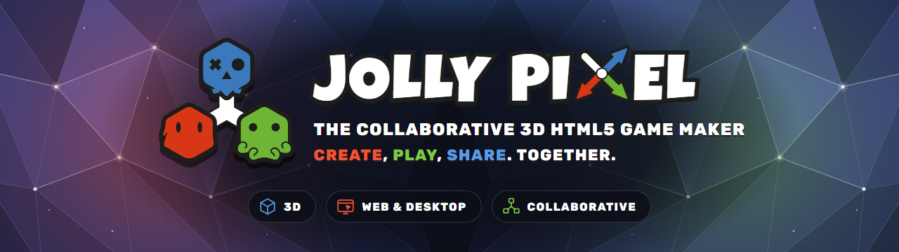
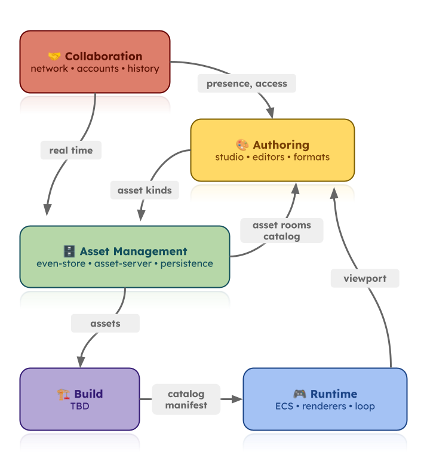

<p align="center">
  
</p>

## ⚙️ Requirements
- [Node.js](https://nodejs.org/en/) version 24 or higher
- [pnpm](https://pnpm.io/) v12+ for workspaces (the repository pins it through the `packageManager` field)

## 🧭 Workspaces

Workspaces are grouped by sub-domain. Each arrow shows what one sub-domain provides to another.

<p align="center">
  
</p>

### 🤝 Collaboration

- [@jolly-pixel/network](./packages/network) - Rooms, peers and state sync for the collaborative editors
- [@jolly-pixel/accounts](./packages/accounts) - User accounts and session tokens for JollyPixel servers
- [@jolly-pixel/history](./packages/history) - Command documents and per-person undo history that survives collaboration

### 🎨 Authoring

#### Shell

- [@jolly-pixel/studio](./packages/studio) - One project, its assets and one editor per tab
- [@jolly-pixel/editor.host](./packages/editors/host) - Shared launch, session and runtime boot for the editors

#### Editors and formats

Each editor is listed with the formats it owns: the asset kinds it reads and writes, and that `asset-server` stores. Editors also read the formats their documents link, such as the `.pixelart` textures used by voxel maps and models.

- [@jolly-pixel/editor.voxel-map](./packages/editors/voxel-map) - Voxel-terrain editor
  - [@jolly-pixel/asset.voxel-map](./packages/assets/voxel-map) - `.voxelmap.json` worlds and the `.blockset.json` blocksets
- [@jolly-pixel/editor.voxel-model](./packages/editors/voxel-model) - Low-polygon 3D model editor
  - [@jolly-pixel/asset.voxel-model](./packages/assets/voxel-model) - `.voxelmodel.json` models
  - [@jolly-pixel/asset.voxel-animation](./packages/assets/voxel-animation) - `.voxelanim.json` animation sets
- [@jolly-pixel/editor.pixel-art](./packages/editors/pixel-art) - Pixel-art texture editor (built on `pixel-draw.renderer`)
  - [@jolly-pixel/asset.pixel-art](./packages/assets/pixel-art) - `.pixelart` textures
- [@jolly-pixel/editor.terrain](./packages/editors/terrain) - Heightfield terrain editor 🚧
  - [@jolly-pixel/asset.terrain](./packages/assets/terrain) - `.terrain.json` heightfield terrains 🚧

#### UI

- [@jolly-pixel/ui](./packages/ui) - Design system (declarative UI components and a facade API)
- [@jolly-pixel/resize-handle](./packages/resize-handle) - Resize handles and splitters
- [@jolly-pixel/console](./packages/console) - Command palette and developer console for the editors
- [@jolly-pixel/lantern](./packages/lantern) - Guided tours for the editors

### 🗄️ Asset Management

- [@jolly-pixel/asset](./packages/asset) - Asset references, catalogs and loading orchestration for browser and Node.js
- [@jolly-pixel/asset-server](./packages/asset-server) - Event-sourced asset projection, reconciliation and catalog delivery
- [@jolly-pixel/asset-source](./packages/asset-source) - Physical asset storage (filesystem, memory, IndexedDB)
- [@jolly-pixel/event-store](./packages/event-store) - Append-only event log (event sourcing)

### 🏗️ Build

Planned. It will turn a project's assets into the catalog manifest the runtime loads.

### 🎮 Runtime

#### Core

- [@jolly-pixel/runtime](./packages/runtime) - Game runtime for web browsers and Electron
- [@jolly-pixel/engine](./packages/engine) - Minimal ECS framework on top of Three.js
- [@jolly-pixel/loop](./packages/loop) - Frame scheduling and time primitives (FrameScheduler, GameLoop)
- [@jolly-pixel/controls](./packages/controls) - Input controls (screen, mouse, touchpad, keyboard, gamepad)

#### Renderers

- [@jolly-pixel/voxel.renderer](./packages/voxel-renderer) - Voxel engine and renderer
- [@jolly-pixel/voxel.tiled](./packages/voxel-tiled) - Tiled map import for `voxel.renderer` 🚧
- [@jolly-pixel/terrain.renderer](./packages/terrain-renderer) - Heightfield terrain engine and renderer 🚧
- [@jolly-pixel/pixel-draw.renderer](./packages/pixel-draw-renderer) - Pixel-art canvas drawing and rendering

## 🧩 Shared libraries

Generic packages used by more than one sub-domain.

- [@jolly-pixel/three](./packages/three) - Three.js components and utilities (grid, transform controls, selection highlight...)
- [@jolly-pixel/color](./packages/color) - Color parsing, palettes, color spaces and conversions
- [@jolly-pixel/image](./packages/image) - PNG codecs and browser raster decoding

## 🛠️ Tooling

- [@jolly-pixel/bench](./packages/bench) - Benchmarking harness and CLI
- [@jolly-pixel/e2e](./packages/e2e) - Playwright config, locators and editor fixtures for e2e suites

## 💃 Getting started

Public packages are published on npm and can be installed with [npm](https://docs.npmjs.com/getting-started/what-is-npm) or [yarn](https://yarnpkg.com). The studio, editors, formats, tooling and 🚧 renderers are private workspaces.

```bash
$ npm i @jolly-pixel/engine
# or
$ yarn add @jolly-pixel/engine
```

### Build
To install and compile all workspaces, just run the following command at the root

```bash
$ pnpm install
$ pnpm run build
```

### Run
[@jolly-pixel/studio](./packages/studio) is the full application

```bash
$ pnpm --filter @jolly-pixel/studio dev
```

### Test
Run tests for one workspace, then run the repository type checks:

```bash
$ pnpm --filter <workspace> test
$ pnpm run typecheck
```

### Linter
Lint all workspaces with oxlint (the script also checks package exports and CSS):

```bash
$ pnpm run lint
```

## 📦 Publishing package
Each public package has its own `prepublishOnly` script that builds the TypeScript source before publishing.

```bash
$ pnpm publish --filter <workspace>
```

## Contributors ✨

<!-- ALL-CONTRIBUTORS-BADGE:START - Do not remove or modify this section -->
[](#contributors-)
<!-- ALL-CONTRIBUTORS-BADGE:END -->

Thanks goes to these wonderful people ([emoji key](https://allcontributors.org/docs/en/emoji-key)):

<!-- ALL-CONTRIBUTORS-LIST:START - Do not remove or modify this section -->
<!-- prettier-ignore-start -->
<!-- markdownlint-disable -->
<table>
  <tbody>
    <tr>
      <td align="center" valign="top" width="14.28%"><a href="https://github.com/fraxken"><br /><sub><b>Thomas.G</b></sub></a><br /><a href="https://github.com/JollyPixel/editor/commits?author=fraxken" title="Code">💻</a> <a href="https://github.com/JollyPixel/editor/commits?author=fraxken" title="Documentation">📖</a> <a href="https://github.com/JollyPixel/editor/issues?q=author%3Afraxken" title="Bug reports">🐛</a> <a href="https://github.com/JollyPixel/editor/commits?author=fraxken" title="Tests">⚠️</a> <a href="#security-fraxken" title="Security">🛡️</a></td>
      <td align="center" valign="top" width="14.28%"><a href="https://github.com/AlexandreMalaj"><br /><sub><b>Alexandre Malaj</b></sub></a><br /><a href="https://github.com/JollyPixel/editor/commits?author=AlexandreMalaj" title="Code">💻</a> <a href="https://github.com/JollyPixel/editor/commits?author=AlexandreMalaj" title="Documentation">📖</a> <a href="https://github.com/JollyPixel/editor/issues?q=author%3AAlexandreMalaj" title="Bug reports">🐛</a></td>
      <td align="center" valign="top" width="14.28%"><a href="https://github.com/PierreDemailly"><br /><sub><b>PierreDemailly</b></sub></a><br /><a href="https://github.com/JollyPixel/editor/commits?author=PierreDemailly" title="Code">💻</a></td>
      <td align="center" valign="top" width="14.28%"><a href="https://blog-clement-gombauld.vercel.app/"><br /><sub><b>Clement Gombauld</b></sub></a><br /><a href="https://github.com/JollyPixel/editor/commits?author=clemgbld" title="Code">💻</a></td>
    </tr>
  </tbody>
</table>

<!-- markdownlint-restore -->
<!-- prettier-ignore-end -->

<!-- ALL-CONTRIBUTORS-LIST:END -->

## 📃 License
MIT
