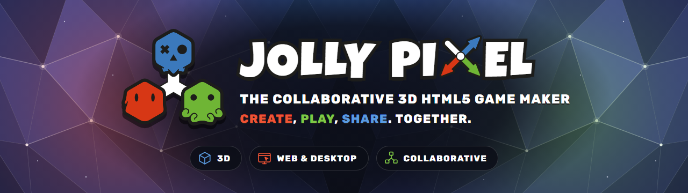
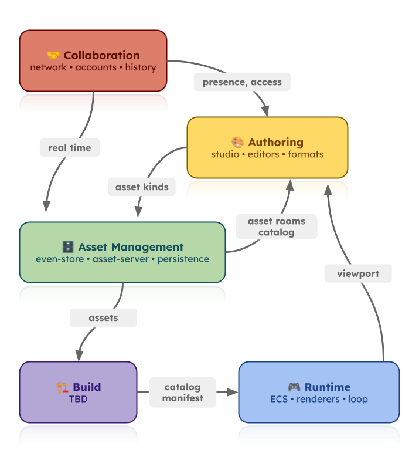

<p align="center">
  
</p>

## ⚙️ Requirements
- [Node.js](https://nodejs.org/en/) version 24 or higher
- [pnpm](https://pnpm.io/) v12+ for workspaces

## 🧭 Workspaces

Workspaces are grouped by sub-domain. Each arrow shows what one sub-domain provides to another.

<p align="center">
  
</p>

> [!NOTE]
> Every workspace name below drops the `@jolly-pixel/` scope: `network` is `@jolly-pixel/network`.

### 🤝 Collaboration

- [network](./packages/network) - Rooms, peers and state sync for the collaborative editors
- [accounts](./packages/accounts) - User accounts and session tokens
- [history](./packages/history) - Command documents and per-person undo history that survives collaboration

### 🎨 Authoring

#### Shell

- [studio](./packages/studio) - One project, its assets and one editor per tab
- [server](./packages/server) - HTTP and WebSocket server for projects and accounts
- [editor.host](./packages/editors/host) - Shared launch, session and runtime boot for the editors
- [preferences](./packages/preferences) - Preference scopes, validation and overrides for the studio and the editors

#### Editors

- [editor.voxel-map](./packages/editors/voxel-map) - Voxel map and blockset editor
- [editor.voxel-model](./packages/editors/voxel-model) - Voxel model and animation editor
- [editor.pixel-art](./packages/editors/pixel-art) - Pixel-art texture editor
- [editor.terrain](./packages/editors/terrain) - Heightfield terrain editor
- [editor.scene](./packages/editors/scene) - Scene editor for actors and their components
- [editor.environment](./packages/editors/environment) - Environment editor
- [editor.script](./packages/editors/script) - Code editor for scripts, shaders and text files
- [editor.sound](./packages/editors/sound) - Sound player
- [editor.model](./packages/editors/model) - 3D model viewer
- [editor.texture](./packages/editors/texture) - Image viewer

#### Formats

Each `asset.<name>` workspace owns the asset kinds that its editor reads and writes and that `asset-server` stores.

- [asset.voxel-map](./packages/assets/voxel-map) - `.voxelmap.json` worlds and the `.blockset.json` blocksets they link
- [asset.voxel-model](./packages/assets/voxel-model) - `.voxelmodel.json` models
- [asset.voxel-animation](./packages/assets/voxel-animation) - `.voxelanim.json` animation sets
- [asset.pixel-art](./packages/assets/pixel-art) - `.pixelart` textures
- [asset.terrain](./packages/assets/terrain) - `.terrain.json` heightfield terrains
- [asset.scene](./packages/assets/scene) - `.scene.json` scenes
- [asset.environment](./packages/assets/environment) - `.environment.json` environments
- [asset.script](./packages/assets/script) - `.ts` and `.js` scripts, `.tsl.ts` shaders and text files
- [asset.sound](./packages/assets/sound) - `.ogg` sounds
- [asset.model](./packages/assets/model) - `.glb`, `.gltf`, `.fbx` and `.obj` models
- [asset.font](./packages/assets/font) - `.typeface.json` fonts
- [asset.common](./packages/assets/common) - Code shared by the asset workspaces

#### UI

- [ui](./packages/ui) - Lit design system for the editors
- [resize-handle](./packages/resize-handle) - Resize handles and splitters
- [console](./packages/console) - Command palette and developer console for the editors
- [lantern](./packages/lantern) - Guided tours for the editors

### 🗄️ Asset Management

- [asset](./packages/asset) - Asset references, catalogs and loading for browser and Node.js
- [asset-server](./packages/asset-server) - Event-sourced asset projection, reconciliation and catalog delivery
- [asset-source](./packages/asset-source) - Asset storage on the filesystem, in memory or in IndexedDB
- [event-store](./packages/event-store) - Append-only event log

### 🏗️ Build

Planned. It will turn a project's assets into the catalog manifest the runtime loads.

### 🎮 Runtime

#### Core

- [runtime](./packages/runtime) - Renderer-agnostic game runtime for browsers and Electron
- [ecs](./packages/ecs) - Renderer-agnostic actor, component and scene framework
- [backend.three](./packages/backend.three) - Three.js backend for the ECS
- [loop](./packages/loop) - Game loop and frame scheduling
- [controls](./packages/controls) - Keyboard, mouse, touchpad, gamepad and screen input
- [scripting](./packages/scripting) - Compiles and loads game scripts and TSL shaders

#### Physics

- [physics](./packages/physics) - Engine-neutral physics contract and ECS components
- [physics.rapier](./packages/physics-rapier) - Rapier backend for physics

#### Renderers

- [voxel.renderer](./packages/voxel-renderer) - Voxel engine and renderer
- [terrain.renderer](./packages/terrain-renderer) - Heightfield terrain engine and renderer
- [pixel-draw.renderer](./packages/pixel-draw-renderer) - Pixel-art drawing canvas and renderer

## 🧩 Shared libraries

Generic packages used by more than one sub-domain.

- [three](./packages/three) - Three.js components shared by the editors
- [color](./packages/color) - Color parsing, palettes, color spaces and conversions
- [image](./packages/image) - PNG codecs and browser raster decoding
- [math](./packages/math) - Vector, quaternion and matrix math on plain number tuples
- [utils](./packages/utils) - Small standalone helpers

## 🛠️ Tooling

- [bench](./packages/bench) - Benchmarking harness and CLI
- [cdp](./packages/cdp) - Chrome DevTools Protocol recording and profile readers
- [e2e](./packages/e2e) - Playwright config, locators and editor fixtures for e2e suites

## 🤖 AI

- [golem](./packages/golem) - Connects a local AI agent to a running studio as a peer
- [golem.kit](./packages/golem-kit) - Golem intent contract for asset kinds

## 💃 Getting started

Public packages are published on npm and can be installed with [npm](https://docs.npmjs.com/getting-started/what-is-npm) or [yarn](https://yarnpkg.com).

```bash
$ npm i @jolly-pixel/ecs @jolly-pixel/backend.three
# or
$ yarn add @jolly-pixel/ecs @jolly-pixel/backend.three
```

### Build
To install and compile all workspaces, just run the following command at the root

```bash
$ pnpm install
$ pnpm run build
```

### Run
[studio](./packages/studio) is the full application

```bash
$ pnpm --filter @jolly-pixel/studio dev
```

### Test
Run tests for one workspace, then run the repository type checks:

```bash
$ pnpm --filter <workspace> test
$ pnpm run typecheck
```

### Linter
Lint all workspaces with oxlint (the script also checks package exports and CSS):

```bash
$ pnpm run lint
```

## 📦 Publishing package
Each public package has its own `prepublishOnly` script that builds the TypeScript source before publishing.

```bash
$ pnpm publish --filter <workspace>
```

## Contributors ✨

<!-- ALL-CONTRIBUTORS-BADGE:START - Do not remove or modify this section -->
[](#contributors-)
<!-- ALL-CONTRIBUTORS-BADGE:END -->

Thanks goes to these wonderful people ([emoji key](https://allcontributors.org/docs/en/emoji-key)):

<!-- ALL-CONTRIBUTORS-LIST:START - Do not remove or modify this section -->
<!-- prettier-ignore-start -->
<!-- markdownlint-disable -->
<table>
  <tbody>
    <tr>
      <td align="center" valign="top" width="14.28%"><a href="https://github.com/fraxken"><br /><sub><b>Thomas.G</b></sub></a><br /><a href="https://github.com/JollyPixel/editor/commits?author=fraxken" title="Code">💻</a> <a href="https://github.com/JollyPixel/editor/commits?author=fraxken" title="Documentation">📖</a> <a href="https://github.com/JollyPixel/editor/issues?q=author%3Afraxken" title="Bug reports">🐛</a> <a href="https://github.com/JollyPixel/editor/commits?author=fraxken" title="Tests">⚠️</a> <a href="#security-fraxken" title="Security">🛡️</a></td>
      <td align="center" valign="top" width="14.28%"><a href="https://github.com/AlexandreMalaj"><br /><sub><b>Alexandre Malaj</b></sub></a><br /><a href="https://github.com/JollyPixel/editor/commits?author=AlexandreMalaj" title="Code">💻</a> <a href="https://github.com/JollyPixel/editor/commits?author=AlexandreMalaj" title="Documentation">📖</a> <a href="https://github.com/JollyPixel/editor/issues?q=author%3AAlexandreMalaj" title="Bug reports">🐛</a></td>
      <td align="center" valign="top" width="14.28%"><a href="https://github.com/PierreDemailly"><br /><sub><b>PierreDemailly</b></sub></a><br /><a href="https://github.com/JollyPixel/editor/commits?author=PierreDemailly" title="Code">💻</a></td>
      <td align="center" valign="top" width="14.28%"><a href="https://blog-clement-gombauld.vercel.app/"><br /><sub><b>Clement Gombauld</b></sub></a><br /><a href="https://github.com/JollyPixel/editor/commits?author=clemgbld" title="Code">💻</a></td>
    </tr>
  </tbody>
</table>

<!-- markdownlint-restore -->
<!-- prettier-ignore-end -->

<!-- ALL-CONTRIBUTORS-LIST:END -->

## 📃 License
MIT
