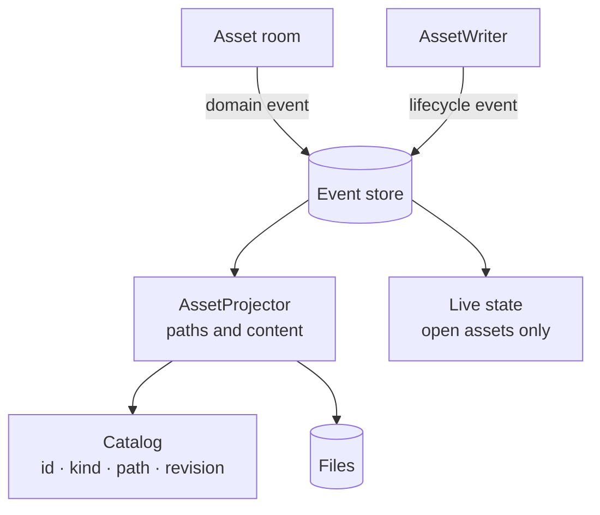
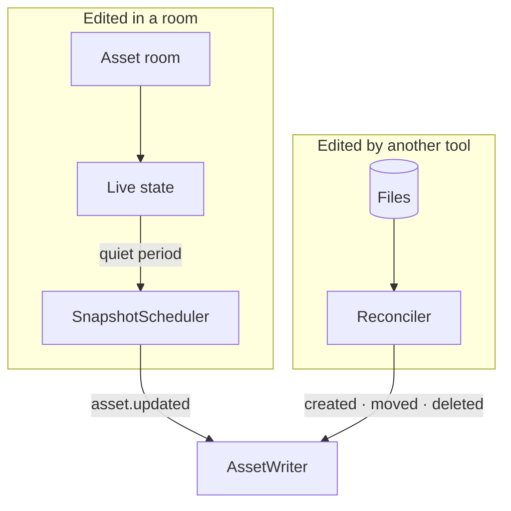
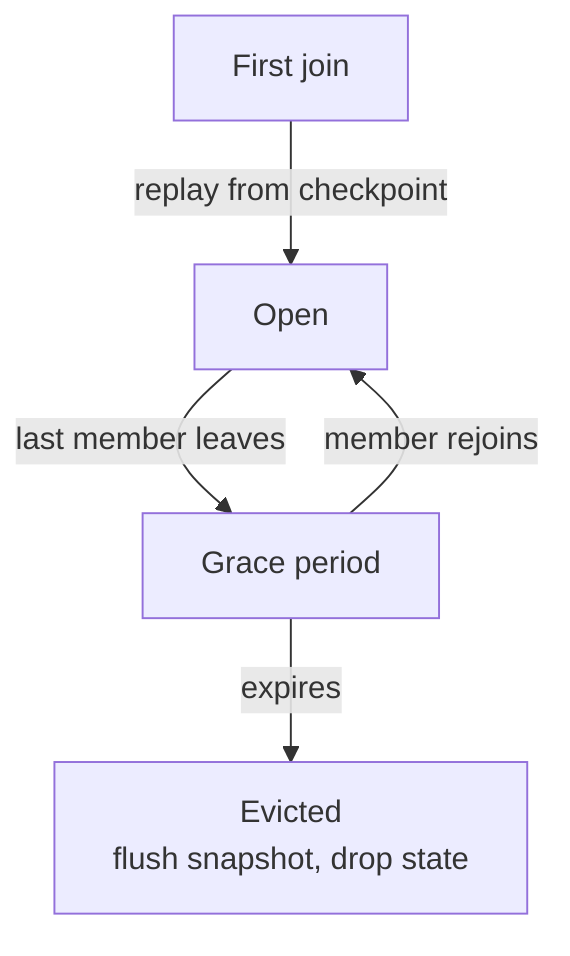
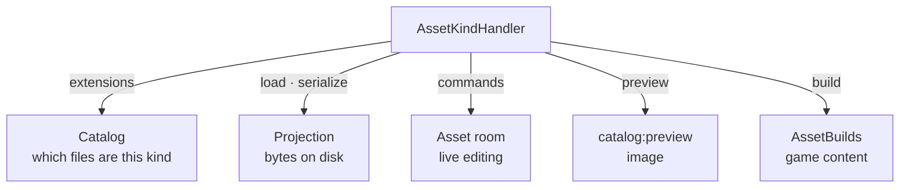

# Asset server architecture

`@jolly-pixel/asset-server` records every asset change in an event store, then
turns that history into files, a catalog and live editing rooms. Terms are
defined in the [glossary](./GLOSSARY.md).

## History first



- Files, catalog and live state are views of the history, never the source.
- The projection and catalog are rebuilt at startup. Live state is replayed
  when a room opens and dropped after it closes.
- Code: `storage/writer/`, `storage/projection/`, `catalog/`, `live/`.

## Two ways in



- Room commands reach the file through a snapshot. That `asset.updated` is
  also the checkpoint the next replay starts from.
- The reconciler compares files with what the projector last wrote, so a
  detected change is never written back.
- Code: `live/SnapshotScheduler.ts`, `storage/reconcile/`.

## A room lives while someone is in it



- One command at a time: arbitrate, append, broadcast. Arbitration always sees
  every earlier command.
- A tag room shows one tagged content and accepts no command.
- Large binary snapshots go out as content refs, fetched over HTTP and kept by
  the browser cache.
- Code: `live/`, `live/room/`.

## Kinds plug in



- The backend knows no kind by name. A kind without `commands` is stored and
  listed, but never opens a room.
- Builds live in memory only, so a restart builds them again. A build depends
  on one asset's content only, never on its path or on another asset.
- A project loads extra kinds from packages named in its project file.
- Code: `model/kinds/`, `node/project/`.

## Parts: large assets in pieces

```
world.terrain           manifest, sent on join
world.terrain.parts/
  0_0.bin               one part per chunk, sent on subscribe
  0_1.bin
```

- A kind opts in with `parts`. A member subscribes to the parts it needs and
  is sent the commands that touch them.
- A generation stores the changed parts inline and points to older
  checkpoints for the rest.
- Code: `storage/AssetPartFiles.ts`, `live/room/PartSubscriptions.ts`.

## Layers

`common` → `model` → `storage` → `catalog` → `live` → `client` → `node`.
Each folder imports only from the ones before it, and `createAssetBackend.ts`
wires them. `client/` is the browser entry (`./client`), so nothing it imports
may reach a Node.js builtin.
`AssetServer` (`./node`) adds the network server and the SQLite event store at
`.jollypixel/events.db`.
