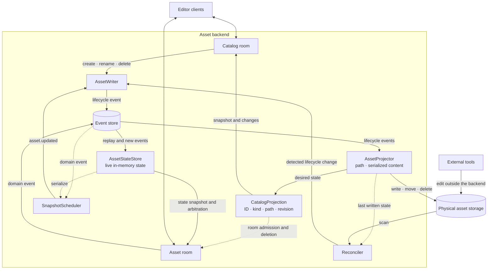
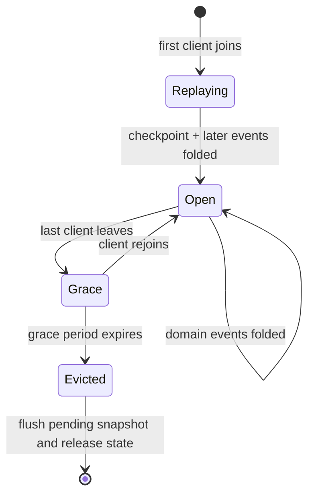
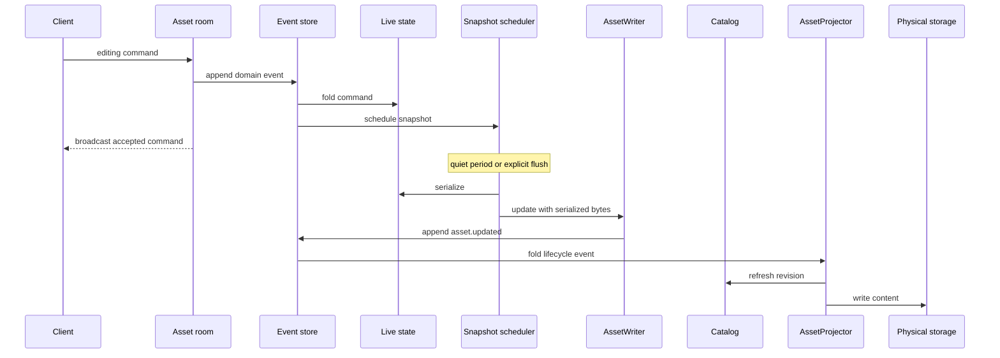
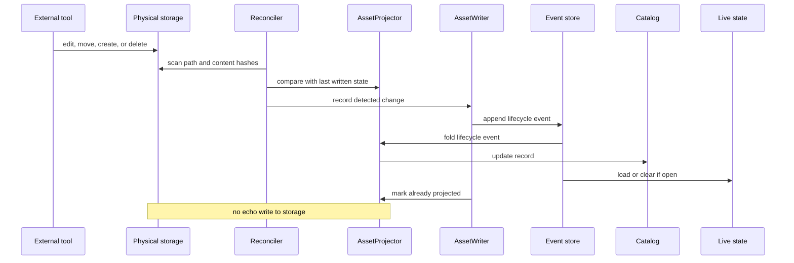

# Asset server architecture

The event store is the backend's history. The catalog, physical projection,
and live state are separate views of that history.

## Read by task

- [Startup and ownership](./architecture/Startup.md): assembly order, files,
  injected resources, and shutdown.
- [Events and projections](./architecture/EventsAndProjections.md): which
  events change the catalog, source, and live state.
- [Rooms and reconciliation](./architecture/RoomsAndReconciliation.md): edits
  from clients and changes made directly to physical storage.

## Workspace map

The three views answer different questions:

| View | What it answers | Lifetime |
|---|---|---|
| Catalog | Which assets exist, and where are they? | Rebuilt when the backend starts, then kept current. |
| Physical projection | What path and bytes should storage contain? | Rebuilt when the backend starts, then kept in sync with the asset source. |
| Live state | What is the editable state of this open asset? | Replayed when its room opens and released after eviction. |

## Source layout

Each folder under `src/` imports only from the folders listed above it:

- `common/`: helpers with no asset vocabulary (`TaskChain`, `contentHash`,
  `Logger`).
- `model/`: asset kinds, their handlers, and the asset event types.
- `storage/`: the physical projection. `AssetWriter`, `AssetProjector`,
  `Reconciler`, and the files in the state directory.
- `catalog/`: `CatalogProjection`, the catalog room, tags, archives, and the
  browser client served as `./client`.
- `live/`: asset rooms, `AssetStateStore`, and `SnapshotScheduler`.
- `server/`: the `./node` entry. `AssetServer`, the HTTP catalog handler,
  Vite plugins, and the project file.

`createAssetBackend.ts` at the root wires these together.

## Live state lifetime

## A room edit reaches storage

The room snapshot sent on join and the persisted snapshot serve different
paths. Only the persisted `asset.updated` event is a replay checkpoint.

## An external file change enters history

