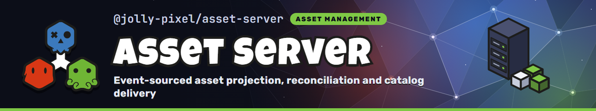

<p align="center">
  
</p>

## 💃 Getting Started

Install the package with pnpm:

```bash
$ pnpm add @jolly-pixel/asset-server
```

## 👀 Usage example

```ts
import http from "node:http";
import { DEFAULT_WEBSOCKET_PATH } from "@jolly-pixel/network";
import { WebsocketTransport } from "@jolly-pixel/network/node";
import { textureAssetKind } from "@jolly-pixel/asset-server";
import { AssetServer } from "@jolly-pixel/asset-server/node";

await using assetServer = await AssetServer.open({
  root: "./assets",
  handlers: [textureAssetKind()]
});

const httpServer = http.createServer().listen(3000);
new WebsocketTransport({
  path: DEFAULT_WEBSOCKET_PATH,
  httpServer,
  server: assetServer.network
});
```

On startup, the backend catalogs files already present in `./assets`. Changes
made through `assetServer.backend.writer` are appended to the event store and
written to the asset source. Changes made by external tools are detected and
appended as system events.

`AssetServer` is the backend plus a network `Server`, with a filesystem source
and a sqlite event log under `root`. A host with its own source and event log,
such as a browser tab, builds the backend and attaches it to a `Server`:

```ts
import * as EventStore from "@jolly-pixel/event-store";
import { MemoryAssetSource } from "@jolly-pixel/asset-source";
import { Server } from "@jolly-pixel/network";
import {
  createAssetBackend,
  textureAssetKind
} from "@jolly-pixel/asset-server";

await using backend = await createAssetBackend({
  source: new MemoryAssetSource(),
  eventStore: EventStore.persistence.memory(),
  handlers: [textureAssetKind()]
});

const server = new Server();
backend.attach(server);
```

## 🧪 Testing helpers

`@jolly-pixel/asset-server/testing` runs an asset kind's live room in memory,
for the tests of packages that ship asset kinds.

```ts
import {
  LiveAssetRoom,
  mockAssetRoom
} from "@jolly-pixel/asset-server/testing";

const server = new LiveAssetRoom(myAssetKind());
const room = mockAssetRoom<MyNetworkCommand, MySnapshot>("B");

await server.connect("B");
for (const message of server.take<MySnapshot>("B")) {
  room.deliver(message);
}
```

- `LiveAssetRoom` serves the kind's live room for asset `"asset-1"`. Drive it
  with `connect()`, `receive()` and `resync()`, awaiting each, then read what it
  sent a client with `take()`.
- `mockAssetRoom()` returns a client `Room` with no transport. It records what
  the client sends in `sent`, and `deliver()` feeds it server messages.

## 📈 Benchmarks

```bash
$ pnpm --filter @jolly-pixel/asset-server bench
$ pnpm --filter @jolly-pixel/asset-server bench catalog --allocations
$ pnpm --filter @jolly-pixel/asset-server bench:load --scenario edit --clients 50
```

`bench` runs the micro suites in `bench/`. `bench:load` drives a backend over
real WebSockets and HTTP. Run `bench:load --help` to see the scenarios and options.

## ✨ Contributors guide

Read the [contributing guide][contributing] before submitting a change.

Run these commands from the monorepo root:

```bash
$ pnpm --filter @jolly-pixel/asset-server test
$ pnpm run lint
```

> [!CAUTION]
> Include tests when adding a feature or fixing a bug.

## 📃 License

MIT

<!-- Reference-style links -->

[contributing]: ../../CONTRIBUTING.md
