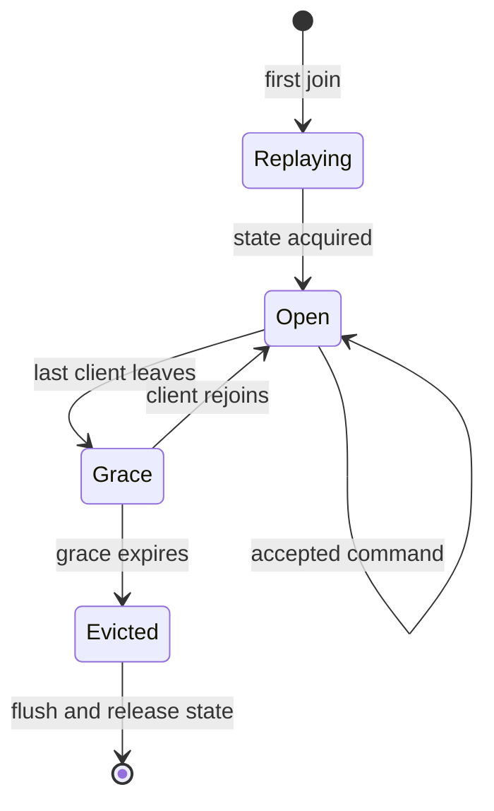
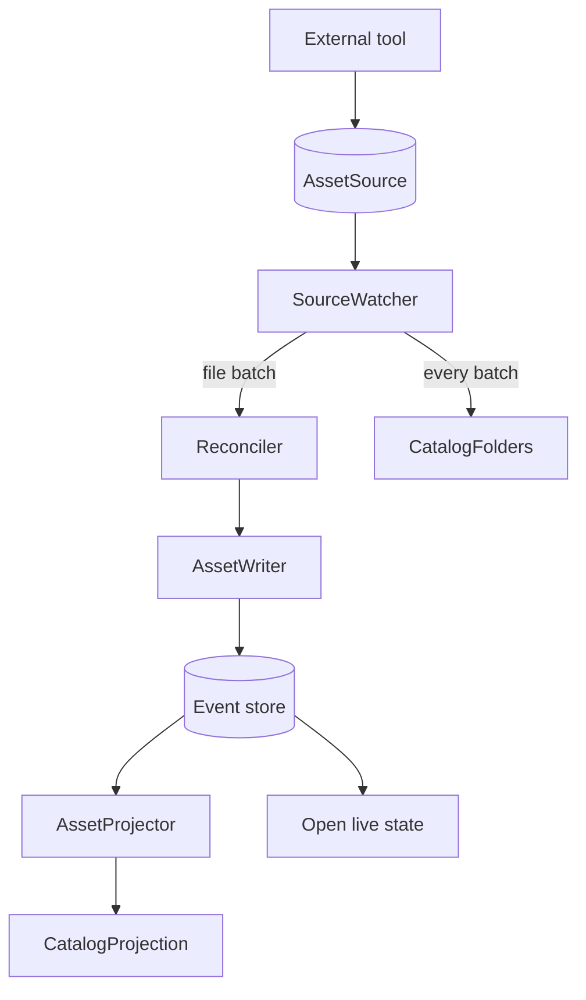

# Rooms and reconciliation

`backend.attach(server)` registers the `asset-catalog` room and a resolver
for editable assets. An asset room is admitted when its kind has
`commands.live` and the catalog contains that asset under the same kind.

A host registers `CatalogViewExtension` (`asset-catalog-view`) itself, for
peers that must not see the whole catalog. Its `scope(identity)` names one
asset; the peer receives that asset and its dependency closure, no folders,
and changes filtered by the closure recomputed on each catalog change. An
asset linked later shows up as created, one unlinked as deleted. Every
command is rejected. `CatalogClient.connect(client, { room })` joins it.

A room named with a tag (`counter@v1:<assetId>`, see `AssetRoom`) holds the
content of that tagged event in a state of its own. It is resolved read-only,
so members receive `read` rights and every command is denied. It appends
nothing, reads no catch-up from the event store, and keeps its snapshot when
the asset changes afterwards. An unknown tag refuses the join.

## Room lifetime

The room validates and arbitrates a command, appends it, then commits and
broadcasts it. The event store folds the command into live state. A failed
append sends `rejected` to the sender and leaves the room state unchanged.

The room handles one command at a time. The next command is arbitrated only
after the previous append settled, so arbitration always runs against a state
holding every earlier command. A join or a resync waits its turn behind the
commands received before it; relay messages skip the queue.

A kind may also relay ephemeral messages that are neither arbitrated nor
logged, such as live previews of an edit. The kind declares their schemas once,
as `commands.relay`: `inbound` joins the command protocol, each schema with its
own literal tag on the command discriminator, and `outbound` joins the notices
the room may send. Typing `AssetCommands` with the inbound message type ties
the schemas to the relay. A kind that relays nothing keeps the `never` default,
which refuses relay schemas and types its room messages as its commands alone.
The backend stores handlers of every kind as `AnyAssetKindHandler`.
`registerAssetRooms` builds the room protocols of every live kind when it
starts, once per declaration, so a relay tag shared with a command or with
another relay message fails at startup.

Each live room keeps its own state in `live().relay`. A kind declares the
schemas and the relay together: a room whose `commands.relay` and
`live().relay` are not both present or both absent throws a `TypeError` when
it opens. The room hands every relay message, already validated and typed, to
`receive(clientId, message, room)`, which forwards it with `room.sendTo` or
`room.broadcast`, and calls `leave(clientId)` when a member disconnects. When `live()` or the restore of
recorded commands throws, the room stays closed and releases the asset state.

## Changes outside the backend

An external tool can edit files in `AssetSource`. `SourceWatcher` groups
notifications into batches. A batch holding a file change runs `Reconciler`,
which compares scanned paths and hashes with the last projected state; every
batch then refreshes `CatalogFolders`. `backend.reconcile()` runs the same
scan and refresh on demand. Part files count toward their asset, as
[asset parts](./AssetParts.md#storage-layout) describes.

The reconciler records detected creates, updates, renames, and deletions as
system lifecycle events. Unique matching content hashes identify renames;
ambiguous matches become a deletion and creation. A write already present
in the source is marked projected, so it is not written back as an echo.
