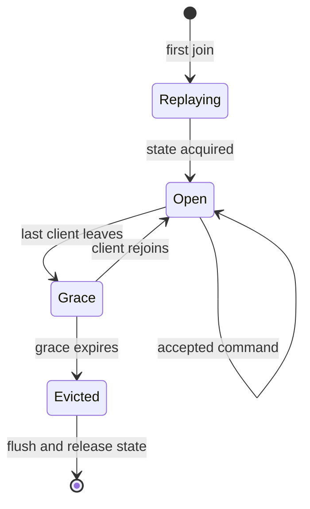
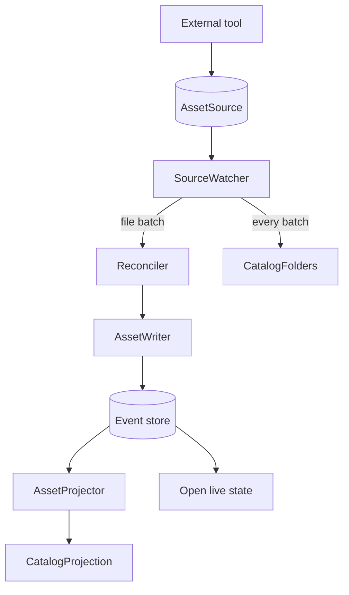

# Rooms and reconciliation

`backend.attach(server)` registers the `asset-catalog` room and a resolver
for editable assets. An asset room is admitted when its kind has
`commands.live` and the catalog contains that asset under the same kind.

A host registers `CatalogViewExtension` (`asset-catalog-view`) itself, for
peers that must not see the whole catalog. Its `scope(identity)` names one
asset; the peer receives that asset and its dependency closure, no folders,
and changes filtered by the closure recomputed on each catalog change. An
asset linked later shows up as created, one unlinked as deleted. Every
command is rejected. `CatalogClient.connect(client, { room })` joins it.

A room named with a tag (`counter@v1:<assetId>`, see `AssetRoom`) holds the
content of that tagged event in a state of its own. It is resolved read-only,
so members receive `read` rights and every command is denied. It appends
nothing, reads no catch-up from the event store, and keeps its snapshot when
the asset changes afterwards. An unknown tag refuses the join.

## Room lifetime

The room validates and arbitrates a command, appends it, then commits and
broadcasts it. The event store folds the command into live state. A failed
append sends `rejected` to the sender and leaves the room state unchanged.

A live protocol may also carry a `relay` for ephemeral messages that are
neither arbitrated nor logged, such as live previews of an edit. Its
`schemas.inbound` join the command protocol, each with its own literal tag on
the command discriminator, and its `schemas.outbound` join the notices the room
may send. The room hands each relay message to `receive(clientId, message,
room)`, which forwards it with `room.sendTo` or `room.broadcast`, and calls
`leave(clientId)` when a member disconnects. A relay tag shared with a command
or with another relay message fails room resolution.

## Changes outside the backend

An external tool can edit files in `AssetSource`. `SourceWatcher` groups
notifications into batches. A batch holding a file change runs `Reconciler`,
which compares scanned paths and hashes with the last projected state; every
batch then refreshes `CatalogFolders`. `backend.reconcile()` runs the same
scan and refresh on demand.

The reconciler records detected creates, updates, renames, and deletions as
system lifecycle events. Unique matching content hashes identify renames;
ambiguous matches become a deletion and creation. A write already present
in the source is marked projected, so it is not written back as an echo.
