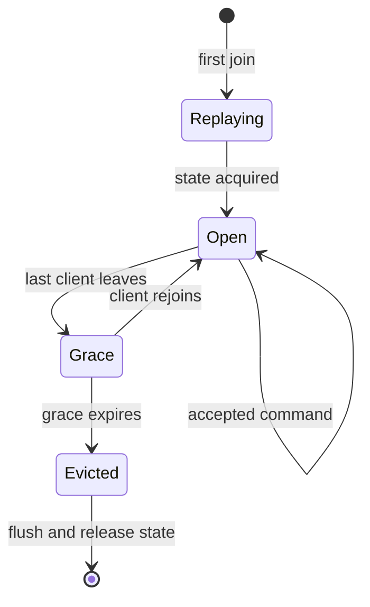
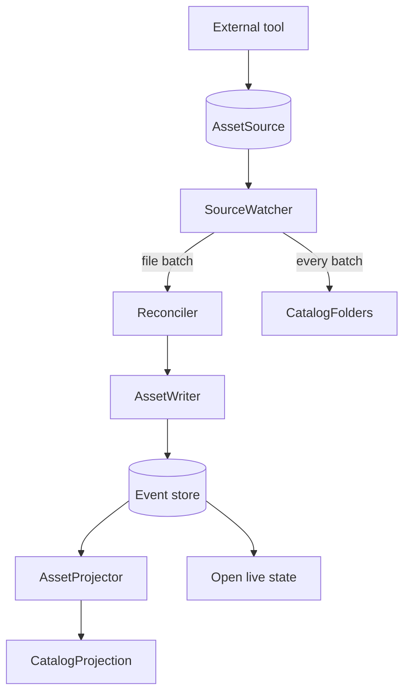

# Rooms and reconciliation

`backend.attach(server)` registers the `asset-catalog` room and a resolver
for editable assets. An asset room is admitted when its kind has
`commands.live` and the catalog contains that asset under the same kind.

A host registers `CatalogViewExtension` (`asset-catalog-view`) itself, for
peers that must not see the whole catalog. Its `scope(identity)` names one
asset; the peer receives that asset and its dependency closure, no folders,
and changes filtered by the closure recomputed on each catalog change. An
asset linked later shows up as created, one unlinked as deleted. Every
command is rejected. `CatalogClient.connect(client, { room })` joins it.

Most catalog commands need `write`. `catalog:read` is a query: a member with
`read` may send it too, and gets back one asset's current content, flushed
first. Members with `read` already receive every asset snapshot, so the query
shows them nothing new.

A room named with a tag (`counter@v1:<assetId>`, see `AssetRoom`) holds the
content of that tagged event in a state of its own. It is resolved read-only,
so members receive `read` rights and every command is denied. It appends
nothing, reads no catch-up from the event store, and keeps its snapshot when
the asset changes afterwards. An unknown tag refuses the join.

## Room lifetime

The room validates and arbitrates a command, appends it, then commits and
broadcasts it. The event store folds the command into live state. A failed
append sends `rejected` to the sender and leaves the room state unchanged.

When arbitration returns another command than the one received, the room
broadcasts it and then sends the author a correction or a snapshot. A protocol
with `authorRebases` skips that step: the author rewrites its own copy the same
way, as text kinds do when they transform an edit. When the state is replaced
from outside, the room calls the protocol's `reloaded()` before it broadcasts
the new snapshot.

A snapshot is the protocol's `encodeSnapshot()` form once it is ready for the
room version, and `snapshot()` otherwise. An `encodeSnapshot()` that resolves
`null` keeps the `snapshot()` form for that version. With `compressSnapshot`,
the room asks the socket to compress the `snapshot()` form, for kinds whose raw
bytes shrink such as glTF or RGBA pixels; the encoded form is sent as it is.
`binaryCommands(eventType, { compress: true })` sets it for a binary kind.
`compressCommands` does the same for broadcast commands and catch-ups, for
kinds whose commands carry raw bytes such as heights or RGBA pixels.

A binary kind declared with `binaryCommands(eventType, { refAbove })` sends
content larger than `refAbove` bytes as a content ref,
`{ type: "ref", hash, size, ticket }`, when the backend was attached with a
`ContentRefs`, as `AssetServer.open({ content })` does. The ref is its encoded
form: it waits for the room version like any `encodeSnapshot()`. Content at or
below `refAbove` encodes to `null`, so it goes out as the `snapshot()` form,
compressed with `compress`. `ContentRefs` holds the bytes behind the last ref
each room issued until the room is evicted or issues another.
`assetServer.contentHandler` serves them at `/__jollypixel/content/<hash>` to a
request that carries the ticket in `x-jolly-content-ticket`.

The ticket reaches only room members, so the route checks no account or share
link. A revoked member can still fetch the bytes it was sent while the room
stays open on the same content. Responses are
`private, max-age=31536000, immutable`, and the ticket travels in a header, so
reopening the same content is a browser cache hit even though each open gets a
new ticket. When the state is replaced, members get the new bytes inline
through `snapshot()`, and the next join issues the new ref.

With `content: { compression: true }`, the route sends the content of a kind
that declares `compress` as brotli (quality 5), or gzip when the request does
not accept brotli. It encodes each content once and keeps the result as long
as `ContentRefs` holds the bytes. Without `compression`, or for a kind such as
sound whose Ogg bytes do not shrink, it sends the bytes as they are. The
studio turns both socket and route compression on with
`StudioBackend.open(project, { compression })`.

On the client, `resolveBinarySnapshot` from `./client` returns bytes as they
are and fetches a ref; a kind's document passes it as `resolveSnapshot`. When
the fetch fails, it sends `{ action: "inline-snapshot" }` to the room, which
answers that member with `{ type: "inline-snapshot", data, version }` holding
the `snapshot()` form, compressed like a snapshot. The room declares the
request as a query, so a member with only read rights, such as a share-link
guest or a tag room member, may send it. A denied request, leaving the room,
or no answer within 30 seconds rejects the resolution. Without `ContentRefs`, as in the in-page offline
server, every snapshot stays inline.

The room handles one command at a time. The next command is arbitrated only
after the previous append settled, so arbitration always runs against a state
holding every earlier command. A join or a resync waits its turn behind the
commands received before it; relay messages skip the queue.

A kind may also relay ephemeral messages that are neither arbitrated nor
logged, such as live previews of an edit. The kind declares their schemas once,
as `commands.relay`: `inbound` joins the command protocol, each schema with its
own literal tag on the command discriminator, and `outbound` joins the notices
the room may send. Typing `AssetCommands` with the inbound message type ties
the schemas to the relay. A kind that relays nothing keeps the `never` default,
which refuses relay schemas and types its room messages as its commands alone.
The backend stores handlers of every kind as `AnyAssetKindHandler`.
`registerAssetRooms` builds the room protocols of every live kind when it
starts, once per declaration, so a relay tag shared with a command or with
another relay message fails at startup.

Each live room keeps its own state in `live().relay`. A kind declares the
schemas and the relay together: a room whose `commands.relay` and
`live().relay` are not both present or both absent throws a `TypeError` when
it opens. The room hands every relay message, already validated and typed, to
`receive(clientId, message, room)`, which forwards it with `room.sendTo` or
`room.broadcast`, and calls `leave(clientId)` when a member disconnects. When `live()` or the restore of
recorded commands throws, the room stays closed and releases the asset state.

## Changes outside the backend

An external tool can edit files in `AssetSource`. `SourceWatcher` groups
notifications into batches. A batch holding a file change runs `Reconciler`,
which compares scanned paths and hashes with the last projected state; every
batch then refreshes `CatalogFolders`. `backend.reconcile()` runs the same
scan and refresh on demand. Part files count toward their asset, as
[asset parts](./AssetParts.md#storage-layout) describes.

The reconciler records detected creates, updates, renames, and deletions as
system lifecycle events. Unique matching content hashes identify renames;
ambiguous matches become a deletion and creation. A file recorded as `binary`
whose path a registered kind now claims is deleted and created again, so it
takes that kind and a new id. When several kinds claim a path, the longest
matching extension wins: `.voxelmap.json` before `.json`. A write already present
in the source is marked projected, so it is not written back as an echo.
