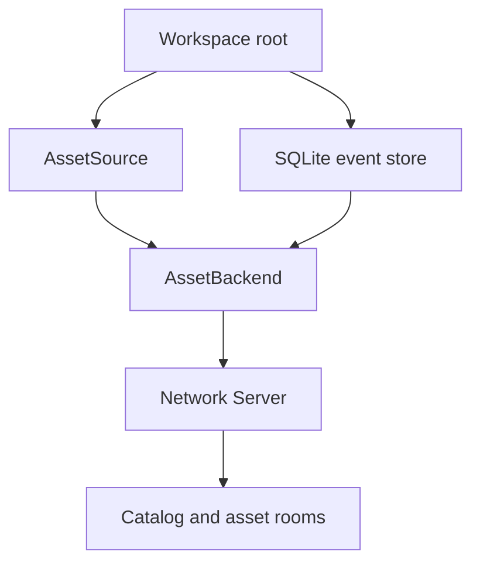

# Startup and ownership

`createAssetWorkspace()` builds a source, event store, backend, and network
server. Hosts with their own instances can pass them in. With
`inMemory: true`, the default source and event store live in memory and the
workspace root is never read or written.

## Startup order

1. `seedAssetSource()` writes missing starter files, if `seed` is set.
2. The workspace opens the event store.
3. `createAssetBackend()` runs. With `compactOnOpen: true`, it removes events
   superseded by each asset's latest lifecycle checkpoint. It loads
   projection state, or starts from none when the event log is empty, then
   starts the projector, live state store, and snapshot scheduler.
4. The backend scans physical storage when `reconcileOnStart` is enabled,
   loads the catalog, backfills missing dependency edges, and starts the
   watcher when `watch` is enabled.
5. The workspace registers host extensions, then attaches catalog and asset
   rooms to the server.

The backend writes `.jollypixel/.gitignore` and uses these entries under the
state directory:

- `assets.json` keeps path to ID mappings across checkouts. Commit it when
  IDs must remain stable without a local event log.
- `state.json` stores local projection positions and failures. It can be
  rebuilt from the event store. A full `flush()` and `close()` write it at
  once; projecting a single asset writes it up to a second later.
- `objects/` holds backup copies of tagged content
  and of external edits the projector was about to overwrite, listed in
  `objects/index.json`. The ledger is read on the first backup, not at
  startup. It is local, like `events.db`, and cannot be rebuilt.

The default event log lives at `.jollypixel/events.db`. A host can supply an
event store at another location.

## Shutdown

Close the server before the workspace. Evicting an asset room may flush its
snapshot. `workspace.close()` detaches the room resolver, closes the backend,
and closes the event store only if the workspace created it. It does not
close the server or source.
