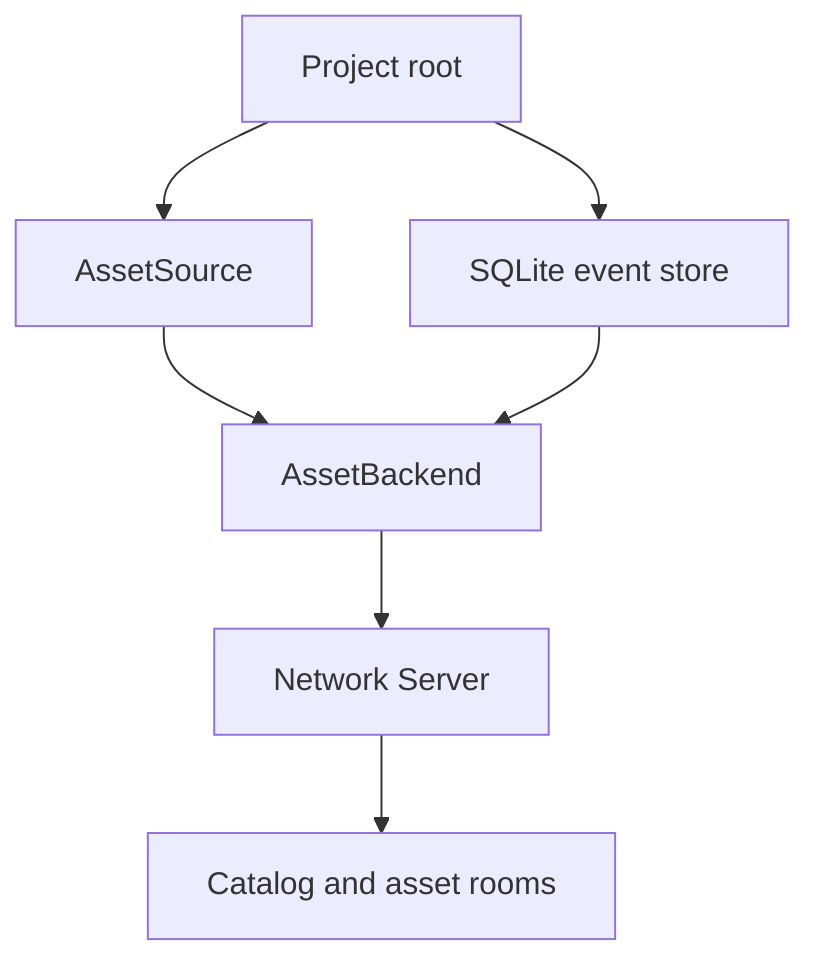

# Startup and ownership

`AssetServer.open()` builds a source, event store, backend, and network
server for one project root. Hosts can pass their own source and event store.
With `inMemory: true`, the default source and event store live in memory and
the project root is never read or written.

## Startup order

1. `seedAssetSource()` writes missing starter files, if `seed` is set.
2. The asset server opens the event store.
3. `createAssetBackend()` runs. With `compaction.onOpen: true`, it removes
   events superseded by each asset's latest lifecycle checkpoint. It loads
   projection state, or starts from none when the event log is empty, then
   starts the projector, catalog, live state store, and snapshot scheduler.
4. `SourceSync` starts the watcher when `reconcile.watch` is enabled, scans
   physical storage when `reconcile.onStart` is enabled, and refreshes the
   folders. Source changes seen before then wait for it. The backend then
   backfills missing dependency edges. If any step fails, the backend closes
   what it already started, in reverse order.
5. The asset server registers host extensions, then attaches catalog and
   asset rooms to the network server.

The backend writes `.jollypixel/.gitignore` and uses these entries under the
state directory:

- `assets.json` keeps path to ID mappings across checkouts. Commit it when
  IDs must remain stable without a local event log.
- `state.json` stores local projection positions and failures. It can be
  rebuilt from the event store. A full `flush()` and `close()` write it at
  once; projecting a single asset writes it up to a second later.
- `objects/` holds backup copies of tagged content
  and of external edits the projector was about to overwrite, listed in
  `objects/index.json`. The ledger is read on the first backup, not at
  startup. It is local, like `events.db`, and cannot be rebuilt.

The default event log lives at `.jollypixel/events.db`. A host can supply an
event store at another location.

## Shutdown

Close the network server before the asset server. Evicting an asset room may
flush its snapshot. `close()` detaches the room resolver, closes the backend,
and closes the event store only if the asset server created it. It does not
close the network server or source. The backend closes its parts in reverse
order of startup and keeps going when one fails, so the catalog still sees
the snapshots flushed on close.
