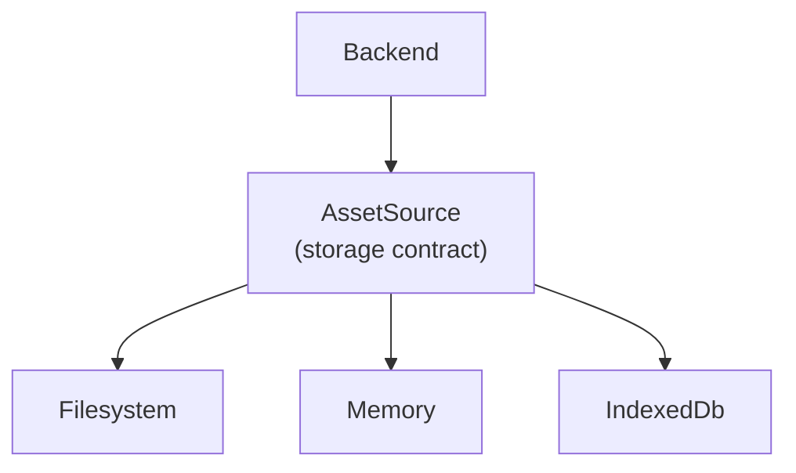

<p align="center">
  
</p>

## 💡 About 

An `AssetSource` stores bytes under root-relative POSIX paths. It reads,
writes, deletes and lists assets, and keeps the folders holding them.
Sources normalize path separators and reject paths that escape their root.



## 💃 Getting Started

This package is available in the Node Package Repository and can be easily installed with [npm][npm] or [yarn][yarn].

```bash
$ npm i @jolly-pixel/asset-source
# or
$ yarn add @jolly-pixel/asset-source
```

## 👀 Usage example

```ts
import {
  FilesystemAssetSource
} from "@jolly-pixel/asset-source/node";

const source = new FilesystemAssetSource("./assets");

const bytes = new TextEncoder().encode("grass texture");
await source.write(
  "textures/grass.png",
  bytes
);
```

## 📚 API

### `AssetSource`

All persistence and durable sources implement this contract:

```ts
type AssetEntryType = "file" | "folder";

interface AssetSource {
  read(path: string): Promise<Uint8Array>;
  exists(path: string): Promise<boolean>;
  write(path: string, data: Uint8Array): Promise<void>;
  writeIfAbsent(path: string, data: Uint8Array): Promise<boolean>;
  delete(path: string): Promise<void>;
  list(): Promise<string[]>;
  folders(): Promise<string[]>;
  createFolder(path: string): Promise<void>;
  deleteFolder(path: string): Promise<void>;
  isIgnored(path: string): boolean;
  watch?(
    onChange: (path: string, type: AssetEntryType) => void,
    options?: { onReady?: () => void; }
  ): () => void;
}
```

> [!IMPORTANT]
> 
> Paths are normalized to root-relative POSIX form. Empty, absolute and
> root-escaping paths are rejected. State files remain available to direct
> storage operations.

`read` rejects with `AssetPathNotFoundError` when no file exists at the path,
including when the path names a folder. `exists` reports `false` for a
folder. Its answer can be stale by the time the caller acts on it, so creation
that may race goes through `writeIfAbsent`: it writes atomically and returns
`false`, leaving the stored bytes alone, when the path is already occupied.

`list()` and `folders()` return sorted paths, and `folders()` includes empty
folders. Writing a file creates its folders, and deleting the file keeps them.
`createFolder` also creates the missing parents. A folder stays, empty or not,
until `deleteFolder` removes it with its empty sub-folders; a sub-folder that
still holds a file is kept.

`isIgnored` reports whether a path is hidden from `list()`, `folders()` and
`watch()`. Every built-in source ignores the `.jollypixel/` state directory.

`watch` calls `onChange` with each changed path and returns a function that
stops watching. `options.onReady` runs once the watcher starts reporting
changes.

### 📦 Persistence

- [`MemoryAssetSource`](./docs/persistence/Memory.md) stores assets in one
  in-process instance.
- [`FilesystemAssetSource`](./docs/persistence/Filesystem.md) stores assets on
  the local filesystem in Node.js.
- [`IndexedDbAssetSource`](./docs/persistence/IndexedDb.md) stores assets in
  browser IndexedDB across page reloads.

> [!NOTE]
> 
> Only the filesystem source provides the optional `watch`. The root entry is
> browser-safe: it exports the contract, the memory and IndexedDB sources and
> utilities. The filesystem source and the HTTP handler are exported from
> `@jolly-pixel/asset-source/node`.

### ✂️ Utilities

[Path, state-directory and JSON helpers](./docs/Utilities.md)

### 🌍 HTTP serving

[`createAssetStaticHandler`](./docs/http/Http.md) serves any `AssetSource` over
HTTP as connect-style middleware.

## ✨ Contributors guide

If you are a developer **looking to contribute** to the project, you must first read the [CONTRIBUTING][contributing] guide.

Run these commands from the monorepo root:

```bash
$ pnpm --filter @jolly-pixel/asset-source test
$ pnpm run lint
```

> [!CAUTION]
> In case you introduce a new feature or fix a bug, make sure to include tests for it as well.

## 📃 License

MIT

<!-- Reference-style links for DRYness -->

[npm]: https://docs.npmjs.com/getting-started/what-is-npm
[yarn]: https://yarnpkg.com
[contributing]: ../../CONTRIBUTING.md
