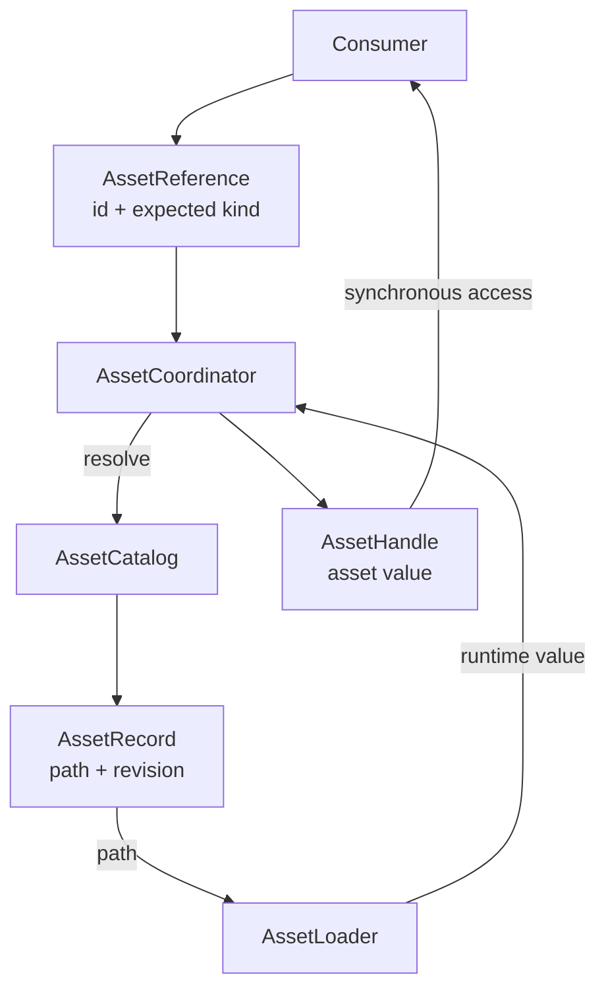

<p align="center">
  
</p>

## 💃 Getting Started

This package is available in the Node Package Repository and can be easily installed with [npm][npm] or [yarn][yarn].

```bash
$ npm i @jolly-pixel/asset
# or
$ yarn add @jolly-pixel/asset
```

## 💡 About 

An asset keeps the same identity when its file, URL, or revision changes.
Consumers store an `AssetReference`. An `AssetCatalog` resolves that reference
to an `AssetRecord`, which describes the current path and revision.



The [loading architecture](./docs/concepts/runtime-loading-architecture.md)
explains how these objects share work, and the
[asset glossary](./GLOSSARY.md) defines the terms shared by these APIs.

## 👀 Usage example

Share one `AssetType` token per kind, register its loader, and load a reference
through a coordinator:

```ts
import {
  AssetCatalog,
  AssetCoordinator,
  AssetLoaderRegistry,
  AssetReference,
  AssetType
} from "@jolly-pixel/asset";

const TEXT_ASSET = new AssetType<string>("text");

const catalog = AssetCatalog.parse({
  version: 1,
  assets: [
    { id: "intro", kind: "text", path: "texts/intro.txt" }
  ]
});

const loaders = new AssetLoaderRegistry();
loaders.register(TEXT_ASSET, {
  async load(record) {
    const response = await fetch(record.path.toString());

    return response.text();
  }
});

const assets = new AssetCoordinator({ catalog, loaders });
const intro = await assets.load(
  new AssetReference("intro", TEXT_ASSET)
);
```

The catalog supplies the path for `"intro"`; consumers keep the stable
reference. The [loading assets guide](./docs/guides/loading-assets.md) covers
batches, handles, and eviction.

## 📚 API

### Core model

Start here. These types define persistent asset identity and catalog lookup.

- [`AssetReference`](./docs/api/core/AssetReference.md): the stable, typed value
  stored by scenes and components.
- [`AssetCatalog`](./docs/api/core/AssetCatalog.md): the authoritative records
  for one project or session.

### Supporting domain types

- [`AssetId`](./docs/api/domain/AssetId.md): validated stable identity.
- [`AssetKind`](./docs/api/domain/AssetKind.md): the validated persistent
  category of an asset.
- [`AssetType`](./docs/api/domain/AssetType.md): the shared token connecting a
  persistent kind to its loaded value type.
- [`AssetRecord`](./docs/api/domain/AssetRecord.md): path and revision metadata
  held by a catalog.
- [`AssetPath`](./docs/api/domain/AssetPath.md): a workspace-relative path
  split into directory, name, and extension.
- [`AssetRoom`](./docs/api/domain/AssetRoom.md): the `${kind}:${assetId}`
  network room name of one asset.

### Runtime orchestration

These APIs are primarily for runtime integrations, editor tools, and explicit
dynamic loading.

- [`AssetCoordinator`](./docs/api/runtime/AssetCoordinator.md): resolves
  references, starts loads, and owns loaded values.
- [`AssetLoader`](./docs/api/runtime/AssetLoader.md) and
  [`AssetLoaderRegistry`](./docs/api/runtime/AssetLoaderRegistry.md): produce
  runtime values for registered asset types.
- [`AssetHandle`](./docs/api/runtime/AssetHandle.md): exposes one asset's
  runtime state.
- [`AssetLoadBatch`](./docs/api/runtime/AssetLoadBatch.md): tracks one fixed
  loading operation.

The reference also covers [package errors](./docs/api/errors.md) and the
[room-name and URL constants](./docs/api/integration-utilities.md) shared with
server and collaboration packages.

## ✨ Contributors guide

If you are a developer **looking to contribute** to the project, you must first read the [CONTRIBUTING][contributing] guide.

Once you have finished your development, check that the tests (and linter) are still good by running the following script:

```bash
pnpm --filter @jolly-pixel/asset test
pnpm run lint
```

> [!CAUTION]
> In case you introduce a new feature or fix a bug, make sure to include tests for it as well.

## 📃 License

MIT

<!-- Reference-style links for DRYness -->

[npm]: https://docs.npmjs.com/getting-started/what-is-npm
[yarn]: https://yarnpkg.com
[contributing]: ../../CONTRIBUTING.md
