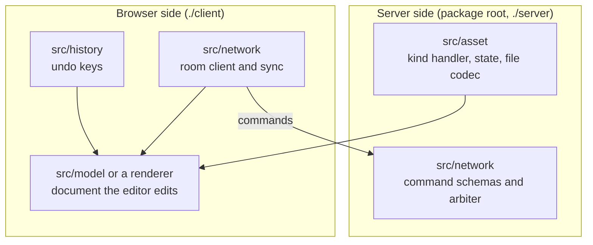
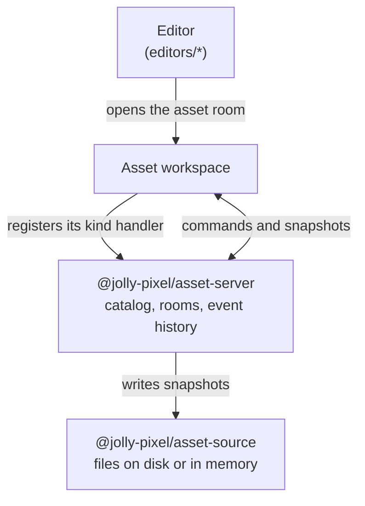
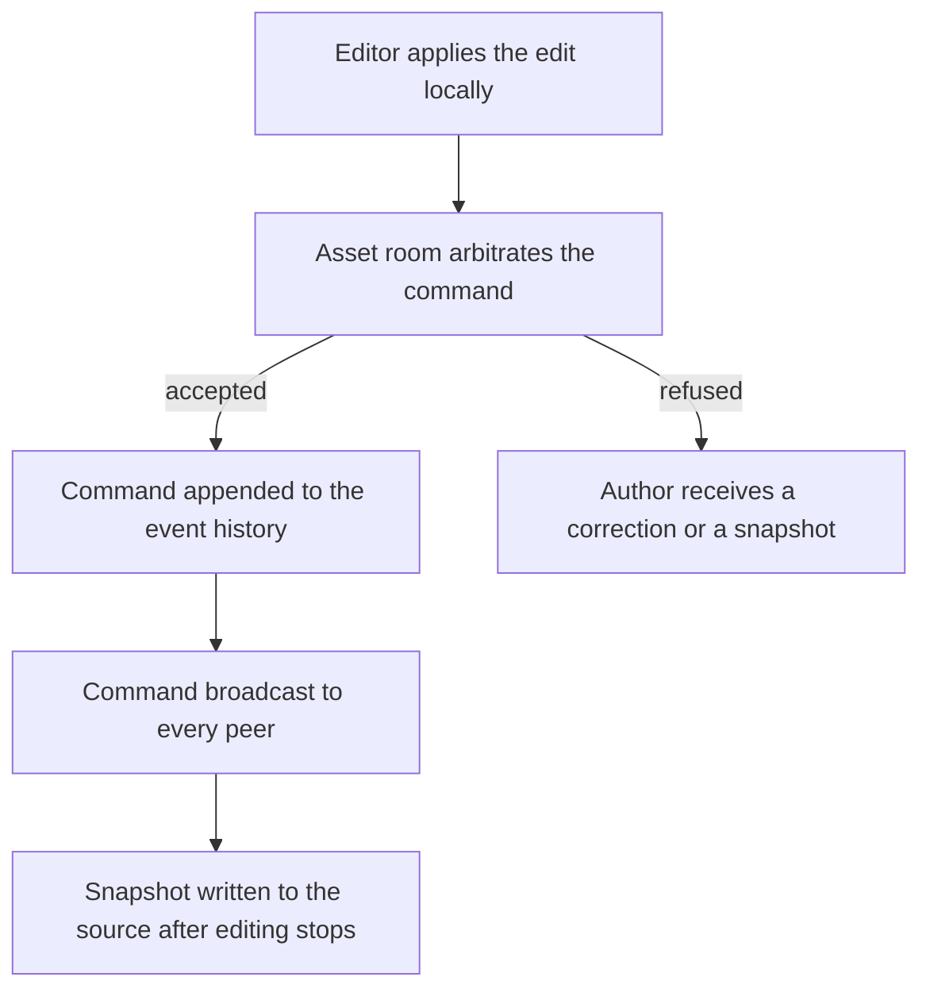
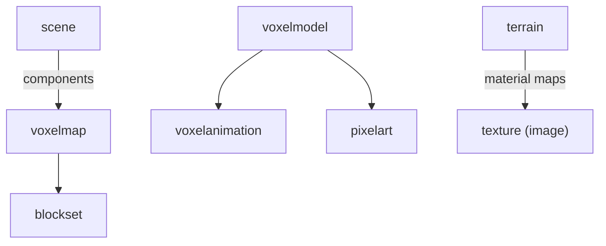

# Asset workspaces architecture

Each workspace in this directory owns one or two editable asset kinds. The
server stores and arbitrates them; the editors open and edit them.

## Inside one workspace

- The server and the editor share the same model: the server replays commands
  on it, the editor draws it.
- Browser code imports `./client` only; the root pulls in server dependencies.
- Code: `src/asset/`, `src/model/`, `src/network/`, `src/history/`; pixel-art
  and voxel-map take their document from the renderer packages instead.

## Where a workspace plugs in

- The catalog room creates, renames and deletes assets; one asset room per
  open asset carries its edits.
- An asset keeps its ID when its path or content changes.

## From edit to stored asset

- Edits show at once; the room has the final word.
- On restart, the server replays the history to rebuild each asset.

## Assets reference each other

- Scene components may reference assets of any kind.
- A reference is an asset ID and kind; the catalog lists each asset's
  references as its dependencies.
- Creating a voxel map also creates its blockset; creating a voxel model also
  creates its pixel-art texture.
