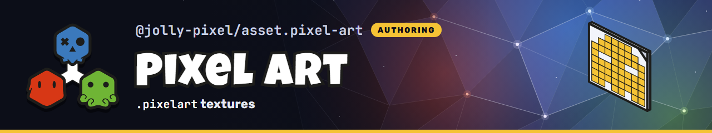

<p align="center">
  
</p>

## 📌 About

Private asset workspace for `.pixelart` textures (kind `pixelart`). Textures are edited in `@jolly-pixel/editor.pixel-art` and referenced by voxel maps, voxel models and scenes.

Browser code imports `@jolly-pixel/asset.pixel-art/client`; the package root and `@jolly-pixel/asset.pixel-art/server` pull in server dependencies. The golem entry (`@jolly-pixel/asset.pixel-art/golem`, `src/golem/`) is what gives agents this kind: see [Golem](./docs/Golem.md).

The [runtime entry](./docs/runtime/README.md) (`@jolly-pixel/asset.pixel-art/runtime`) lets a game load `pixelart` assets and holds the three.js [mesh texturing](./docs/runtime/mesh-texturing/README.md) adapters the editors share.

## 🚀 Building

```bash
$ pnpm install
$ pnpm --filter @jolly-pixel/asset.pixel-art build
```

Editors load the built `dist/` output, so rebuild after a change before running them.

## 🧪 Tests and checks

```bash
$ pnpm --filter @jolly-pixel/asset.pixel-art test
$ pnpm --filter @jolly-pixel/asset.pixel-art lint
$ pnpm --filter @jolly-pixel/asset.pixel-art bench
```

## Contributors Guide

If you are a developer **looking to contribute** to the project, you must first read the [CONTRIBUTING][contributing] guide.

## License

MIT

<!-- Reference-style links for DRYness -->

[contributing]: ../../../CONTRIBUTING.md
