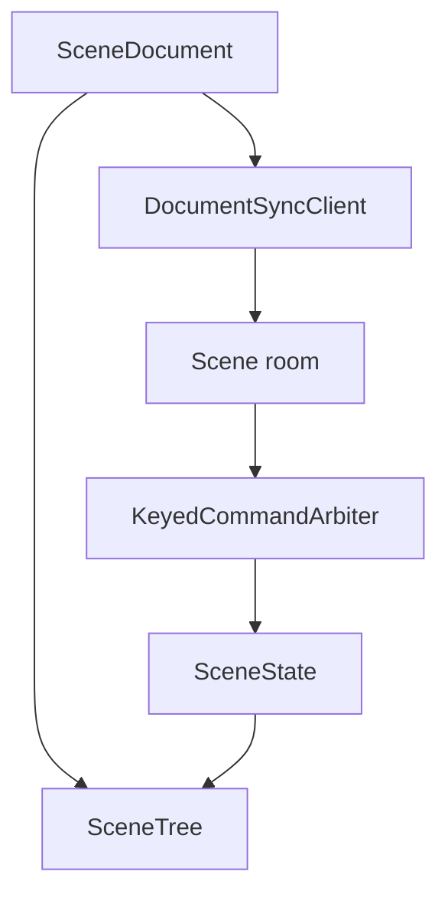
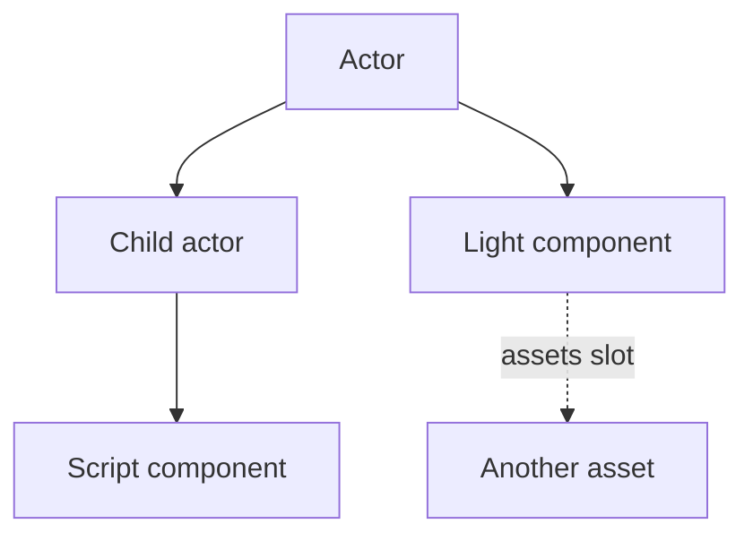
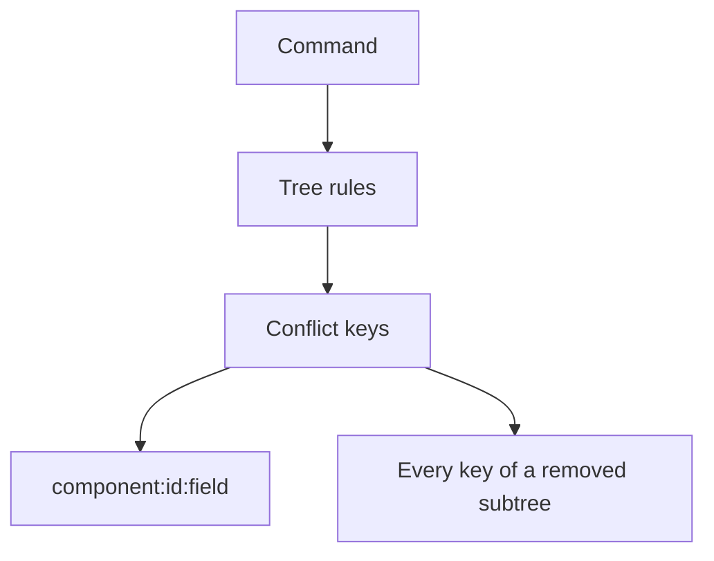

# Scene architecture

## One tree, two sides

- Client and server apply commands to the same `SceneTree`, so both check the same rules.
- Code: `src/model/`, `src/asset/sceneAssetKind.ts`.

## Actors own components

- `ActorHierarchy` keeps the actors and a child list per parent. `SceneTree` adds, for each component, the actor that owns it.
- A component is opaque: the room merges top-level `data` fields and never reads its type.
- Filled asset slots are the scene's catalog dependencies.

## Conflicts per value

- Each command writes the keys of the values it sets; last write wins per key.
- A command with an older `basis` (an undo) loses to a newer write. See the [network API](./docs/network.md#conflict-keys).
- Code: `src/network/SceneCommandKeys.ts`.

## Stored form

- `.scene.json` drops identity transform fields and `visible: true`; the decoder fills them back in.
- The engine reads the decoded form. Code: `src/asset/sceneFile.ts`.
