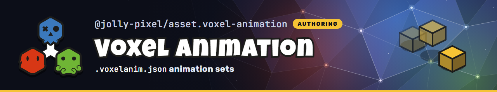

<p align="center">
  
</p>

## 📌 About

Private asset workspace for `.voxelanim.json` animation sets (kind `voxelanimation`): clips of keyframes that target blocks by name path. Voxel models link them and `@jolly-pixel/editor.voxel-model` edits them.

Browser code imports `@jolly-pixel/asset.voxel-animation/client`; the package root and `@jolly-pixel/asset.voxel-animation/server` pull in server dependencies.

## 🚀 Building

```bash
$ pnpm install
$ pnpm --filter @jolly-pixel/asset.voxel-animation build
```

Editors load the built `dist/` output, so rebuild after a change before running them.

## 🧪 Tests and checks

```bash
$ pnpm --filter @jolly-pixel/asset.voxel-animation test
$ pnpm --filter @jolly-pixel/asset.voxel-animation lint
```

## Contributors Guide

If you are a developer **looking to contribute** to the project, you must first read the [CONTRIBUTING][contributing] guide.

## License

MIT

<!-- Reference-style links for DRYness -->

[contributing]: ../../../CONTRIBUTING.md
