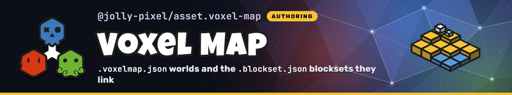

<p align="center">
  
</p>

## 📌 About

Private asset workspace for `.voxelmap.json` worlds (kind `voxelmap`) and the `.blockset.json` blocksets they link (kind `blockset`), edited in `@jolly-pixel/editor.voxel-map`.

Browser code imports `@jolly-pixel/asset.voxel-map/client`; the package root and `@jolly-pixel/asset.voxel-map/server` pull in server dependencies.

## 🚀 Building

```bash
$ pnpm install
$ pnpm --filter @jolly-pixel/asset.voxel-map build
```

Editors load the built `dist/` output, so rebuild after a change before running them.

## 🧪 Tests and checks

```bash
$ pnpm --filter @jolly-pixel/asset.voxel-map test
$ pnpm --filter @jolly-pixel/asset.voxel-map lint
```

## Contributors Guide

If you are a developer **looking to contribute** to the project, you must first read the [CONTRIBUTING][contributing] guide.

## License

MIT

<!-- Reference-style links for DRYness -->

[contributing]: ../../../CONTRIBUTING.md
