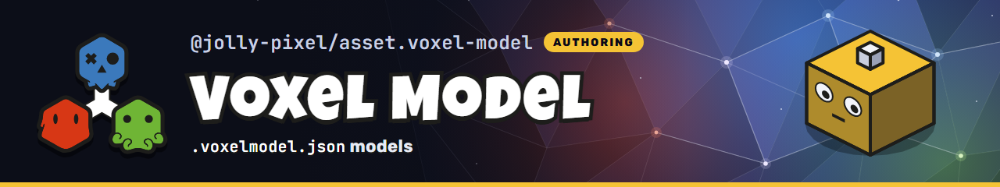

<p align="center">
  
</p>

`.voxelmodel.json` models

## 📌 About

Private asset workspace for `.voxelmodel.json` model trees (kind `voxelmodel`): blocks and folders, a material library and links to animation sets. Models are edited in `@jolly-pixel/editor.voxel-model`.

Browser code imports `@jolly-pixel/asset.voxel-model/client`; the package root and `@jolly-pixel/asset.voxel-model/server` pull in server dependencies. The golem entry (`@jolly-pixel/asset.voxel-model/golem`, `src/golem/`) is what gives agents this kind: see [Golem](./docs/Golem.md).

The runtime entry (`@jolly-pixel/asset.voxel-model/runtime`, `src/runtime/`) gives a game the `VoxelModel` component and a `voxelmodel` loader, which reads the model's build and loads its texture with the pixel-art runtime loader. The build is the model file with the transform and UV fields the stored form omits; animations do not play in a game yet. `ModelView` and the block meshes it draws (`src/runtime/blocks/`) are shared with the voxel-model editor.

## 🚀 Building

```bash
$ pnpm install
$ pnpm --filter @jolly-pixel/asset.voxel-model build
```

Editors load the built `dist/` output, so rebuild after a change before running them.

## 🧪 Tests and checks

```bash
$ pnpm --filter @jolly-pixel/asset.voxel-model test
$ pnpm --filter @jolly-pixel/asset.voxel-model lint
```

## Contributors Guide

If you are a developer **looking to contribute** to the project, you must first read the [CONTRIBUTING][contributing] guide.

## License

MIT

<!-- Reference-style links for DRYness -->

[contributing]: ../../../CONTRIBUTING.md
