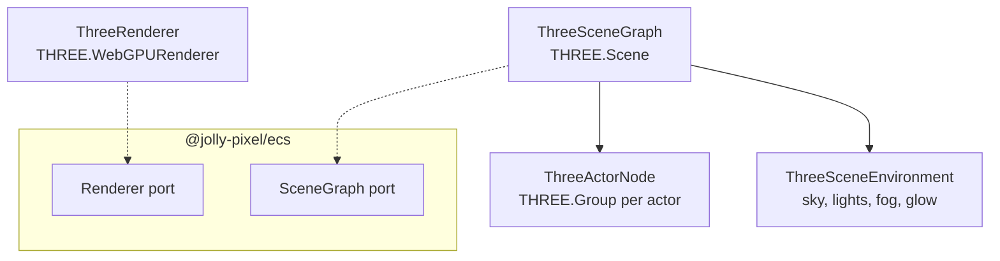
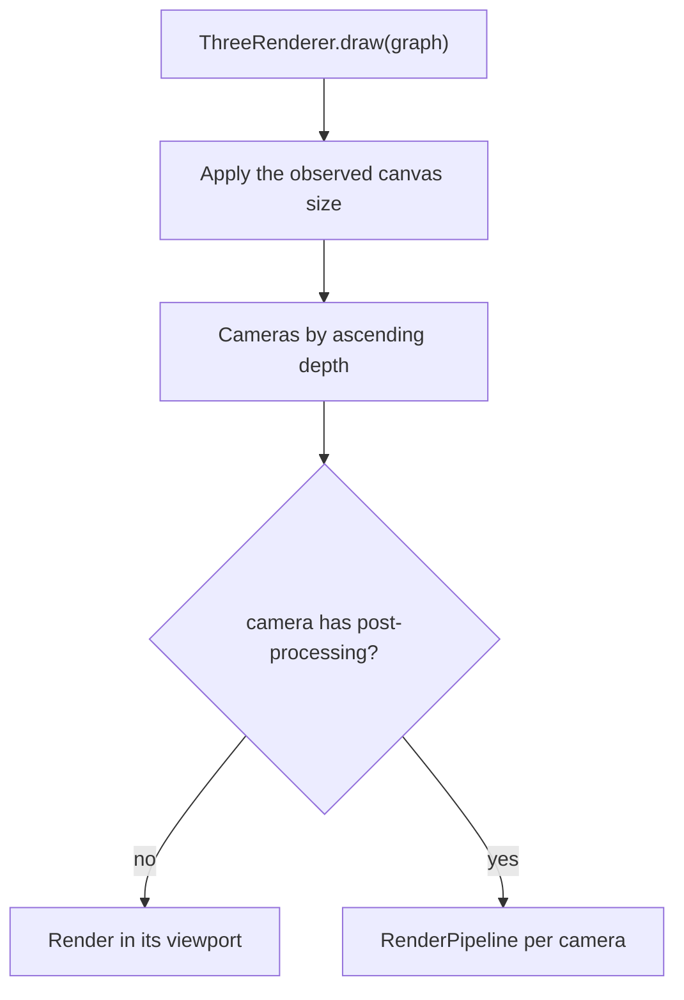
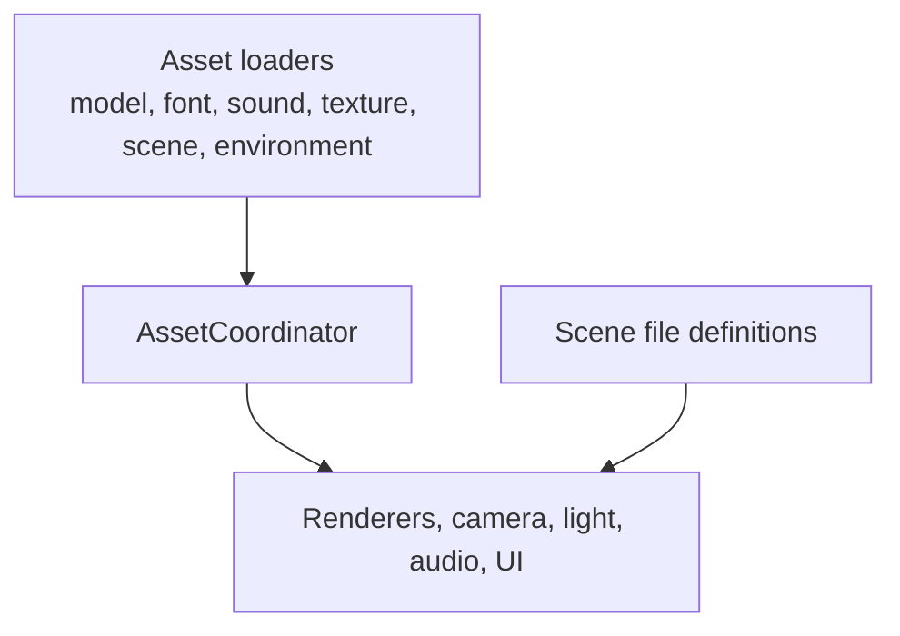
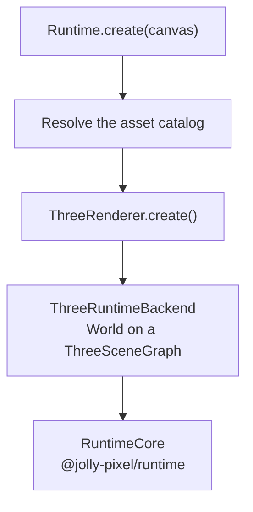

# backend.three architecture

`@jolly-pixel/backend.three` implements the ECS backend ports with three.js
and adds the components, assets and browser runtime a game needs.

## Ports

- Importing the package registers its types on the ECS `SceneBackend`, so
  `actor.node.object3D` types without a cast.
- Script compilers load the package as ambient `types` for the same reason.

Code: `src/rendering/`, `src/scene/`.

## Drawing a frame

- Pipelines compile asynchronously; `compiled` fires when the last settles.
- The scene graph's `postProcessing` applies to cameras that have none.

Code: `src/rendering/compositing/`.

## Components and assets

- `createDefaultAssetLoaders()` shares one `THREE.LoadingManager`.
- Camera, light, audio, mesh, model and text components have a definition,
  so an ECS `FileScene` can build them.
- `src/components/physics/` is the `./physics` entry, the only code that
  imports the optional `@jolly-pixel/physics` peer. The root entry never
  reaches it; `test/bundle.spec.ts` checks that.

Code: `src/assets/`, `src/components/`, `src/audio/`, `src/ui/`.

## Runtime

- `RuntimeCore` owns the loop, loading screen, overlay and metrics.
- The backend adds the renderer counters, the view helper and the KTX2 loader.

Code: `src/runtime/`.

See the [glossary](./GLOSSARY.md) and the [API](./README.md#-api).
