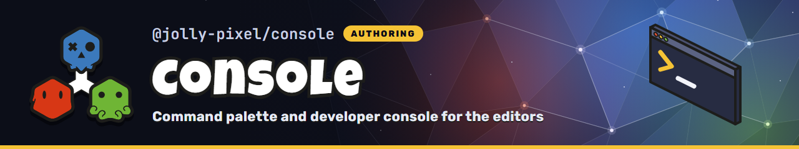

<p align="center">
  
</p>

## 💃 Getting Started

This package is available in the Node Package Repository and can be easily installed with [npm][npm] or [yarn][yarn].

```bash
$ npm i @jolly-pixel/console
# or
$ yarn add @jolly-pixel/console
```

## 👀 Usage example

```ts
import { CommandConsole } from "@jolly-pixel/console";
import "@jolly-pixel/console/element";

const commands = new CommandConsole();

const brush = commands.registerNamespace("brush", {
  description: "Voxel brush"
});
brush.registerVariable("size", {
  type: "number",
  description: "Brush size in voxels",
  get: () => brushStore.size,
  set: (value) => {
    brushStore.size = value;
  }
});
brush.registerCommand("grow", {
  description: "Grow or shrink the brush",
  args: [
    { name: "delta", type: "number", required: true }
  ],
  execute: ({ delta }, ctx) => {
    brushStore.resize(delta);
    ctx.print(`brush size ${brushStore.size}`);
  }
});

const element = document.createElement("jolly-console");
element.console = commands;
document.body.append(element);
```

Ctrl+K (Cmd+K on macOS) opens the console.

## 📖 Guides

- [Registering from features](./docs/guides/registering-features.md): split an editor's console
  entries into features and register them as one list

## 📚 API

### Headless

```ts
import "@jolly-pixel/console";
```

Holds namespaces, commands and variables, runs what the user types and keeps the output and
history.

- [CommandConsole](./docs/CommandConsole.md): namespaces, features, commands, variables, reverting, scripts, output and history
- [Input grammar](./docs/grammar.md): prompt syntax, value coercion, scope and script format
- [Remote consoles](./docs/remote.md): `ConsoleServer` and `ConsoleMirror`, a console served over a `MessagePort`

> [!NOTE]
> It touches no DOM and does not need Lit.

### UI component

```ts
import "@jolly-pixel/console/element";
```

The `jolly-console` Lit dialog that displays a `CommandConsole`. It needs the optional `lit` and
`@jolly-pixel/ui` peers.

- [jolly-console](./docs/element.md): mounting, opening and closing, keys, scripts and styling

The element's `console` property connects the two.

## 🧪 Benchmarks

```bash
# Node: tokenizing, classifying, search, browse and completion on each keystroke
pnpm --filter @jolly-pixel/console bench

# Headless Chromium: jolly-console keystroke time with a full scrollback
pnpm --filter @jolly-pixel/console bench:browser
```

## ✨ Contributors guide

If you are a developer **looking to contribute** to the project, you must first read the [CONTRIBUTING][contributing] guide.

Once you have finished your development, check that the tests (and linter) are still good by running the following script:

```bash
$ pnpm run test
$ pnpm run test:e2e
$ pnpm run lint
```

> [!CAUTION]
> In case you introduce a new feature or fix a bug, make sure to include tests for it as well.

## 📃 License

MIT

<!-- Reference-style links for DRYness -->

[npm]: https://docs.npmjs.com/getting-started/what-is-npm
[yarn]: https://yarnpkg.com
[contributing]: ../../CONTRIBUTING.md
