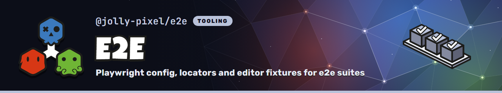

<p align="center">
  
</p>

## 💃 Getting Started

This workspace-private package is never published or built. It exports
TypeScript directly; Node and Playwright strip the types at run time. Add it as
a development dependency:

```json
{
  "scripts": {
    "test:e2e": "playwright test"
  },
  "devDependencies": {
    "@jolly-pixel/e2e": "workspace:*"
  }
}
```

`@playwright/test` is a peer dependency, installed once at the repository root.

## 👀 Usage example

A suite has a `playwright.config.ts`:

```ts
// Import Third-party Dependencies
import {
  PORTS,
  defineE2EConfig
} from "@jolly-pixel/e2e";

export default defineE2EConfig({
  port: PORTS.voxelModel,
  command: "pnpm run dev:e2e"
});
```

An editor suite also has a `test/e2e/fixtures.ts` that seeds the documents each
test opens on the config's `baseURL`:

```ts
// Import Third-party Dependencies
import {
  e2eFolder,
  editorFixture
} from "@jolly-pixel/e2e/editor";

export { expect } from "@playwright/test";

export const test = editorFixture({
  async create(catalog) {
    const id = await catalog.create(
      `${e2eFolder()}/model.voxelmodel.json`,
      encodeModelFile(),
      { kind: VOXEL_MODEL_KIND }
    );

    return { id };
  }
});
```

Specs import `test` and `expect` from it. The editor is already open and ready
when the test body runs:

```ts
// Import Third-party Dependencies
import { treeRow } from "@jolly-pixel/e2e";

// Import Internal Dependencies
import {
  test,
  expect
} from "./fixtures.ts";

test("opens the requested model with its default block", async({ page }) => {
  await expect(treeRow(page, "Block")).toBeVisible();
});
```

## 📚 API

`@jolly-pixel/e2e`, for every suite:

- [Config](./docs/config.md): `defineE2EConfig`, `PORTS`, `baseUrl`, the
  `prebundleWorkspace` Vite plugin and `RunMode`.
- [Roles](./docs/roles.md): `CookieAuthentication` and `ContextAccess`.
- Browser helpers:
  [Pointer](./docs/browser/pointer.md) (bounding boxes and drags),
  [Locators](./docs/browser/locators.md) (dialogs, fields and tree rows of
  `@jolly-pixel/ui`) and [Sockets](./docs/browser/sockets.md) (`recordSockets`).
- [Console](./docs/browser/console.md): `CommandConsole`, the command console
  prompt and log.

`@jolly-pixel/e2e/editor`, for editors and the studio:

- [Editor fixture](./docs/editor/fixture.md): `editorFixture`, roles, the `peer` page and the catalog helpers.
- [Editor navigation](./docs/editor/navigation.md): `openEditor`, `reloadEditor`, `followEditor` and `waitForEditor`.
- [Editor frames](./docs/editor/frames.md) and [Editor press](./docs/editor/press.md): `nextFrames` and `pressAt`.
- [Editor toolbar](./docs/editor/toolbar.md): `EditorToolbar`, the target picker and tags above the viewport.

## 🧱 Boundaries

The package never imports `@jolly-pixel/ui` or an editor, directly or through
a dependency. Locators match `jolly-*` tag names and ARIA roles only, and
`nextFrames` types `window.jollyEditor` structurally. This lets `@jolly-pixel/ui` devDepend on
the package without a workspace cycle.

## 🧭 Starting a new suite

1. Add a port to `PORTS` and pass it to
   [`RunMode`](./docs/config.md#runmode) in the suite's `vite.config.ts`.
2. Add `playwright.config.ts` with `defineE2EConfig`, and a `test:e2e` script
   running `playwright test`.
3. For an editor, add `test/e2e/fixtures.ts` exporting `editorFixture` with the
   suite's seed documents, and `expect`.
4. Write `test/e2e/<feature>.e2e.ts` against that `test`. Keep domain helpers
   (scene, painting, hierarchy) in the suite's `test/e2e/support/`.
5. Serve the page with `vite --mode e2e` and add `mode.plugins()`, which
   holds [`prebundleWorkspace()`](./docs/config.md#prebundleworkspace-plugin),
   to the Vite plugins. Vite never pre-bundles linked packages, so plain
   `vite` serves each file of their `dist/` as its own module: about 1,000
   requests per editor boot, which on a CI runner is enough to push tests that
   boot several pages past the 30s timeout. A trace of one test should show no
   request under `packages/*/dist/`. A page that imports its own `src/` still
   serves each source file on its own; build it instead with
   `vite build --mode e2e && vite preview --mode e2e`, as `@jolly-pixel/ui`
   does.
6. CI picks the suite up from its `test:e2e` script and runs it when the
   package or one of its workspace dependencies changes
   (`scripts/ci/affected.ts`). To keep it out of CI, add a `--skip-e2e` entry
   in `.github/workflows/node.js.yml`.

## ✨ Contributors guide

Read the [CONTRIBUTING][contributing] guide before contributing.

After making changes, run the tests and linter:

```bash
$ pnpm run test
$ pnpm run lint
```

> [!CAUTION]
> New features and bug fixes need tests.

## 📃 License

MIT

[contributing]: ../../CONTRIBUTING.md
