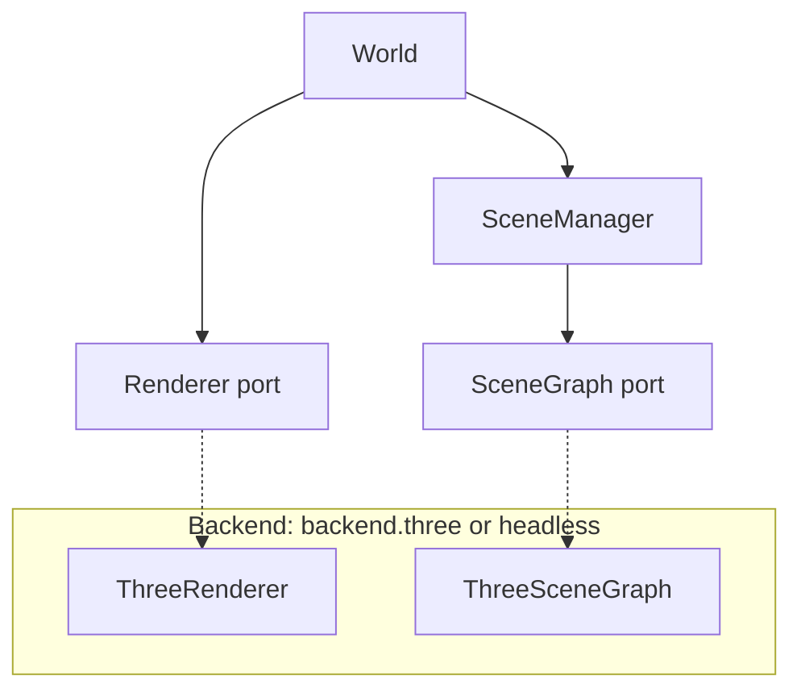
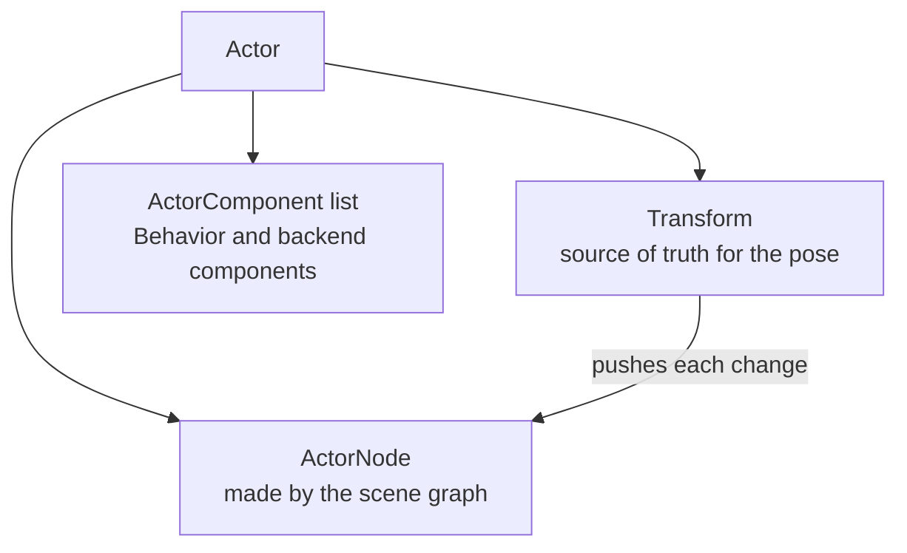
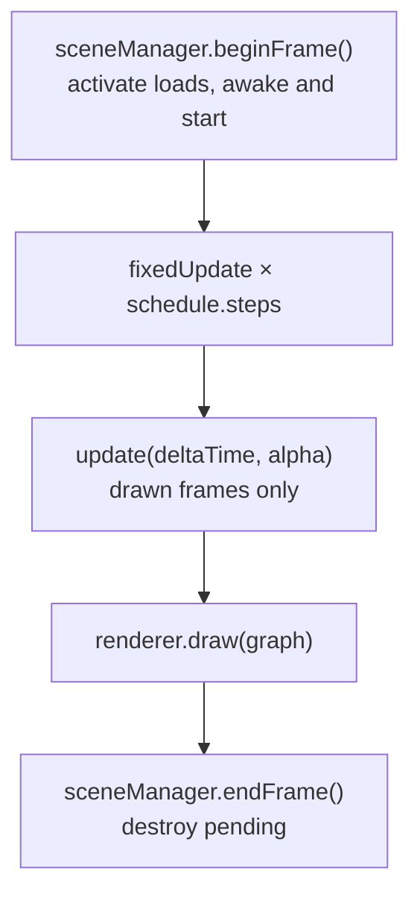
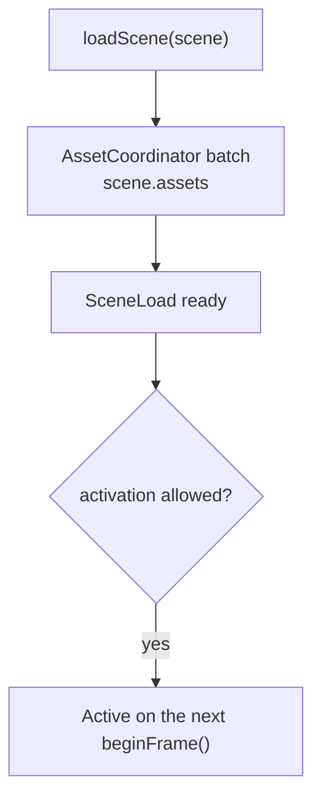
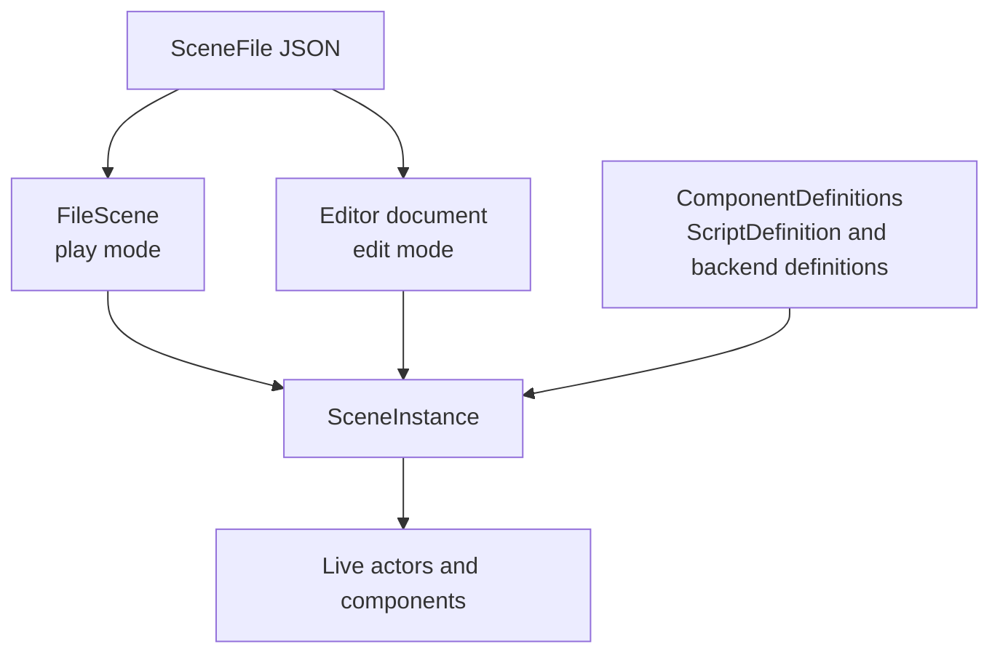

# ECS architecture

`@jolly-pixel/ecs` holds the game model: actors, components, scenes and the
world loop. It never draws. A backend implements two ports to put the world on
screen.

## World and backend ports

- A backend types `actor.node`, `sceneManager.graph` and `world.audio` by
  augmenting the top-level `SceneBackend` interface.
- `HeadlessRenderer` and `HeadlessSceneGraph` run a world without a GPU.

Code: `src/systems/`, `src/systems/rendering/`, `src/systems/scene/`.

## Actor

- Math runs on `@jolly-pixel/math` tuples; the API takes `{ x, y, z }` objects.
- A pose written on the node is overwritten by the next transform change.

Code: `src/actor/`, `src/components/script/`.

## One frame

- The world has no accumulator: a runtime's `GameLoop` hands it the schedule.
- Only actors holding a started component with `needUpdate` are visited.

## Scene loading

`load.done` resolves before the scene's `awake()` runs.

## Scene files

- In edit mode a definition builds nothing that runs the game.
- Prefab instances expand another scene file under an actor, with overrides.
- Component packages contribute definitions and asset loaders by name.

Code: `src/systems/scene/file/`, `src/systems/contributions/`.

See the [glossary](./GLOSSARY.md) and the [API](./README.md#-api).
