# Architecture

`@jolly-pixel/editor.host` is the code every editor page shares. It finds the
asset to open, opens a session on it and mounts the editor. Terms are defined
in the [glossary](./GLOSSARY.md).

## Map

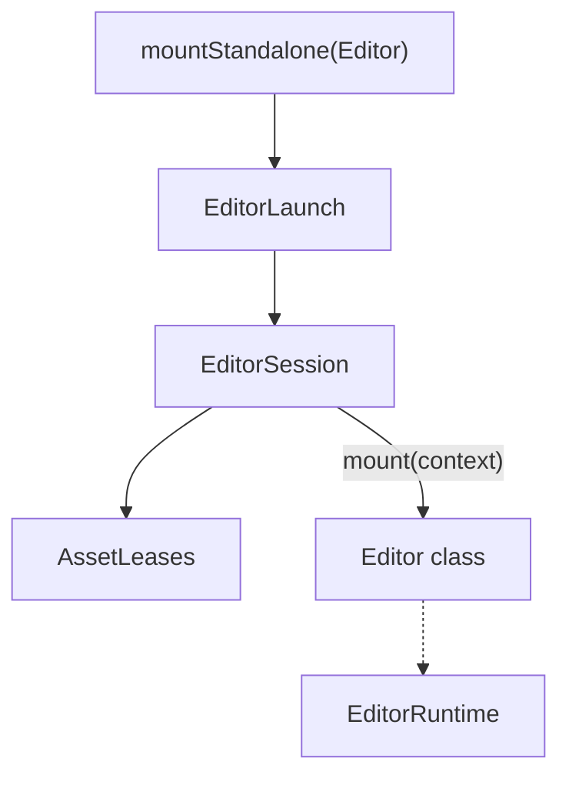

- `launch/`: where the target comes from, and the `ShellChannel` to a parent frame.
- `session/`: the connection, the session, toolbar sources and archives.
- `lease/`: one shared room, and at most one document, per asset.
- `editor/`: `mountStandalone`, `bootStandalone`, `EditorMount`, `Placement`.
- `state/`: the page state (`data-editor-state`) and its loading bar.
- `runtime/`: the 3D runtime wrapper and `PeerFrustums`.
- `workspace/`: offline and shared-tab connections, behind the `./offline` entry.

## Who owns what

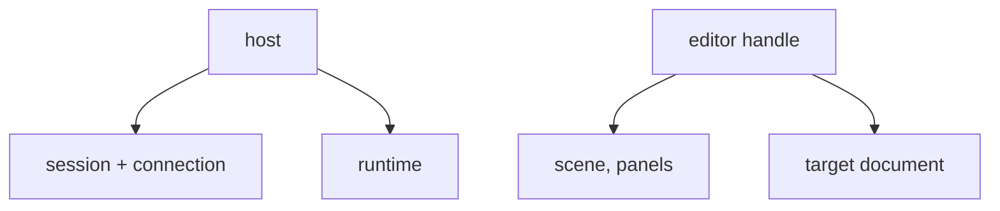

- The host keeps the session, the connection and the runtime for the page's lifetime.
- The editor releases only what `mount` built, in `dispose()`.
- `Editor.createRuntime(logger)` is optional; editors without a 3D view skip it.

## Boot

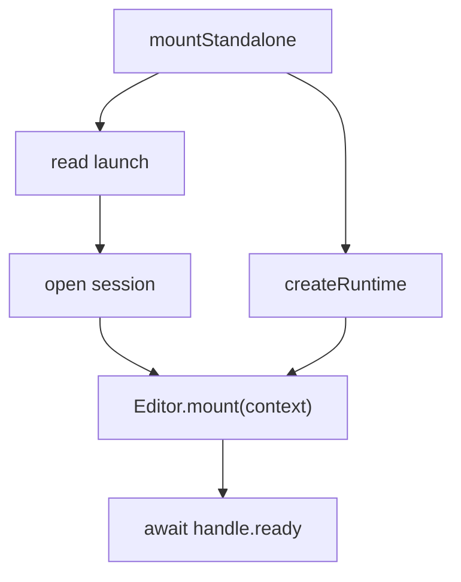

- The runtime is created while the launch is read; `mount` awaits it.
- With a `connect` option and a `?target=` in the URL, the session opens before
  the launch answers. It is kept only if the launch names the same view.
- Every dependency document is synced before `mount`. The target room is only reserved.
- Once ready, the page gets `data-editor-state="ready"` and, in dev, `window.jollyEditor`.

## Finding the target

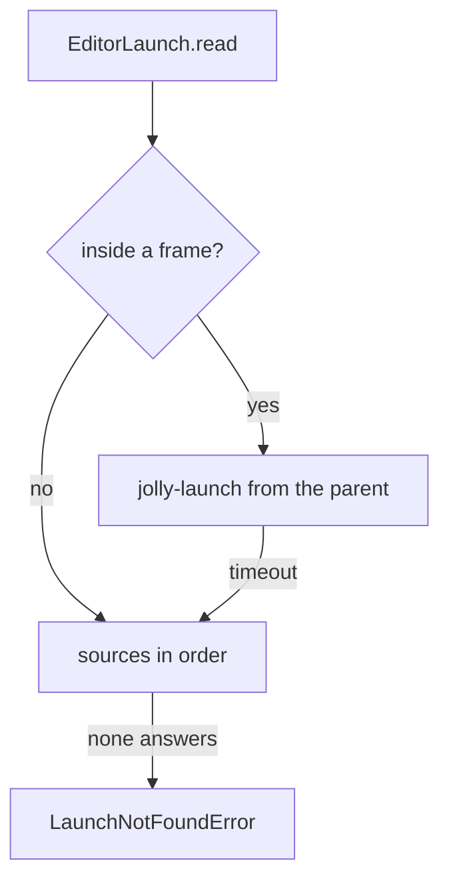

- The first source that answers wins. Outside a frame there is no wait.
- The parent has 1000 ms, from an allowed origin (the page's own by default).
- Default sources: `?target=`, then the injected JSON element.
- `mountStandalone({ sources })` replaces the defaults; the parent is always asked first.

## Inside a shell

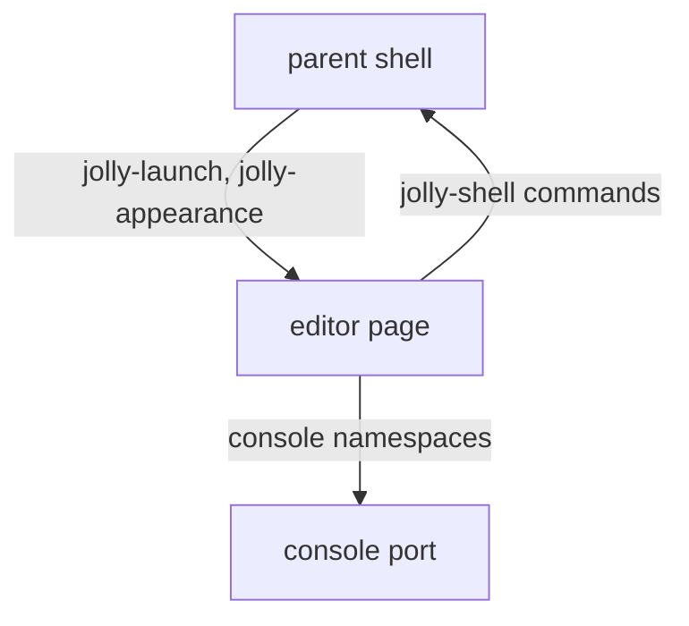

- Only a launch answered by the parent carries a `ShellChannel` (`context.shell`).
- The page mounts no console of its own and forwards Ctrl+K as `toggle-console`.
- It posts `unsaved` when its documents gain or lose unacknowledged changes.
- It posts `editor-state` on every page state change (`PageState`).
- It posts `session-refused` and reconnects after `jolly-session-renewed`.
- Messages and ports: [ShellChannel](./docs/launch/ShellChannel.md).

## Placement

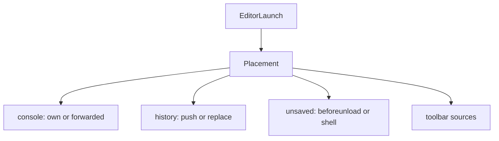

- Placement reads the launch, never the session: an early session cannot tell
  a shell or share-link launch from a plain page.
- `targets` exist only outside a shell, `tags` only on a server connection, and neither for a share link.
- A workspace-backed session remembers its target for the next offline launch.

## Target and dependencies

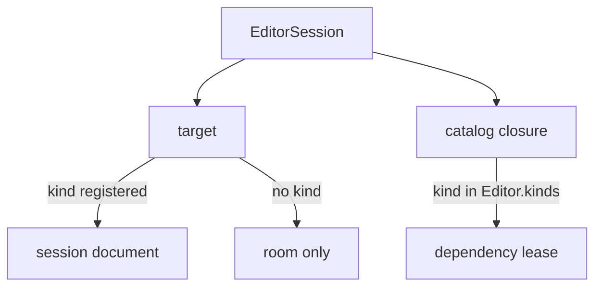

- A room-only target is joined and synced by the editor itself.
- A dependency is leased only when its reference kind matches its record kind.
- `dependencies()` and `dependency(id)` return frozen views without `release()`.
- A panel that needs a longer lifetime opens its own lease through `session.assets`.

## Following the catalog

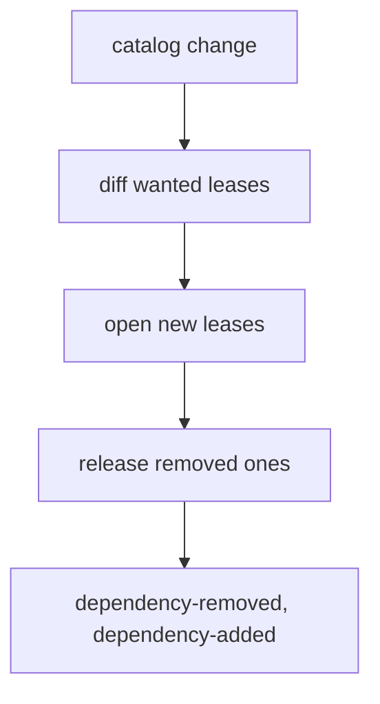

- Only the boot waits for dependency documents. A lease from `dependency-added` may still be syncing.
- After awaiting it, check `session.dependency(id)` still returns that view.
- If an open throws, the pass is rolled back and the previous set stays.

## Lease lifecycle

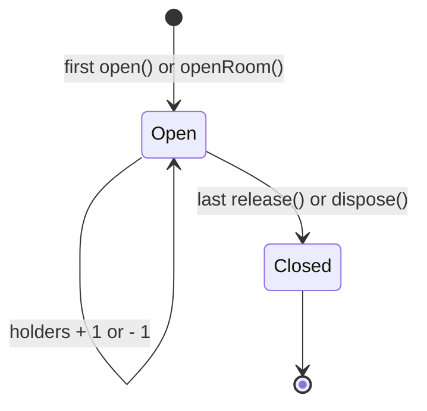

- Every holder shares one room and at most one document.
- `open(kind)` joins on first open; `openRoom` does not join.
- Opening with another document kind, or with a kind after `openRoom`, throws `AssetDocumentConflictError`.
- Kinds compare by identity: reuse the objects from `Editor.kinds`.
- `release()` is idempotent per holder. `AssetLeases.dispose()` closes everything.

## Switching target or tag

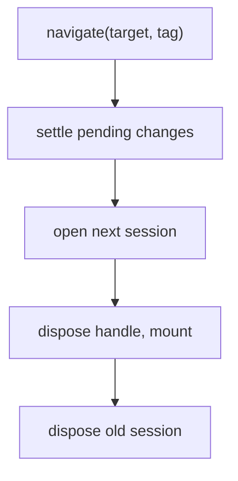

- The page, runtime, client and catalog stay. Leases both sessions use are shared.
- The old session is disposed last, so the old scene keeps its documents until replaced.
- The boot is the first switch, through the same `EditorMount`.
- One switch at a time; only the latest waiting request runs and writes the URL.
- A tag view puts only the target on its read-only tag room.
- A failed remount reloads the page on the requested launch.

## Archives and workspace

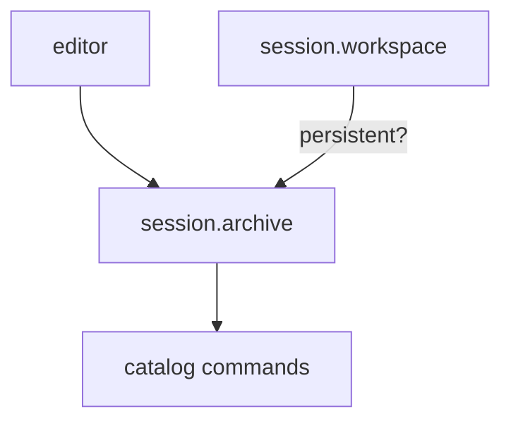

- `export`, `plan` and `import` go through the catalog, online or offline.
- A memory workspace cannot import: `archive.canImport` is `false`.
- `session.workspace` is `null` on the default server connection.
- API: [archives](./docs/session/Archives.md).

## Offline

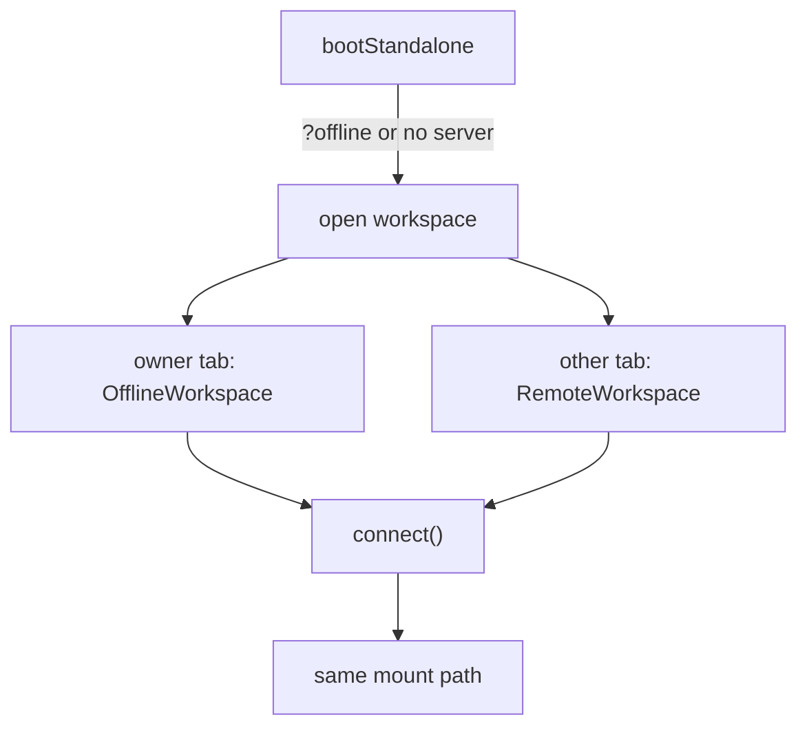

- The workspace runs the asset back-end in the page, so session and leases work unchanged.
- `./offline` is a separate entry, loaded only when needed.
- With IndexedDB, one tab holds the lock; other tabs reach it over a BroadcastChannel.
- Only the owner tab loads the back-end and the editor's handlers and seed.
- Without Web Locks the shared opener falls back to memory storage.
- Storage, seeds and reset: [bootStandalone](./docs/editor/bootStandalone.md#offline-workspace).

## Failure and teardown

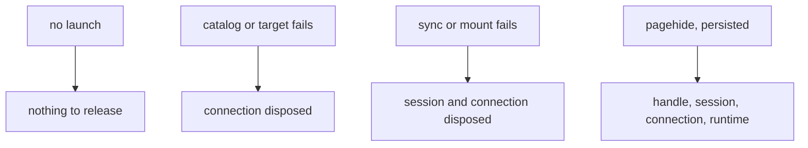

- Session disposal releases its leases.
- Connection disposal closes remaining leases, the catalog and the network client.
- A page restored from the back-forward cache reloads.

## Runtime keyboard

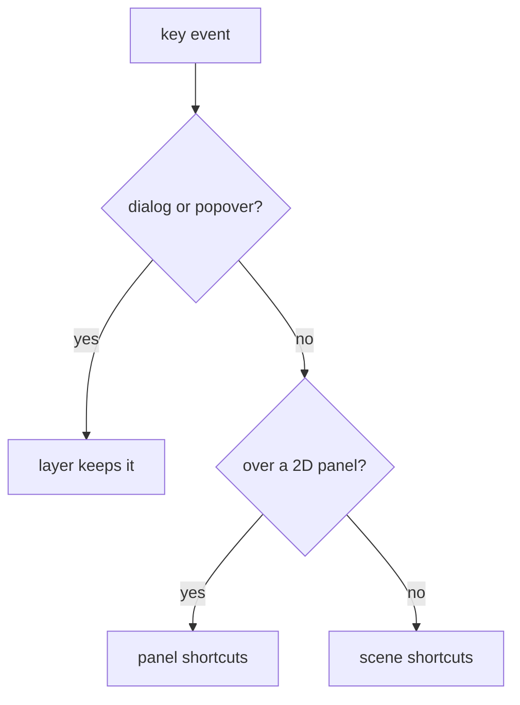

- `EditorRuntime.create` installs the input-layer guard.
- The hover branch exists only after `suspendKeyboardOnHover`; overlapping bindings release last-out.
- `PeerFrustums` is an actor component editors add for peer cameras.

API: [mountStandalone](./docs/editor/mountStandalone.md),
[bootStandalone](./docs/editor/bootStandalone.md),
[EditorLaunch](./docs/launch/EditorLaunch.md),
[EditorSession](./docs/session/EditorSession.md),
[EditorToolbar](./docs/session/EditorToolbar.md),
[AssetLeases](./docs/lease/AssetLeases.md),
[EditorRuntime](./docs/runtime/EditorRuntime.md),
[QueryParams](./docs/params/QueryParams.md).
