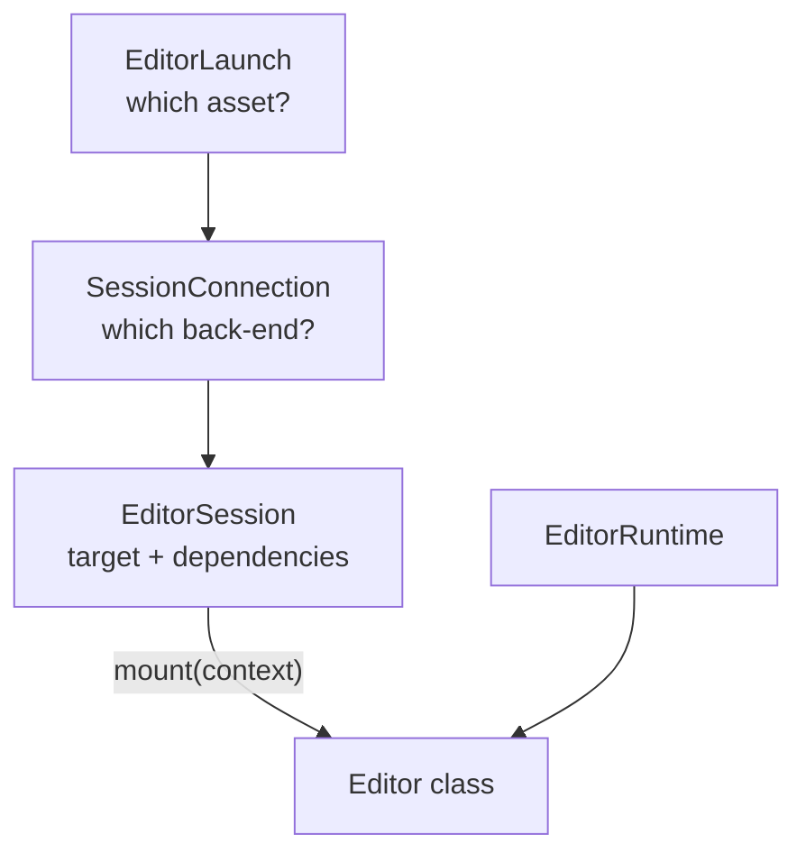
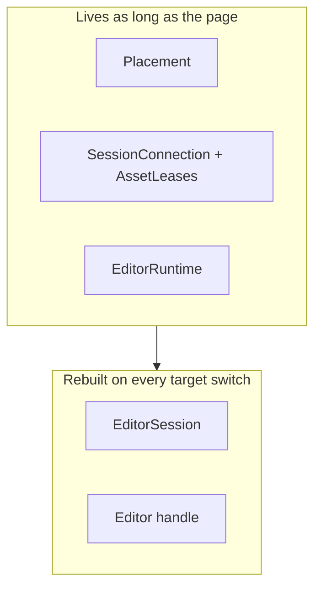
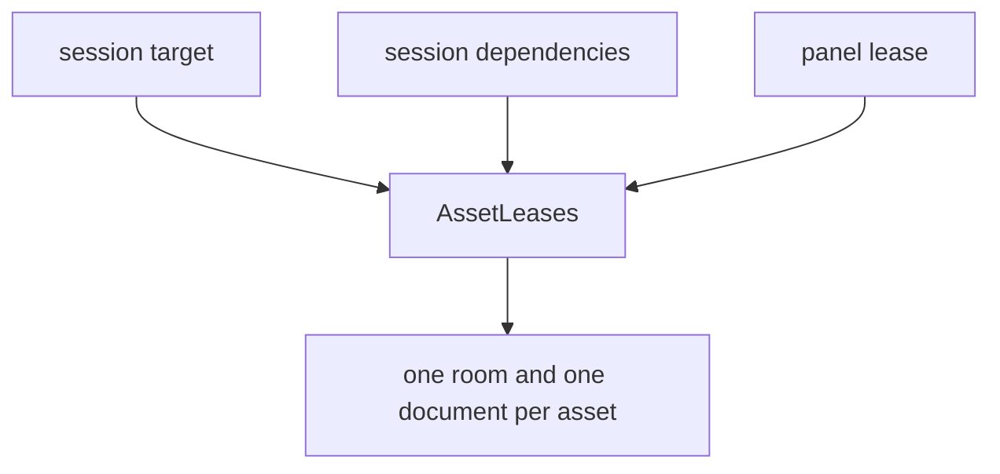
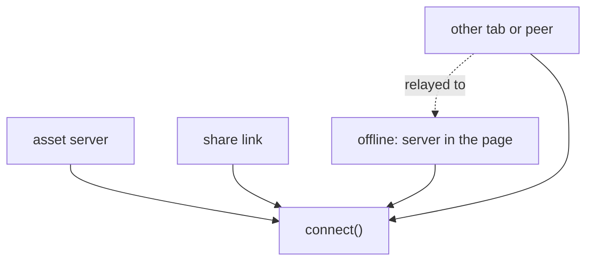
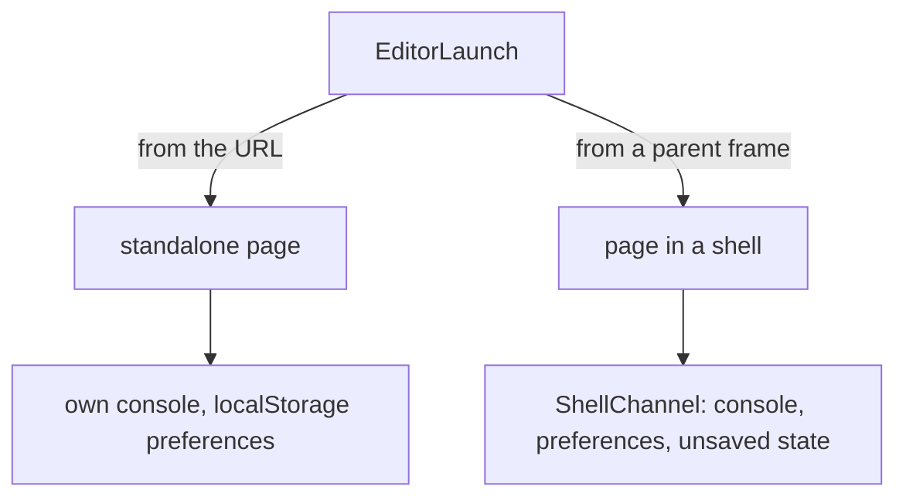

# Architecture

`@jolly-pixel/editor.host` turns an editor class into a working page. It finds
the asset to open, connects to a back-end and mounts the editor on a live
session. Terms are defined in the [glossary](./GLOSSARY.md).

## A page opens one asset

- The editor only implements `mount(context)` and `dispose()`. Everything above it belongs to the host.
- Code: `launch/`, `session/`, `boot/`.

## Two lifetimes

- Switching target or tag remounts in place: the next session opens, the old editor unmounts, the new one mounts, and the old session is released last.
- Placement holds what depends on where the page runs: console, preferences, history and the unsaved guard.

## One room per asset

- Holders share the room; it closes when the last one releases. Two sessions that use the same texture during a switch keep it synced.
- On a server, unsent changes are also kept in IndexedDB, so closing a tab does not lose them.
- Code: `lease/`.

## Any back-end, same editor

- `bootStandalone` picks one; `mountStandalone({ connect })` accepts any.
- Offline code sits behind the `./offline` entry and loads only when used.
- Code: `connection/`, `offline/`.

## Standalone or inside a shell

- Only the launch knows where the page runs. Placement reads it; the editor never has to.
- Code: `shell/`, `launch/`, `preferences/`.

API: [bootStandalone](./docs/boot/bootStandalone.md),
[EditorDefinition](./docs/boot/EditorDefinition.md),
[Shell](./docs/shell/Shell.md),
[EditorSession](./docs/session/EditorSession.md),
[AssetLeases](./docs/lease/AssetLeases.md),
[EditorRuntime](./docs/runtime/EditorRuntime.md),
[QueryParams](./docs/params/QueryParams.md).
