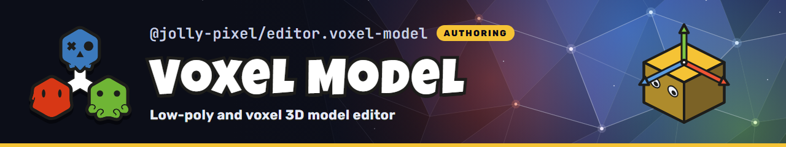

<p align="center">
  
</p>

Voxel model and animation editor

## 📌 About

Private editor workspace for [`@jolly-pixel/asset.voxel-model`][asset-voxel-model] models, booted through [`@jolly-pixel/editor.host`][editor-host].

The package exports a read-only model viewer from `src/viewer/` and the `VoxelModel` scene component from `src/sceneComponents/` (`@jolly-pixel/editor.voxel-model/scene`). The component draws the model with the pixel-art texture the model links. The component definition and `ModelView`, which draws the model, come from `@jolly-pixel/asset.voxel-model/runtime`, which also gives a game the component and its loader.

## 🚀 Running the editor

```bash
$ pnpm install
$ pnpm --filter @jolly-pixel/editor.voxel-model dev
```

## 🧪 Tests and checks

```bash
$ pnpm --filter @jolly-pixel/editor.voxel-model test
$ pnpm --filter @jolly-pixel/editor.voxel-model lint
$ pnpm --filter @jolly-pixel/editor.voxel-model test:scenario
```

`test:scenario` builds and animates a small figure in installed Chrome, checking each step through an exported archive; see [the scenario guide](./test/scenario/README.md).

## Contributors Guide

If you are a developer **looking to contribute** to the project, you must first read the [CONTRIBUTING][contributing] guide.

## License

MIT

<!-- Reference-style links for DRYness -->

[contributing]: ../../../CONTRIBUTING.md
[asset-voxel-model]: ../../assets/voxel-model/README.md
[editor-host]: ../host/README.md
