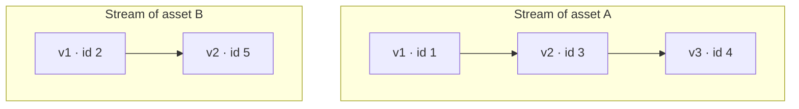
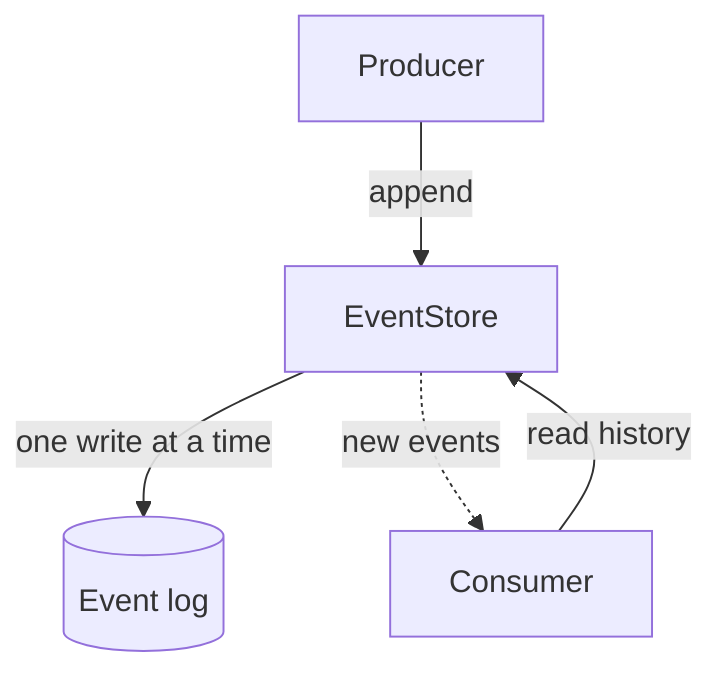
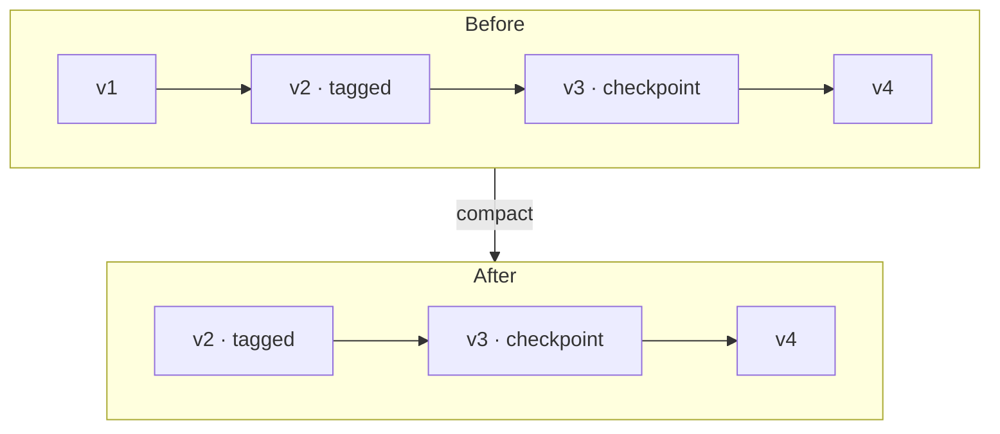
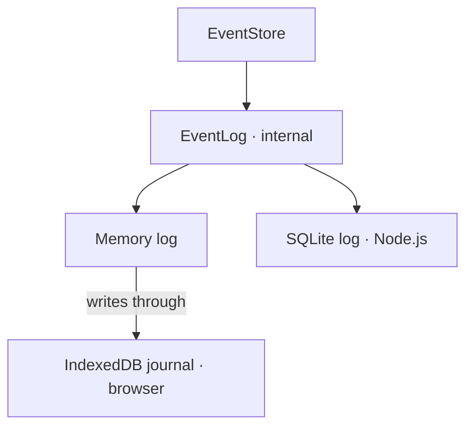

# Event store architecture

The event store keeps the history of every asset as a list of events. It
numbers and orders them, but never reads `eventData`. What an event means, and
how to rebuild an asset from its events, is up to the consumer.

## One log, many streams

- Each asset has its own stream, numbered by `eventVersion` from 1.
- All streams share one log, ordered by `eventId`.
- Events are only appended. Neither number changes afterwards, even after
  compaction.

Code: `src/EventStore.ts`.

## Write, read, listen

- Writes run one at a time, so two appends never race for the same version.
  Reads do not wait for them.
- A rejected append takes no position in the log.
- Listeners only hear new events: a consumer reads history first, then
  subscribes.

Code: `src/persistence/createEventStore.ts`.

## Checkpoints and compaction

- A checkpoint carries an asset's whole state. The consumer names which event
  types are checkpoints, since only it knows how to rebuild the asset.
- `compact` deletes the events before each stream's newest checkpoint, except
  tagged ones. It cannot be undone.
- `listFromCheckpoints` reads the same cut without deleting anything.

Code: `src/persistence/memory/log.ts`, `src/persistence/sqlite/log.ts`.

## Backends

- Callers pick a factory from `persistence` and never see `EventLog`.
- The IndexedDB backend is a memory log loaded from the database. It writes to
  the journal before changing itself, so a failed write leaves it as it was.
- The main entry loads SQLite only when `persistence.sqlite()` is called.
  `@jolly-pixel/event-store/node` exports it directly.

Code: `src/persistence/`.

The [API](./docs/EventStore.md) covers options and errors, and the
[glossary](./GLOSSARY.md) defines the terms.
