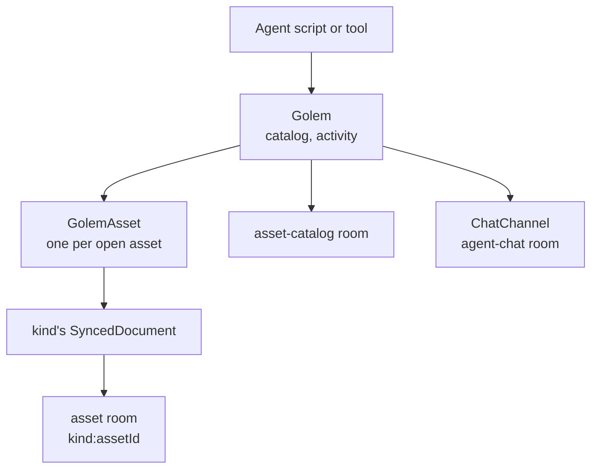
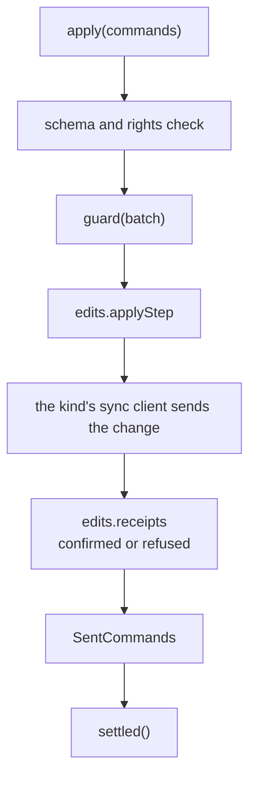

# Golem architecture

A golem is a Node client of the studio's `/ws-sync` socket. It reuses the network client, the catalog client and each kind's synced document, the same pieces an editor runs in the browser.

- `Golem` owns the connection and the open assets; opening an asset twice returns the same one. Each `GolemAsset` joins its room when built and leaves it on `close`.
- `OpenAssets` keeps who holds each open asset: the caller of `open`, and each asset that opened it through `AssetOpening.open`, as a voxel map opens its blocksets. `golem.close` and a holder's `close` drop a holder; the asset closes with its last one.
- `ChatChannel` wraps the server's `AgentChatClient`; it keeps people's messages until `next` takes them. `ActivityMirror` publishes `Golem.activity` on the asset's room and, with the asset id, through `AgentChatClient.publishActivity`.
- Code: `src/peer/`, `src/assets/kinds.ts`, `src/chat/`.

## One batch

- The golem never sends on the room itself: applying a command to the document makes the sync client send it, as an editor's edit does.
- `SentCommands` maps each change `applyStep` returned to the command sent, so a refusal reports the command. A `denied` from the room or a revoked token fails them all, and rejects `ready` if the document is still loading.
- `Golem` aborts one signal when the studio refuses the token. The catalog wait and every open asset listen to it.
- Code: `src/assets/GolemAsset.ts`, `src/assets/SentCommands.ts`.

## Kinds

Each kind is a `GolemAsset` subclass built over the kind's `EditableDocumentKind`: focus, and intent methods that build raw commands and send them through `apply`, such as `SceneAsset.addActors`. Intent methods split long command lists with `applyInBatches`, and take names where an editor shows names: `resolveEntry` takes an id, or a name only one actor, node or material has, and fails with `UnknownEntryError`. `SceneRefs` also resolves asset slots through `AssetOpening.catalog`. `src/assets/kinds.ts` maps kind names to their editable kind and class, so the MCP server reads a kind's `commandSchema` without opening an asset.

- Each asset package exports the editable kind next to its document kind: `sceneEditableKind`, `textEditableKind(kind)`, `voxelMapEditableKind`, `blocksetEditableKind`, `voxelModelEditableKind`, `pixelArtEditableKind`. It adds the header-less `commandSchema`, the room `commandProtocol`, whose `events` are the actions a `denied` names, and `localEdits(synced)`, the history `LocalEdits` that `apply` writes through. `SyncedBlockset` is its own `LocalEdits`: pixel commands go to `pixelEdits(pixels)`, the others to its sync client, which answers them through `CommandSync.sendChange` with its own receipts.
- `SyncedScript`'s sync client merges pending edits into one network command and answers each merged step from that command's receipt.
- One `TextAsset` class serves `script`, `shader` and `text`; the table passes the kind.
- `SyncedVoxelMap.applyStep` runs the document's `applyCommand` and returns the change `VoxelEdits.captureLocal` saw. The map's `loaded()` hook, which `ready` waits for, has `MapBlocksets` open the linked blockset assets through `AssetOpening.open` and link them with `BlocksetAsset.link`. Writes and `summary()` link again first, so a blockset added, closed, or pointed at another asset or slot since is picked up.
- `SceneAsset.guard` checks added components against the `SceneComponentTypes` that `ProjectManifest.sceneComponents()` builds from the `project-manifest.json` that `Golem.connect` reads: editors declare their component types and slot kinds there, since the definitions only load in a browser.
- A kind whose editor has locks overrides `guard(batch)`, which `apply` calls before applying the batch. `VoxelModelAsset` calls `assertModelUnlocked`, which asks `holdsModelLock` from `@jolly-pixel/asset.voxel-model` whether a peer's presence locks one of the conflict refs in the batch's `modelFootprint`.
- A pixel-art texture uses the editor's own `SyncedPixelDocument`: `PixelDocument` creates its canvas only when asked, so it runs in Node. Its schema is `pixelEditCommandSchema`: every document variant of each command, without the packed wire variants and `texture-replaced`.
- A blockset uses the editor's `SyncedBlockset`, whose texture is a `PixelDocument` too. `PixelSurface` paints and reads both kinds' textures through the asset's `applyInBatches`.
- `VoxelModelAsset.addBlocks` opens the model's texture (`linkedTextureId`) through `AssetOpening.open` and lays the nets out with `BlockUvLayouts.place`, which also returns the texture size they fit in. It runs `guard` on the new blocks before resizing the texture, so a locked model leaves the texture as it was.
- Code: `src/assets/scene/`, `src/assets/text/`, `src/assets/voxelMap/`, `src/assets/voxelModel/`, `src/assets/pixelArt/`.

## MCP server

`GolemMcpServer` resolves the URL and token when it is built, then registers each tool group on an `McpServer` and shares one `GolemSession`. The session connects a `Golem` on the first tool call and forgets a failed attempt so the next call retries. Tools hold no domain logic: they call the SDK and turn its answers into JSON results. Thrown errors become error results through the MCP SDK.

- Tool schemas use classic `zod`: the MCP SDK needs `~standard.jsonSchema`, which `zod/mini` lacks. Kind command schemas stay `zod/mini` and go out through `z.toJSONSchema`.
- `Golem.connect` gives the network client a `consoleLogger` on stderr: stdout carries the MCP protocol.
- `WorkspaceDocs` indexes the checkout's `@jolly-pixel/*` workspaces that have a `docs/` folder once, on first use.
- `ScriptRunner` backs `script_run`: it spawns Node on a script under `local/` with the server's URL and token in the child's environment. The token only reaches the MCP server's process, so an agent can script as the golem without holding it.
- Code: `src/mcp/`, `src/bin/jolly-golem.ts`.
