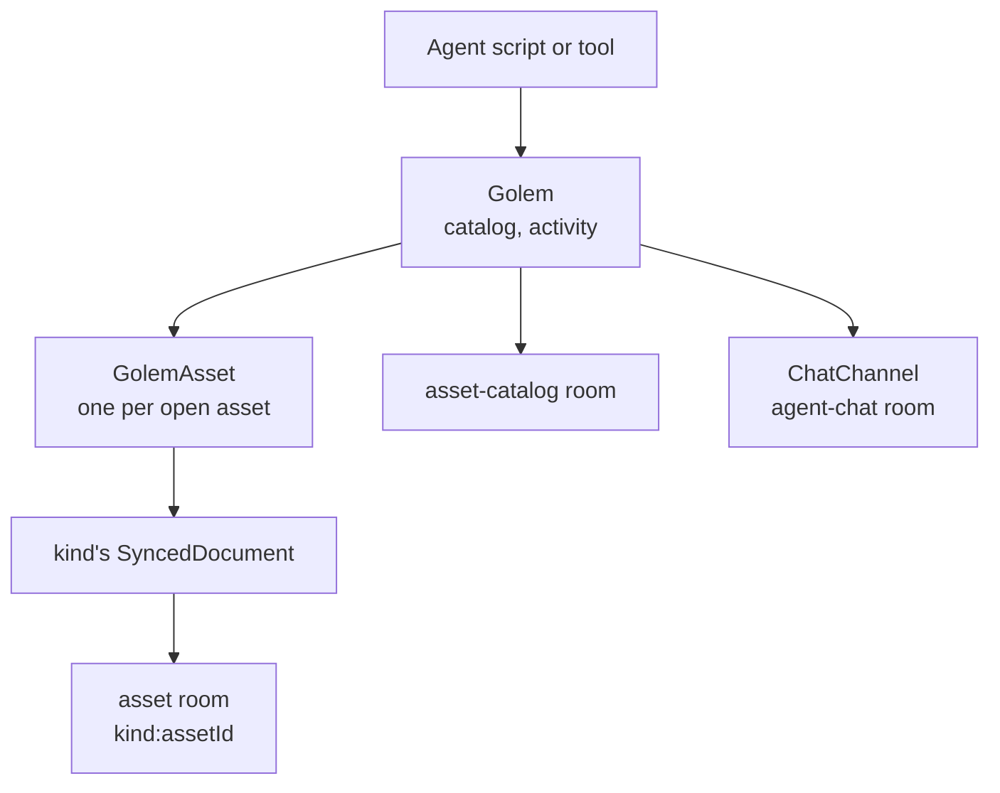
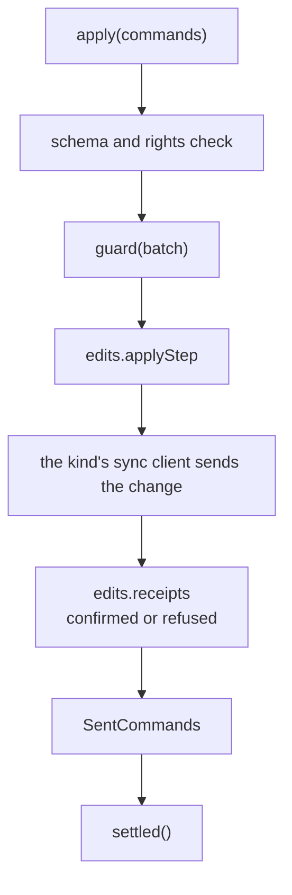
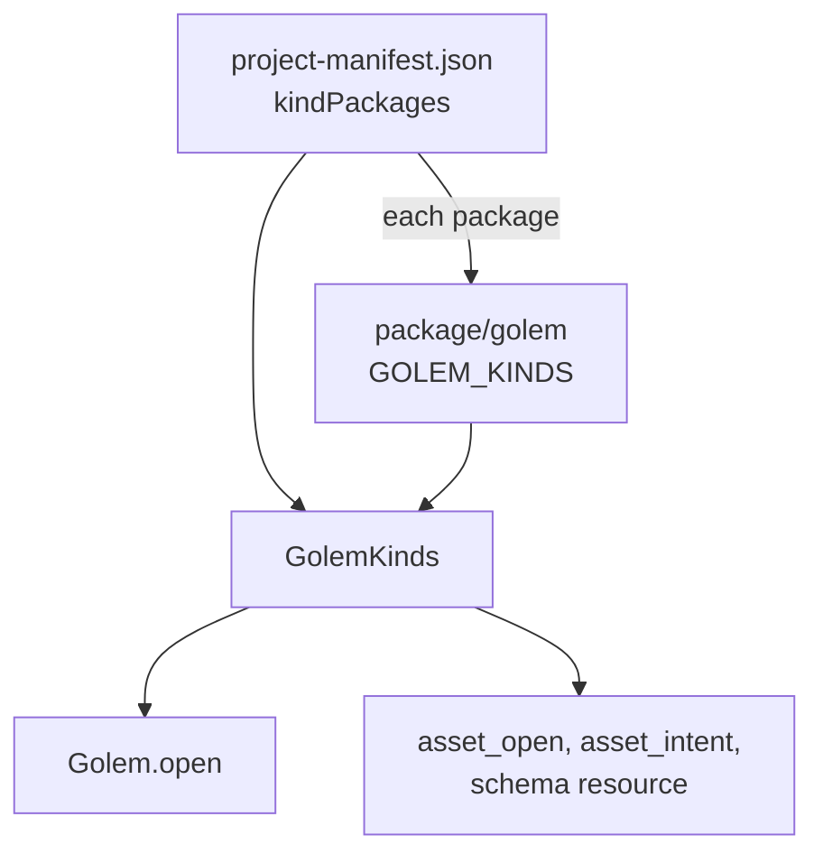

# Golem architecture

A golem is a Node client of the studio's `/ws-sync` socket. It reuses the network client, the catalog client and each kind's synced document, the same pieces an editor runs in the browser.

- `Golem` owns the connection and the open assets; opening an asset twice returns the same one. Each `GolemAsset` joins its room when built and leaves it on `close`.
- `OpenAssets` keeps who holds each open asset: the caller of `open`, and each asset that opened it through `AssetStudio.open`, as a voxel map opens its blocksets. `golem.close` and a holder's `close` drop a holder; the asset closes with its last one.
- `ChatChannel` wraps the server's `AgentChatClient`; it keeps people's messages until `next` takes them. `ActivityMirror` publishes `Golem.activity` on the asset's room and, with the asset id, through `AgentChatClient.publishActivity`.
- Code: `src/peer/`, `src/kinds/GolemKinds.ts`, `src/chat/`.

## One batch

- The golem never sends on the room itself: applying a command to the document makes the sync client send it, as an editor's edit does.
- `SentCommands` maps each change `applyStep` returned to the command sent, so a refusal reports the command. A `denied` from the room or a revoked token fails them all, and rejects `ready` if the document is still loading.
- `Golem` aborts one signal when the studio refuses the token. The catalog wait and every open asset listen to it.
- Code: `GolemAsset` and `SentCommands` in `@jolly-pixel/golem.kit`.

## Kinds

The golem knows no kind. Each asset package that supports golems has a `golem` entry (`src/golem/`) exporting `GOLEM_KINDS`: one `GolemKindContribution` per kind, built with `golemKind(editableKind, Asset, { intents, guide })` from `@jolly-pixel/golem.kit`. The asset class extends the kit's `GolemAsset` with focus and methods that build raw commands and send them through `apply`, such as `SceneAsset.addActors`.

- `GolemKinds.load` locates every kind package the manifest lists with asset-server's `PackageResolver` (`projectRoot`, then the golem's dependencies, then the checkout's `packages/assets/`), reads its `jollypixel.golem` export subpath through `findProjectContributions`, as the studio does for its other contributions, and imports the packages in parallel. A local package such as `./kinds/foo` works the same way. A package without `jollypixel.golem` adds nothing; one that fails to load records the error, which `UnsupportedKindError` carries as its cause when one of its kinds is opened.
- The kit holds what kinds share: `GolemAsset`, `AssetOpening`, `golemKind`, `golemIntent`, `resolveEntry` and the errors kinds throw (`UnknownEntryError`, `UnknownAssetError`, `KindMismatchError`, `LockedByPeerError`). It has no `@jolly-pixel/server` dependency: the server depends on `asset.voxel-map`, which would close a project-reference cycle.
- A package adds its kinds to the kit's `GolemAssets` interface in its `golem` entry, so `golem.open(id, kind)` is typed once the entry is imported. Without it, `open` returns a `GolemAsset`.
- `GolemAsset` keeps the room, the abort signal and `onClose` from its `AssetOpening` to itself. A subclass sees only `synced` and `studio` (`AssetStudio`): the catalog, the manifest's kind packages as `unknown[]` (a kind parses the fields it reads, as the scene parses `sceneComponents`) and `open`. A kind that needs another asset opens it through `studio.open`, such as a voxel map its blocksets; `OpenAssets` keeps it open while a holder needs it.
- An intent is a named operation with a description, an input schema and `run(asset, input)`. `golemIntent` parses the input before `run`, so a bad input fails with `IntentInputError` before any command is sent. Each first-party intent passes its input to the asset method of the same name, whose parameter is the schema's output type, and answers what the method returns.
- The kit's `testing` entry builds openings without a server: `TestStudio` hosts each asset in a `LiveAssetRoom` and hands the golem a `TestRoom`. Each asset package tests its kind with it, in its `test/golem/`. The golem tests discovery, holders, MCP and the bridge against a real studio, so the asset packages are its dev dependencies only.
- `asset_open` reads a kind's guide, a URL next to the built entry, only when an agent opens an asset of that kind.
- Code: `src/kinds/GolemKinds.ts`; each kind in its asset package's `src/golem/`, described in that package's `docs/Golem.md`.

## MCP server

`GolemMcpServer` resolves the URL and token when it is built, then registers each tool group on an `McpServer` and shares one `GolemSession`. The session connects a `Golem` on the first tool call and forgets a failed attempt so the next call retries. Tools hold no domain logic: they call the SDK and turn its answers into JSON results. Thrown errors become error results through the MCP SDK.

- Tool schemas use classic `zod`: the MCP SDK needs `~standard.jsonSchema`, which `zod/mini` lacks. Kind command schemas and intent inputs stay `zod/mini` and go out through `z.toJSONSchema`.
- No tool is tied to a kind: `asset_open` lists a kind's intents and guide, and `asset_intent` runs one, then waits for `settled()`. Tool registration does not depend on which kinds the studio has, and a new kind adds no tool to the agent's context.
- The schema resource and its listing connect first, since only the studio's kind packages know the schemas.
- `Golem.connect` gives the network client a `consoleLogger` on stderr: stdout carries the MCP protocol.
- `WorkspaceDocs` indexes the checkout's `@jolly-pixel/*` workspaces that have a `docs/` folder once, on first use.
- `ScriptRunner` backs `script_run`: it spawns Node on a script under `local/` with the server's URL, token and project root in the child's environment. The token only reaches the MCP server's process, so an agent can script as the golem without holding it.
- Code: `src/mcp/`, `src/bin/jolly-golem.ts`.

## Bridge

`GolemBridge` is a second peer on the token, next to the MCP server's golem. It joins only `agent-chat`, with `AgentChatClient.connect` over the same `studioClient` as `Golem.connect`.

- `GolemBridge` follows the owner: a `said` from them (`peerId` equal to the agent profile's `ownerId`) is queued and one turn runs at a time; their `answered` and `cancelled` reach the relay.
- `AgentSession` is the ACP client (`@agentclientprotocol/sdk`): `initialize`, `session/new`, `session/prompt` and `session/cancel`. It exists only once its session does.
- `ChatRelay` answers the agent's callbacks. `ReplyBuffer` gathers `agent_message_chunk` text and posts it when a tool call starts or the turn ends. `session/request_permission` goes through `GolemToolCalls`, which remembers each tool call's MCP server from its `rawInput` (codex-acp announces it only there) and reads claude-agent-acp's `_meta`. A golem call gets `allow_once`; any other waits in `BridgePermissions` until the owner answers, Stop, or ACP cancels the request.
- The bridge's state lives in presence, so the server keeps nothing: every change republishes `{ turn, tool?, permissions }`. `BridgePermissions` keeps it within `agentBridgeStateSchema`, which `publishBridge` checks. Permission options go out as their index, which keeps the agent's option ids off the wire.
- `AgentProcess` spawns the agent through the shell (so `npx` works on Windows) and hands its stdio to `ndJsonStream` with `Writable.toWeb` and `Readable.toWeb`.
- Code: `src/bridge/`, `src/bin/runBridge.ts`.
