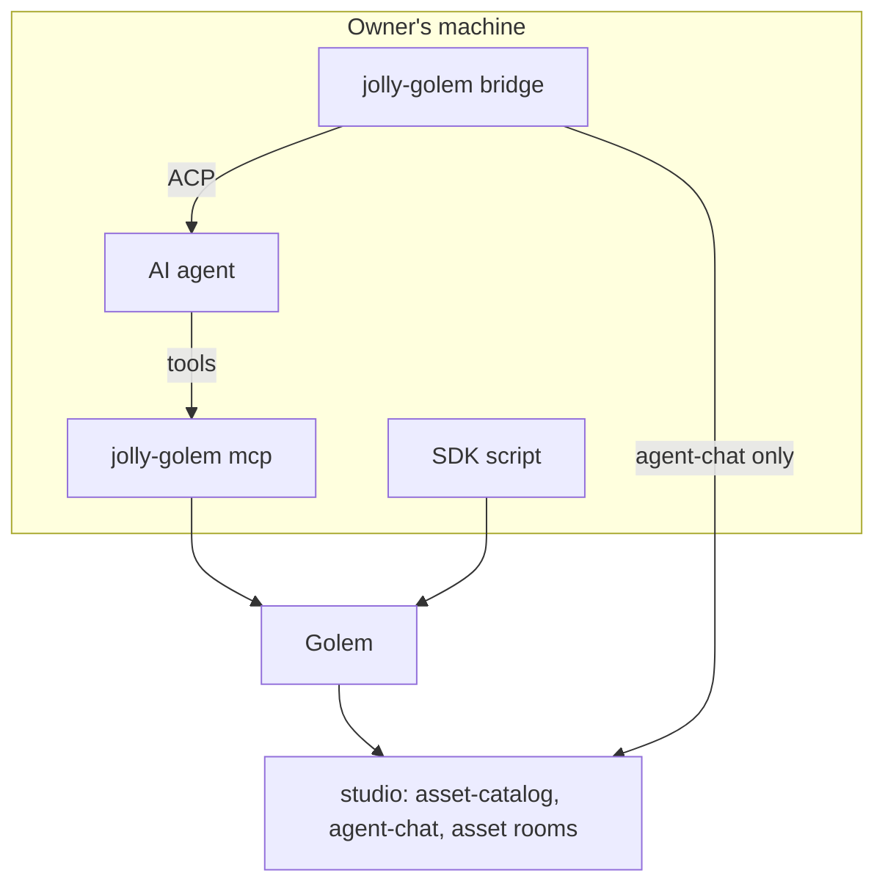
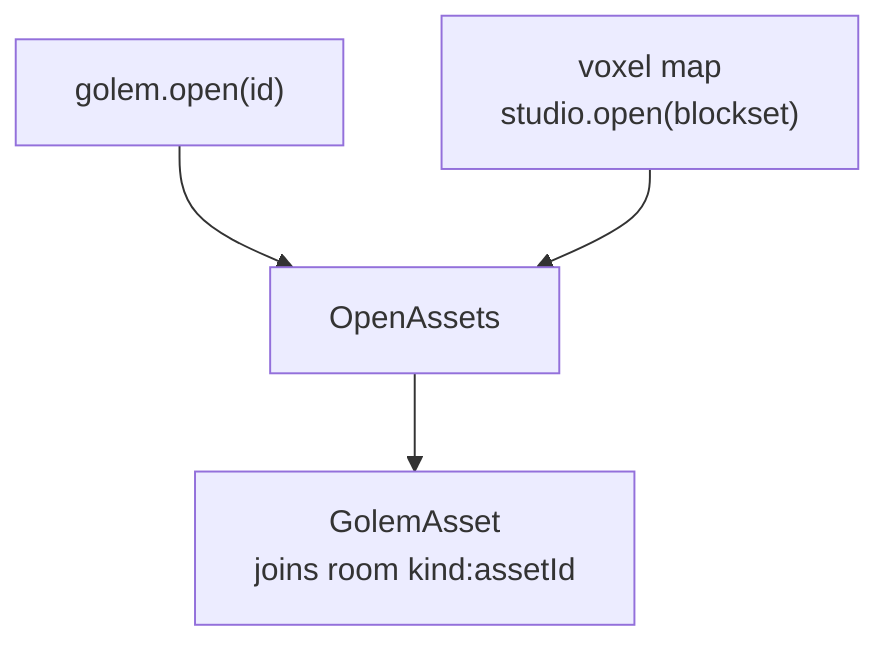
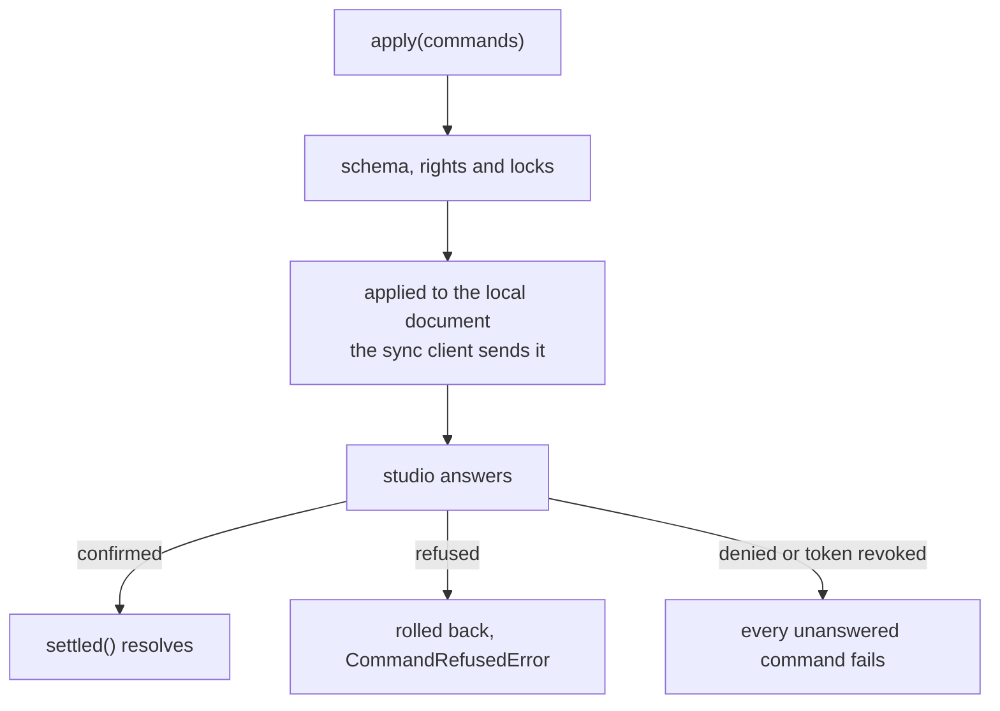
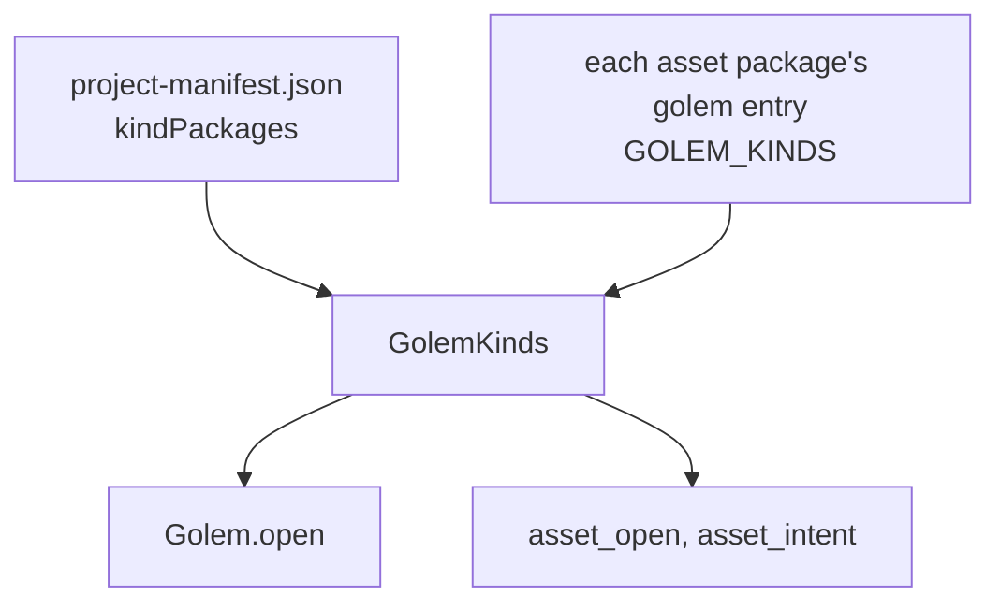
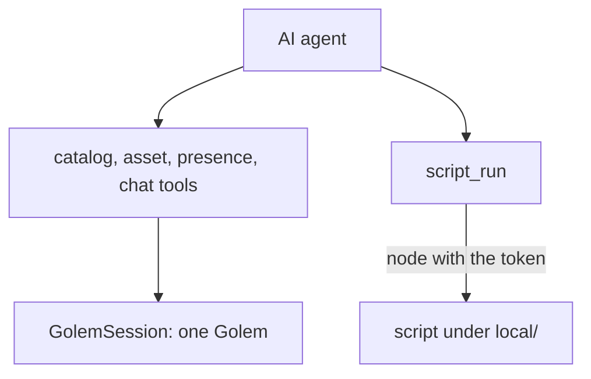
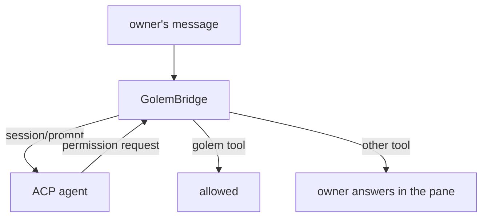

# Golem architecture

A golem is a Node peer of the studio's `/ws-sync` socket. It acts with its token owner's role, through the same rooms and commands as an editor. Terms are defined in the [glossary](./GLOSSARY.md).

## Three ways in, one peer

- The golem reuses the browser's network client, catalog client and each kind's synced document.
- Code: `src/peer/`, `src/chat/`.

## Assets stay open while someone holds them

- Opening an asset twice returns the same one. It leaves its room when its last holder closes it.

## A batch and its answers

- The golem never sends on a room itself: it edits the document, as an editor does.
- Code: `GolemAsset` and `SentCommands` in `@jolly-pixel/golem.kit`.

## Kinds come from asset packages

- The golem knows no kind. A package builds each kind with `golemKind(editableKind, Asset, { intents, guide })` from `@jolly-pixel/golem.kit`.
- Code: `src/kinds/`; each kind in its asset package's `src/golem/`.

## MCP tools stay kind-neutral

- A new kind adds no tool: `asset_open` lists its intents and guide, and `asset_intent` runs one.
- The token stays in the server's process, so the agent scripts as the golem without holding it.
- Code: `src/mcp/`, `src/bin/jolly-golem.ts`.

## The bridge turns the chat into prompts

- A second peer on the token, next to the MCP server's golem. It runs one turn at a time.
- Its state lives in presence, so the server keeps nothing.
- Code: `src/bridge/`, `src/bin/runBridge.ts`.

API: [Golem](./docs/Golem.md), [GolemAsset](./docs/GolemAsset.md), [ChatChannel](./docs/ChatChannel.md), [MCP server](./docs/Mcp.md), [Bridge](./docs/Bridge.md).
