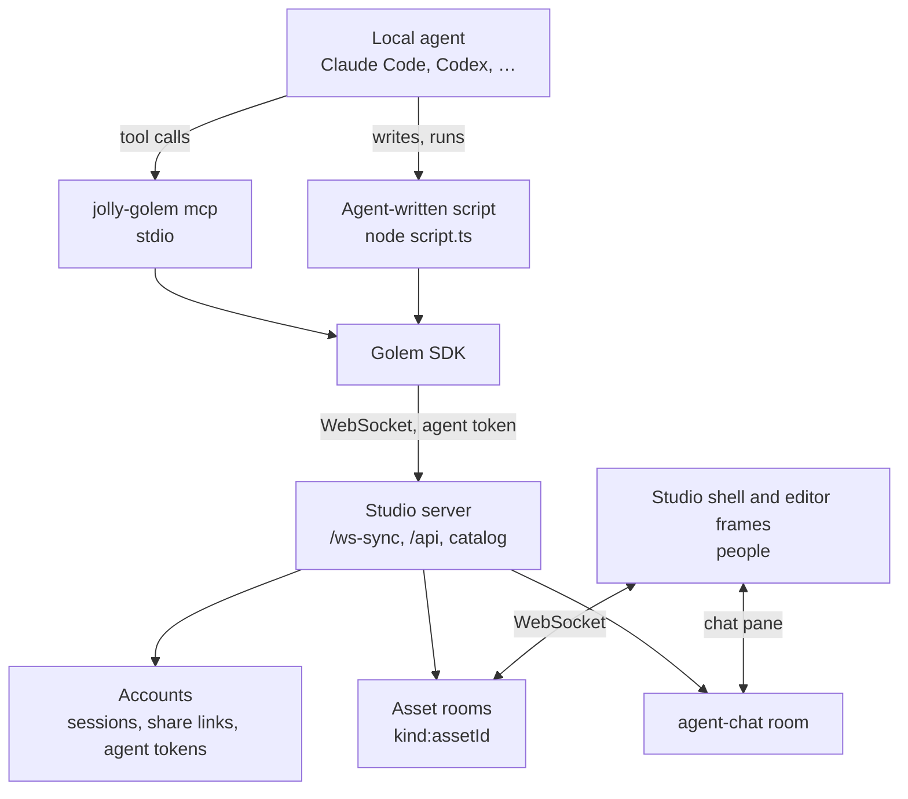
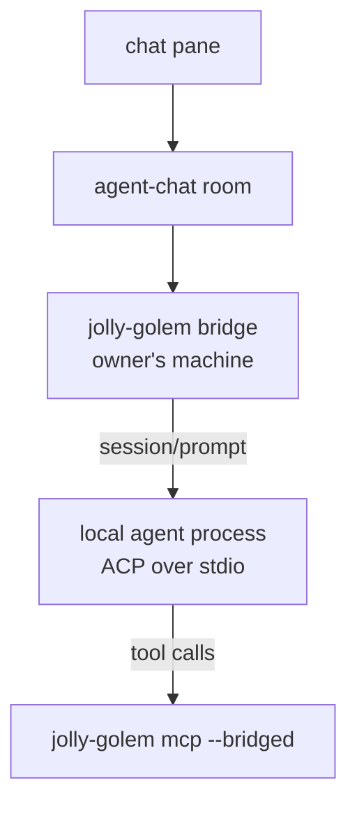

# @jolly-pixel/golem — SPEC

Status: 2026-11-12. Imported from issue #866 (2026-10-03) and updated to the
workspace on branch `golem`. `PLAN.md` holds the work and what is built.

An external AI agent joins a running studio the way a person does: it opens
assets, shows up in the peer lists with a name and a color, publishes
presence, and sends the same commands an editor sends. People watching the
editor see the agent work in real time. JollyPixel ships no model. The agent
runs locally (Claude Code, Codex, Cursor, Claude Desktop, …) and reaches the
studio through this package.

## Naming

Golem is the package's name: the workspace, the SDK class, the CLI and the
console command. The protocol keeps the generic word `agent`: the agent
token, the peer subject and the `agent-chat` room. Another agent integration
can reuse those without being a golem.

| Golem | Agent |
|---|---|
| `@jolly-pixel/golem`, `Golem` | agent token, subject `agent:<tokenId>` |
| `jolly-golem` CLI, `JOLLY_GOLEM_TOKEN` | profile badge `via golem` |
| `/golem` command, golem chat pane | `agent-chat` room, `AgentChatExtension` |

A golem connects as "Golem" unless its token was given another name.

## Goals

- An agent connects to a studio from Node with no browser.
- Agent edits travel through the existing asset rooms, are validated by the
  existing kind protocols, and land in the event log attributed to the agent.
- People can tell an agent from a person, and an agent can never do more than
  the person who created its token.
- One package teaches an agent the platform: tools for small edits, an SDK and
  a skill for scripted, procedural work.
- An on-demand pane in the studio shows the agent's messages and activity and
  lets a person write to it.

## Non-goals

- Shipping, hosting or proxying a model.
- Rendering in Node. Agents read document data and the previews the studio
  already renders, not pixels of the 3D view.
- Undo for the agent, and the agent's edits in a person's undo stack. A bad
  run is rolled back by restoring a catalog tag.
- Reaching the offline in-page back-end (`?offline`, shared-tab workspaces).
  It lives in a browser tab and has no socket.
- The chat pane in standalone editors. It lives in the studio shell.
- The shell following an agent, opening the tab it focuses on.
- Chat history that survives a studio restart.

## Decisions

| Topic | Decision |
|---|---|
| Integration | Node SDK at the core, a stdio MCP server over it (`@modelcontextprotocol/server`), a skill and `llms.txt` that teach scripting against the SDK |
| Identity | agent token owned by an account, checked by `Accounts`; subject `agent:<tokenId>`, badge `via golem` |
| Rights | the owner's current role; no agent role |
| Tokens | created and revoked on the "Agents" Settings page; stored as a digest; no expiry; a revoked token's record stays so the audit can name it |
| Discovery | `--url` or `JOLLY_STUDIO_URL` |
| Distribution | private workspace run from a checkout; published to npm later |
| First kind | `scene`, then `script` / `shader` / `text`, then `voxelmap` + `blockset` |
| Rollback | catalog tags, no undo |
| Chat pane | studio shell; chat and activity feed over a shared room, the agent is driven from its own terminal. Phase 2: `jolly-golem bridge` runs a local agent so the pane drives it |
| Opening the pane | the `/golem` console command, no keybinding |
| Chat history | in memory, per studio process |
| Activity | published on the asset room and mirrored on `agent-chat` |
| Vision | data reads and `catalog:preview` images |

## Big picture



Everything an agent does goes through `Golem`. The MCP server is a thin
adapter and adds no domain logic.

## What already exists

| Need | Existing piece |
|---|---|
| Node client | `network.Client` + `connectWebSocket({ url, credential })` from `@jolly-pixel/network/client`; `packages/e2e/src/editor/catalog.ts` already does it |
| Credential check | `Accounts.authenticate` reads the handshake credential as a share link token today |
| Rights | `StudioAccess` builds a `RightsTable` from the project file's `access` roles |
| Asset discovery | `CatalogClient.connect(client)` on the `asset-catalog` room |
| Room per asset | `"<kind>:<assetId>"` |
| Headless documents | every kind's `<kind>DocumentKind().syncDocument(room)` returns a `SyncedDocument` (`ready`, `document`, `pendingChanges`); the scene, voxel-map and script client entries import in Node |
| Command schemas | zod schemas per kind (`SceneCommand.schema.ts`, …), turned into JSON Schema with `z.toJSONSchema` |
| Server validation | every inbound message is checked against the kind's `MessageProtocol`, then arbitrated |
| Previews | `catalog:preview` returns `{ type, bytes }` |
| Rollback | `catalog:tag`, `catalog:restore` |
| Badge | `PeerProfile.via`, rendered as "via …" by `@jolly-pixel/ui` |
| Event log actor | `toActor` maps a peer to `{ type: "user", id: subject }` |
| Settings page to copy | "Share links": `ShareLinksClient`, `ShareLinkList`, `/api/shares/` |
| Console | studio shell console; root commands supported |
| Notifications | `jolly-notifications` in the studio shell |

## Workspace layout

Private workspace `packages/golem`, name `@jolly-pixel/golem`, Node only.

| Path | Holds |
|---|---|
| `src/peer/` | `Golem`, connection, discovery, activity |
| `src/assets/` | the kind table, `GolemAsset`, per-kind focus, lock reading and intent helpers |
| `src/chat/` | `ChatChannel` client for the `agent-chat` room |
| `src/mcp/` | MCP server, one file per tool group |
| `src/bin/jolly-golem.ts` | CLI: `mcp`, `status` |
| `skill/` | `SKILL.md` and script examples |
| `docs/` | API docs for the SDK |

Exports: `.` (SDK), `./mcp`. The server side (agent tokens, token routes,
`agent-chat`) lives in `@jolly-pixel/accounts` and `@jolly-pixel/server`, and
the pane in `@jolly-pixel/studio`, so neither depends on golem.

## 1. Golem SDK

### Connecting

```ts
const golem = await Golem.connect({
  url: "http://localhost:5173",
  token: process.env.JOLLY_GOLEM_TOKEN
});
```

1. `url` falls back to `JOLLY_STUDIO_URL`, `token` to `JOLLY_GOLEM_TOKEN`.
2. Open `network.Client` with `connectWebSocket({ url, credential: token })`.
   The server sets the profile (name, `peerId`, badge) from the token, so
   every connection made with one token shows the same name and color.
3. Connect the `CatalogClient` and wait for the first snapshot.

`golem.catalog` exposes the `CatalogClient`.

### Opening an asset

```ts
const scene = await golem.open(assetId);
```

`open` reads the record's kind from the catalog, joins `"<kind>:<assetId>"`,
calls the kind's `syncDocument(room)` and waits for `ready`. It returns a
`GolemAsset` over the `SyncedDocument`. A kind the SDK has no client for
throws with the list of supported kinds.

| Kind | Document kind | Notes |
|---|---|---|
| `scene` | `sceneDocumentKind()` | first kind |
| `script`, `shader`, `text` | `textDocumentKind()` | text replace and range edits |
| `voxelmap` | `voxelMapDocumentKind()` | also opens its blocksets: block ids mean nothing without them |
| `blockset` | `SyncedBlockset` | blocks, material and blend groups; its texture is painted like a `pixelart` |
| `voxelmodel` | `voxelModelDocumentKind()` | transform and field locks; new blocks get free space on its texture, which grows when full |
| `pixelart` | `pixelArtDocumentKind()` | `PixelDocument` creates its `<canvas>` only when asked; commands JSON can carry |

### Editing

`await asset.apply(commands)` sends raw kind commands, checked locally against
the kind's schema and the owner's rights first. The SDK adds the command header.

```ts
await scene.apply([
  { action: "actor-renamed", id: actorId, name: "Player" },
  { action: "actor-transformed", id: actorId, transform: { position: { x: 0, y: 1, z: 0 } } }
]);
await scene.settled();
```

Per-kind intent helpers, named after what a person does, come on top as
agents show which commands they struggle to write raw. Block and asset
arguments accept a name or an id; an ambiguous name throws with the
candidates.

The studio stores any scene component `type`. Editors declare their
components and asset slots in their `jollypixel` manifest, the studio serves
them in `project-manifest.json`, and the scene asset refuses an unknown type,
an unknown slot or an asset of the wrong kind before sending.

### Waiting for the server

`await asset.settled()` resolves when every sent command is acknowledged.
A refused or denied command rejects it, so a tool call reports the failure
instead of reporting success. The wire carries no reason for an arbitration
refusal, so the error names the refused commands; a denial carries the
server's reason.

### Rollback

`golem.catalog.tag(assetId, name)` and `golem.catalog.restore(assetId, tag)`
send `catalog:tag` and `catalog:restore`. An agent tags an asset before a scripted
or bulk edit, and restores the tag when the run goes wrong. People cannot undo
agent edits with Ctrl+Z, the same as edits from another person.

### Presence

| Key | Value | Shown by |
|---|---|---|
| `actor` | the last actor the batch touched | scene editor selection marks |
| `frustum` | camera pose aimed at the region being edited | voxel-map, voxel-model peer frustums |
| `brush` | position and size of the current edit | voxel-map peer brushes |
| `cursor` | last pixel touched | pixel-art |
| `activity` | `{ label, progress? }`, e.g. "Placing 12 trees"; `PEER_ACTIVITY_KEY` in `@jolly-pixel/network` | peer tooltip, chat pane |

Each kind publishes the focus its editor already shows: the scene asset sets
its selection to the last actor the batch touched. `golem.activity(asset, { label,
progress? })` publishes the same value in two places:

| Room | Value | Read by |
|---|---|---|
| the asset room | `{ label, progress? }` | people in that editor |
| `agent-chat` | `activity`: `{ label, progress?, assetId }` | the chat pane, which lists every agent's work across assets |

`golem.activity(null)` clears both. Closing an asset clears its room's value
and the mirror when it points at that asset. Asset classes publish focus
for each batch on their own; tools and scripts call `activity` to describe
longer work.

### Locks

Locks are presence values and the server does not enforce them. For kinds
that have them (voxel model `transformLock`, `RoomFieldLocks`, …), the asset
reads the peers' lock keys before editing and throws `LockedByPeerError`
naming the peer. The agent is expected to wait or ask in chat. The scene
editor has no locks.

### Reads

| Method | Returns |
|---|---|
| `asset.read()` | the document as JSON; MCP tools cap it |
| `scene.tree` | actors, transforms, components |
| `text.read(range?)` | source text |
| `map.summary()`, `map.query(box)`, `map.heightmap(layer?, box)` | layers, bounds, counts; cells in a box; top-down heights |
| `golem.catalog.preview(assetId)` | the catalog preview image, when the kind has one |

## 2. MCP server

`jolly-golem mcp --url <studio> [--token <token>]` runs a stdio MCP server
with one `Golem`. Registration for Claude Code, as the Agents page prints it:

```sh
claude mcp add jollypixel --env JOLLY_GOLEM_TOKEN=<token> -- node <checkout>/packages/golem/dist/bin/jolly-golem.js mcp --url <studio url>
```

### Tools

Tools take and return compact JSON. Large reads are capped and say so.

| Group | Tools |
|---|---|
| studio | `studio_status` (URL, peers, open assets) |
| catalog | `catalog_list`, `catalog_create`, `catalog_rename`, `catalog_preview` (image content), `catalog_tag`, `catalog_restore` |
| asset | `asset_open`, `asset_close`, `asset_read`, `asset_apply` |
| presence | `presence_activity` |
| chat | `chat_say`, `chat_next` |
| per kind | intent tools added with each kind (`scene_add_actor`, `voxelmap_fill_box`, …) |

`chat_next({ timeoutMs })` blocks until a person writes in the chat pane or
the timeout passes. It is how a terminal-driven agent hears people in v1.

A tool the agent's role may not use returns the `denied` reason as an error,
not an exception.

### Resources

| URI | Content |
|---|---|
| `jollypixel://guide` | the skill text |
| `jollypixel://schemas/<kind>` | the kind's command JSON Schema |
| `jollypixel://docs/<package>/<path>` | package docs Markdown |

The server's `instructions` field states the rules from the skill in a few
lines: open before editing, batch, tag before bulk edits, check locks,
`settled` before claiming success, scripts for anything procedural.

## 3. Skill and docs

`skill/SKILL.md` teaches:

- connecting, discovering, opening, and the room and command model;
- when to call tools (a few edits, reads) and when to write a script (level
  layout, noise, repeated patterns, anything over a few hundred commands);
- a script template that imports `@jolly-pixel/golem`, tags the asset, edits
  in batches and awaits `settled()`;
- scenes, components and asset references; later block ids, blocksets and
  layers;
- etiquette: announce work in chat, publish `activity`, respect locks.

A script reads the same `JOLLY_GOLEM_TOKEN`, so it shows with the agent's
name and color.

`llms.txt` at the docs site root is generated from the VitePress package list:
one line per page with a link, grouped by package, plus an `llms-full.txt`
with every listed page inlined.

## Server and studio changes

### Agent tokens

`AgentTokens` in `@jolly-pixel/accounts`, next to `ShareLinks`:

- `create({ owner, name })` returns the token value once; the database keeps
  a digest, as sessions do. Tokens never expire.
- `Accounts.authenticate` reads a credential as a share link first, then as an
  agent token. A token returns `{ subject: "agent:<tokenId>", role: <owner's
  current role>, profile: { username: name, peerId: tokenId, avatar: null,
  via: "golem" } }`.
- Revoking a token, or removing or demoting its owner, revokes the subject
  through `watchRevocations`. The agent reconnects with the new role, or is
  refused.

`@jolly-pixel/server` serves `/api/golem/tokens` (create, list own, revoke
own) from `src/golem/api.ts` and `src/node/golem/routes.ts`.

### Agents Settings page

A page next to "Share links" in the studio Settings, built like it: the
account's tokens with name, creation date and a revoke button, and a "New
token" action. A new token is shown once with the setup line; the studio
fills `<checkout>` when it runs from this repository.

### Event log

The actor stays `{ type: "user", id: "agent:<tokenId>" }`. Readers tell an
agent from a person by the subject prefix, as they do for `share:`. The
audit shows it as kind `agent`, named "<token name> (<owner>)".

### `agent-chat` room

`AgentChatExtension` in `@jolly-pixel/server`, registered as a static room:

| Message | Direction | Carries |
|---|---|---|
| `say` | client → server | `text`, optional `assetId` |
| `said` | server → clients | `id`, `clientId`, `peerId?`, `username`, `via?`, `text`, `assetId?`, `at` |
| `history` | server → joiner | last 200 `said` |

The server names the author from the connection's profile; `peerId` lets the
pane color an author who already left. History is in memory, one per studio
process, and is lost on restart. Presence on the room carries the `activity`
mirror. Rights follow the role: a spectator reads the room and cannot `say`,
and share-link guests cannot join it. `AgentChatClient` in
`@jolly-pixel/server/client` is the client both golem and the pane use.

## Chat pane

The golem chat pane lives in the studio shell, which owns the console while
an editor frame is open.

- Hidden by default; closing it hides it.
- Opened from the console only, with no keybinding. `/golem` is a root command
  with one optional `rest` argument:

  | Input | Effect |
  |---|---|
  | `/golem` | shows the pane and focuses its prompt |
  | `/golem <message>` | shows the pane and sends `<message>` as `say` |

  The command sets `closeOnExecute`, so the console closes and the pane takes
  focus.
- Lists messages with the author's color and badge, the agents' current
  `activity`, and a prompt that sends `say`.
- A `said` from an agent while the pane is hidden raises a notification.
- With no agent in the room, the pane says so and points to the Agents page.

## Phase 2: the pane drives the agent

`jolly-golem bridge` runs the agent so the owner talks to it from the pane.
It runs on the owner's machine, not in the studio, so a hosted studio never
spawns processes:



- The bridge joins `agent-chat` with the owner's agent token. The agent
  profile names the owner, and only the owner's messages become prompts.
- Protocol: ACP (Agent Client Protocol). `session/new` attaches
  `jolly-golem mcp --bridged`, which has no `chat_next`. Adapters:
  `@agentclientprotocol/claude-agent-acp`, `@agentclientprotocol/codex-acp`.
- Replies come back as `said`, one per agent message; tool calls show as
  `activity`.
- Calls to the golem MCP server are allowed without asking. Other permission
  requests appear in the pane as buttons only the owner can answer.
- Stop, or `/golem stop`, sends `session/cancel`; pending requests are
  answered `cancelled`.
- The agent to run is a CLI argument (`claude`, `codex` or a command); the
  bridge never stores model keys.

## Security

- An agent token carries its owner's rights, so it is as sensitive as the
  owner's session. It is shown once, stored as a digest and revocable from the
  Agents page.
- Every agent edit is attributed to `agent:<tokenId>` in the event log, so
  it can be audited and rolled back.
- The WebSocket upgrade refuses a foreign browser `Origin` (`HandshakePolicy`
  in `@jolly-pixel/network`) and accepts none, as golem sends.
- A bridged agent can run commands on its owner's machine, so nobody but the
  owner prompts it or answers its permission requests.
- The SDK caps batch size and unanswered commands per asset so a runaway loop
  does not flood a room.

## Risks

- Agents are blind to the 3D view. Shape and placement mistakes only show
  through reads and previews.
- A scripted agent can write faster than rooms broadcast comfortably; command
  sizes and the server's per-room rate need measuring.
- Publishing later means either publishing the private `asset.*` client
  entries golem imports or bundling them into golem's `dist/`.
