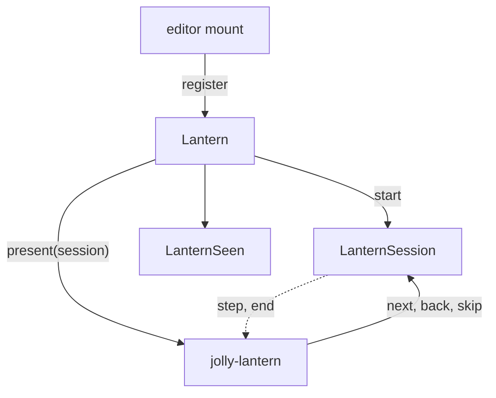

# Lantern architecture

Two entries:

- `@jolly-pixel/lantern`: `Tour`, `TargetPath`, `LanternSession`, `LanternSeen`, `Lantern`. No Lit.
- `@jolly-pixel/lantern/element`: the Lit `jolly-lantern` overlay.

The element imports the root, never the reverse, so tour declarations and the step machine run
under `node --test`.

- `tour/`: `Tour` parses `TourStepOptions` into frozen `TourStep`s with a `zod/mini` schema, whose
  issue path becomes `TourDefinitionError.field`; `parseBody` splits body text.
- `session/`: one promise chain orders `enter`, cleanups and calls made while `enter` is pending.
- `seen/`: the version per tour id, through a `StorageAdapter`.
- `element/`: `TargetTracker` resolves the target each frame, through a pane's `chromeElement`, and
  reads its corner radii; `spotlight` picks the padded or fitted hole and builds the `clip-path`.
- The hole is a `clip-path` with the `evenodd` rule because `clip-path` also clips hit testing.
  Passive steps add a transparent shield over the hole.
