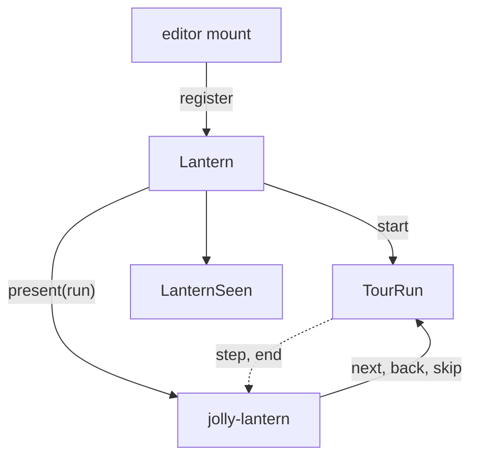

# Lantern architecture

Two entries:

- `@jolly-pixel/lantern`: `Tour`, `TargetPath`, `TourRun`, `LanternSeen`, `Lantern`. No Lit.
- `@jolly-pixel/lantern/element`: the Lit `jolly-lantern` overlay.

The element imports the root, never the reverse, so tour declarations and the step machine run
under `node --test`.

- `tour/`: `Tour` parses `TourStepOptions` into frozen `TourStep`s with a `zod/mini` schema, whose
  issue path becomes `TourDefinitionError.field`; `parseBody` splits body text. In `TourRun`, one
  promise chain orders `enter`, cleanups and calls made while `enter` is pending. `TargetSeek` holds
  one step's search for its target: the one-second wait, the single warning, the late find.
- `LanternSeen`: the version per tour id, through a `StorageAdapter`.
- `element/`: `TargetTracker` calls `run.seek` each animation frame and measures what it finds,
  through a pane's `chromeElement`. `spotlight/SpotlightPlacement` turns that frame into the hole
  and the card position and paints the scrim, ring and card; the element repaints only when the new
  placement differs from the last one. `StepInput` holds the keys and the `inputLayers` layer of a
  passive step.
- The hole is a `clip-path` with the `evenodd` rule because `clip-path` also clips hit testing.
  Passive steps add a transparent shield over the hole.
