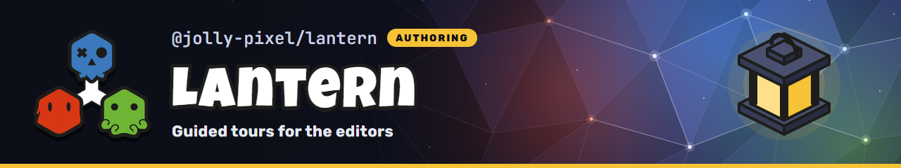

<p align="center">
  
</p>

## 💃 Getting Started

This package is available in the Node Package Repository and can be easily installed with [npm][npm] or [yarn][yarn].

```bash
$ npm i @jolly-pixel/lantern
# or
$ yarn add @jolly-pixel/lantern
```

## 👀 Usage example

A tour is a list of steps. Each step dims the page, cuts a spotlight around one part of the
interface and shows a card with Skip, Back and Next.

```ts
import { LocalStorageAdapter } from "@jolly-pixel/ui";
import { Lantern, Tour } from "@jolly-pixel/lantern";
import "@jolly-pixel/lantern/element";

const basics = new Tour({
  id: "voxel-map.basics",
  version: 1,
  title: "Voxel map basics",
  steps: [
    {
      id: "welcome",
      title: "Welcome",
      body: "This editor builds maps out of blocks.\n\nThe tour takes about a minute."
    },
    {
      id: "save",
      target: ["jolly-editor-toolbar", "[data-tour=save]"],
      title: "Save",
      body: "Click here to save the map. `Ctrl+K` opens every other command."
    }
  ]
});

const element = document.createElement("jolly-lantern");
document.querySelector("jolly-scope")!.append(element);

const lantern = new Lantern({
  storage: new LocalStorageAdapter(),
  present: (run) => {
    element.run = run;
  }
});
lantern.register(basics);
lantern.start(basics);
```

Inside an editor, `editor.host` creates the `Lantern` and the element; the editor only registers
its tours through `context.lantern`.

## 📚 API

### Headless

```ts
import "@jolly-pixel/lantern";
```

Declares tours, runs them and remembers which ones the user has seen. It draws nothing and does
not need Lit.

- [Tour](./docs/Tour.md): `Tour`, step options, `TargetPath` and the definition errors
- [TourRun](./docs/TourRun.md): the step machine behind a running tour
- [Lantern](./docs/Lantern.md): registering and starting tours, `LanternSeen`

### UI component

```ts
import "@jolly-pixel/lantern/element";
```

The `jolly-lantern` Lit element that draws a `TourRun` as a spotlight and a card. It needs the
optional `lit` and `@jolly-pixel/ui` peers.

- [jolly-lantern](./docs/element.md): the overlay, keys, focus and interactive steps

The `present` option of `Lantern` connects the two: it hands every new run to the element.

See [GLOSSARY.md](./GLOSSARY.md) for the terms used by the package.

## License

MIT

[npm]: https://docs.npmjs.com/getting-started/what-is-npm
[yarn]: https://yarnpkg.com
