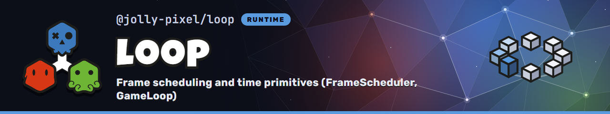

<p align="center">
  
</p>

## 💃 Getting Started

This package is available in the Node Package Repository and can be easily installed with [npm][npm] or [yarn][yarn].

```bash
$ npm i @jolly-pixel/loop
# or
$ yarn add @jolly-pixel/loop
```

## 👀 Usage example

```ts
import { GameLoop } from "@jolly-pixel/loop";

const loop = new GameLoop({
  fixedFps: 60,
  maxFps: 144
});

loop.on("panic", ({ droppedMs }) => {
  console.warn(`the frame overran its budget, dropped ${droppedMs}ms`);
});

loop.start({
  fixedUpdate: (fixedDeltaMs, stepIndex) => {
    world.step(
      fixedDeltaMs / 1000,
      stepIndex
    );
  },
  update: (renderDeltaMs, alpha) => {
    renderer.draw(alpha);
  }
});
```

for a host with its own frame pump:

```ts
import { FrameScheduler } from "@jolly-pixel/loop";

const scheduler = new FrameScheduler({
  fixedFps: 60
});

function tick(
  now: number
) {
  const schedule = scheduler.advance(now);

  for (let stepIndex = 0; stepIndex < schedule.steps; stepIndex++) {
    world.step(
      schedule.fixedDelta / 1000,
      stepIndex
    );
  }
  if (schedule.render) {
    renderer.draw(schedule.alpha);
  }
}
```

Tests drive either layer without timers:

```ts
import {
  GameLoop,
  ManualFrameSource
} from "@jolly-pixel/loop";

const source = new ManualFrameSource();
const loop = new GameLoop({
  source
});

loop.start({
  fixedUpdate,
  update
});
source.run([16, 16, 5000, 16]);
```

## 📚 API

### Core

What runs the loop. Start with `GameLoop`.

- [GameLoop](./docs/gameloop.md): the ready-made loop, its callbacks and events.
- [FrameScheduler](./docs/framescheduler.md): the scheduler under `GameLoop`, for hosts with their own frame pump.
- [FrameSource](./docs/framesource.md): where frames come from.
  - [RequestAnimationFrameSource](./docs/sources/requestanimationframesource.md): browsers, the default.
  - [AnimationLoopFrameSource](./docs/sources/animationloopframesource.md): renderers with `setAnimationLoop()`.
  - [ManualFrameSource](./docs/sources/manualframesource.md): tests and replays.

### Utilities

Optional helpers. Use them only when you need them.

- [Interpolated](./docs/interpolated.md): smooth rendering between two fixed steps.
- [FrameBudget](./docs/framebudget.md): a time limit for optional work inside a frame.
- [FrameRateGovernor](./docs/framerategovernor.md): render at half rate while frames keep missing their refresh.
- [suspendWhenHidden](./docs/suspendwhenhidden.md): stop a loop while its canvas is off screen.
- [Clock](./docs/clock.md): `PerformanceClock` and `ManualClock`, for `FrameBudget` and tests.

See [GLOSSARY.md](./GLOSSARY.md) for the timing terms used by the package.

## 🐌 Lag policy

The loop never tries to catch up on all the time it lost.

- **One huge frame** (tab switch, breakpoint, laptop waking up): the delta is
  clamped to `maxFrameDelta` (250ms by default) and the frame reports
  `clamped: true`.
- **More steps due than one frame allows** (the simulation can't keep up): the
  loop runs `maxStepsPerFrame` steps (5 by default), drops the remaining time
  and reports `panicked: true` with `droppedMs`. The game slows down instead of
  locking up while it catches up.

`GameLoop` emits both cases as `clamp` and `panic` events. The limits are
[FrameScheduler options](./docs/framescheduler.md#options).

## 🧪 Benchmarks

The suites measure `FrameScheduler#advance()`, `GameLoop` callback dispatch,
`Interpolated`, and `FrameBudget`.

```bash
pnpm --filter @jolly-pixel/loop bench
```

Use `-- --list` to inspect the suites. Filtering and measurement rules are
documented by [`@jolly-pixel/bench`](../bench/README.md).

## ✨ Contributors guide

If you are a developer **looking to contribute** to the project, you must first read the [CONTRIBUTING][contributing] guide.

Once you have finished your development, check that the tests (and linter) are still good by running the following script:

```bash
$ pnpm run test
$ pnpm run lint
```

> [!CAUTION]
> In case you introduce a new feature or fix a bug, make sure to include tests for it as well.

## 📃 License

MIT

<!-- Reference-style links for DRYness -->

[npm]: https://docs.npmjs.com/getting-started/what-is-npm
[yarn]: https://yarnpkg.com
[emitt]: https://github.com/OpenAlly/npm-packages/tree/main/src/emitt
[contributing]: ../../CONTRIBUTING.md
