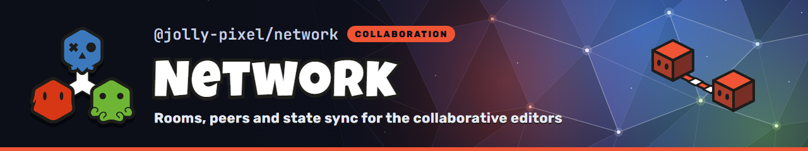

<p align="center">
  
</p>

## 💃 Getting Started

This package is available in the Node Package Repository and can be easily installed with [npm][npm] or [yarn][yarn].

```bash
$ npm i @jolly-pixel/network
# or
$ yarn add @jolly-pixel/network
```

## 👀 Usage example

### Vite server

```ts
import * as network from "@jolly-pixel/network";
import {
  createWebSocketNetworkPlugin
} from "@jolly-pixel/network/node";

export default {
  plugins: [
    createWebSocketNetworkPlugin({
      extensions: [
        new network.PresenceOnlyExtension("echo", "echo", {
          broadcast: true
        })
      ]
    })
  ]
};
```

### Browser client

```ts
import * as network from "@jolly-pixel/network/client";

const client = new network.Client();
const room = client.room("echo");

room.on("message", (payload) => console.log(payload));
room.on("peer-joined", (event) => console.log(`${event.clientId} joined`));
room.on("peer-left", (event) => console.log(`${event.clientId} left`));
room.join();
room.send({ hello: "world" });
```

## 📖 Guides

- [Getting started](./docs/guides/getting-started.md): host a room on Vite and
  exchange messages between tabs
- [Command synchronization](./docs/guides/command-sync.md): sync a command
  document and the server's part in it

## 📚 API

### Client

Import from `@jolly-pixel/network/client`.

- [Client](./docs/client/Client.md): `Client`, `Room`, `PresenceChannel`, `RoomGrants`
- [CommandSync](./docs/client/CommandSync.md): document synchronization and adapters
- [connectWebSocket](./docs/client/connectWebSocket.md): browser socket factory

### Server

Import from `@jolly-pixel/network`; Node.js hosting comes from
`@jolly-pixel/network/node`.

- [Server](./docs/server/Server.md): connections and room lifecycle
- [Extension](./docs/server/Extension.md): feature hooks, presence-only rooms, workers
- [Access](./docs/server/Access.md): authentication and rights
- [Arbitration](./docs/server/Arbitration.md): `KeyedCommandArbiter`
- [WebsocketTransport](./docs/server/WebsocketTransport.md): WebSocket hosting and the Vite plugin

### Protocol

Shared by both sides.

- [Messages](./docs/protocol/Messages.md): message protocols, command schemas, parsing
- [Peer profile](./docs/protocol/PeerProfile.md): profile fields and parsing

### In-process transports

- [LoopbackTransport and channels](./docs/transport/InProcess.md): tests,
  workers, and WebRTC data channels

## 📈 Benchmarks

```bash
$ pnpm --filter @jolly-pixel/network bench
$ pnpm --filter @jolly-pixel/network bench:load --scenario command --clients 150
```

`bench` runs the micro suites in `bench/*.bench.ts` (`--allocations` adds
`B/op`). `bench:load` drives a server over real WebSockets; `--help` lists the
scenarios and options.

## ✨ Contributors guide

Read the [contributing guide][contributing] before submitting a change.

Once you have finished your development, check that the tests (and linter) are still good by running the following script:

```bash
$ pnpm run test
$ pnpm run lint
```

> [!CAUTION]
> In case you introduce a new feature or fix a bug, make sure to include tests for it as well.

## 📃 License

MIT

<!-- Reference-style links for DRYness -->

[npm]: https://docs.npmjs.com/getting-started/what-is-npm
[yarn]: https://yarnpkg.com
[contributing]: ../../CONTRIBUTING.md
