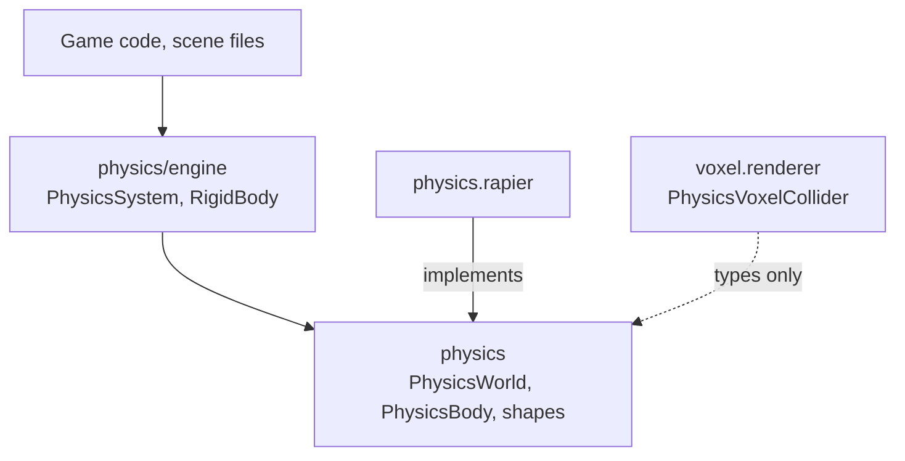
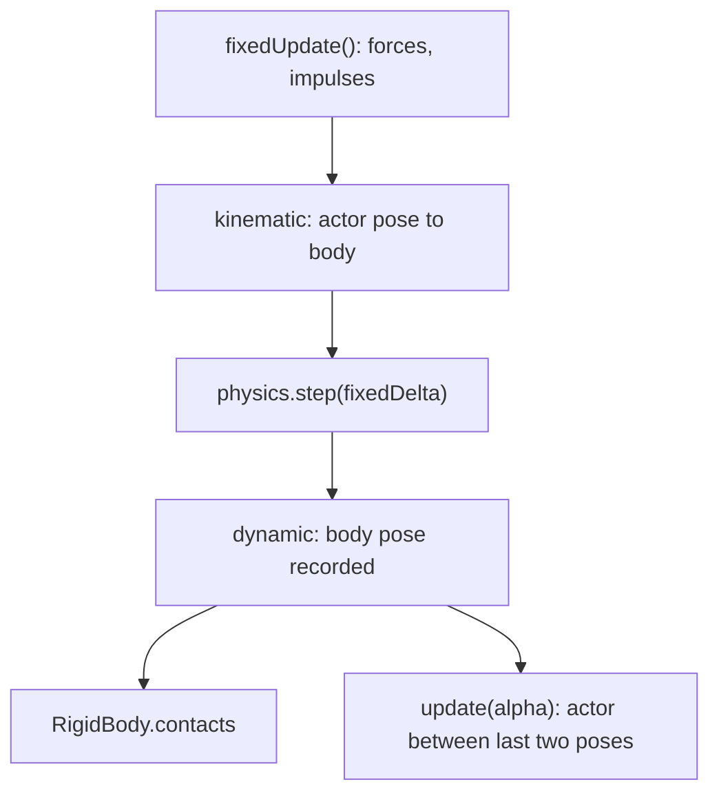

# Physics architecture

## One contract, one package per engine

- The contract imports nothing; a new engine is a new package beside
  `physics-rapier`.
- Engine-specific features stay reachable through each adapter's `native`
  field.
- Code: `src/` (contract), `src/engine/` (engine components), `src/testing/`
  (contract cases every backend runs).
- One `RigidBody` owns one body and all its colliders, so no collider ever
  changes body. Hierarchy compounds (a collider on a child actor joining its
  parent's body) were dropped for that reason.
- `PhysicsSystem` maps each body to its owning actor through a `WeakMap`
  filled by `ownedBodies()`. A removed body needs no cleanup.
- The glue tests run on `FakePhysicsWorld`, which also runs the body
  lifecycle cases, so it cannot drift from the backends. A physics devDep on
  `physics.rapier` would create a workspace cycle.

## Who drives the pose

- The world steps on the engine `World`'s `afterFixedUpdate`, once per fixed
  step.
- Physics only runs in play mode; scene definitions build nothing when editing.
