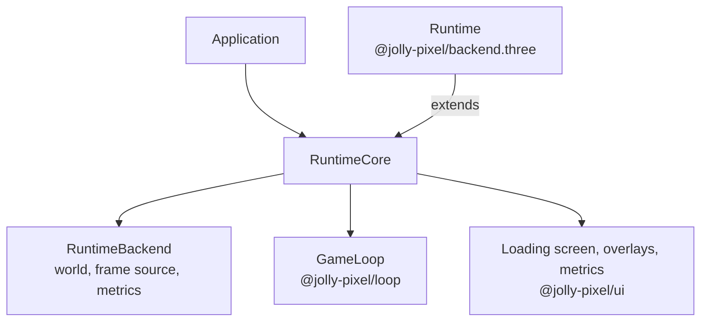
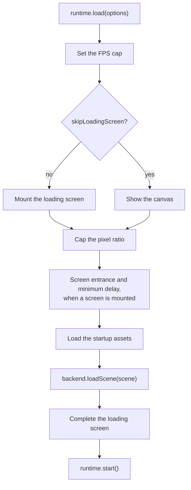
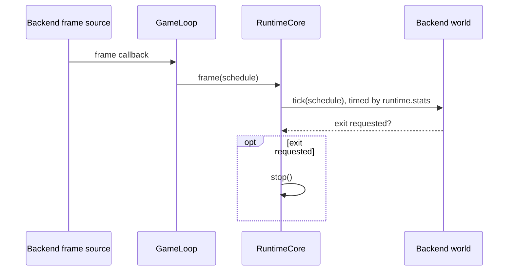
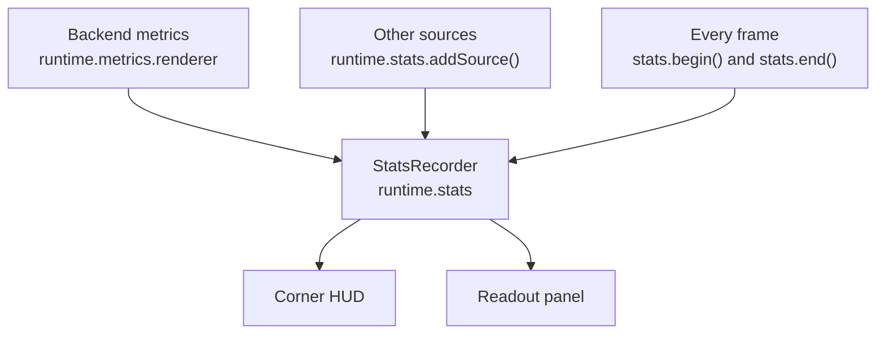
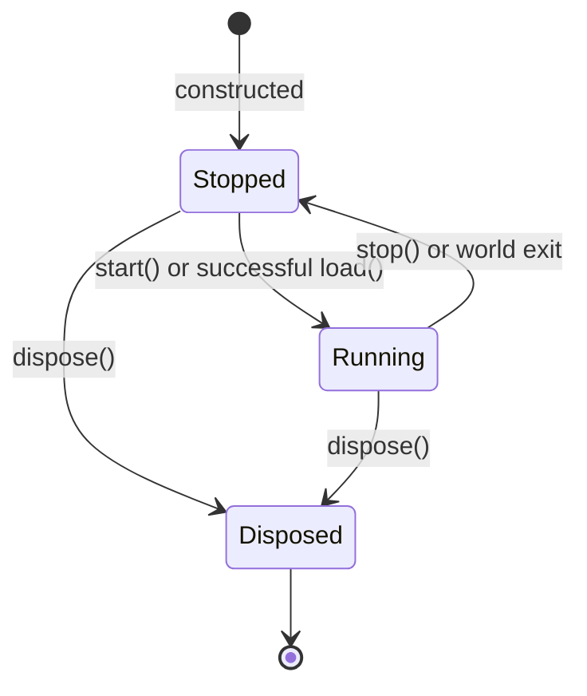

# Runtime architecture

`RuntimeCore` puts a backend's world in a browser page. It drives the world
from a scheduled game loop and owns what surrounds the canvas: focus, loading
screen, overlay and metrics. It imports no renderer and no ECS.

## What the runtime composes

- The backend brings the world and its scenes; `RuntimeCore` only sees the
  structural `RuntimeWorld` in `src/contract/`.
- `startup/` loads, `session/` holds what `start()` attaches, `metrics/` the
  HUD and panel, `overlay/` the HTML layer.
- Nothing here imports three.js; pnpm's isolated `node_modules` make a stray
  import fail typecheck.

## Startup

- The FPS cap is `maxFps`, or none. `RuntimeCore.load()` sets it, and without
  `maxFps` also creates a `FrameRateGovernor` that every frame of `start()`
  feeds before the world ticks.
- Any failure rejects `load()`, leaves the runtime stopped, and is shown on
  the screen when one is mounted.

## Frame path

- `FrameScheduler`, inside `GameLoop`, decides the fixed step count and
  whether to render.
- With `renderOnDemand`, the loop sleeps until page activity or a world
  `invalidate` event wakes it.

## Metrics

One recorder feeds every display. The recorder and the counters exist even
when nothing is mounted.

## Lifecycle

- `start()` attaches the focus listeners and hint, then starts the backend and
  the loop; `stop()` releases them. Both are idempotent.
- The overlay layer never takes pointer events; the loading screen mounts
  outside it.

Details: [RuntimeCore](./docs/api/RuntimeCore.md),
[metrics](./docs/api/RuntimeMetrics.md) and
[overlay layer](./docs/api/OverlayLayer.md).
