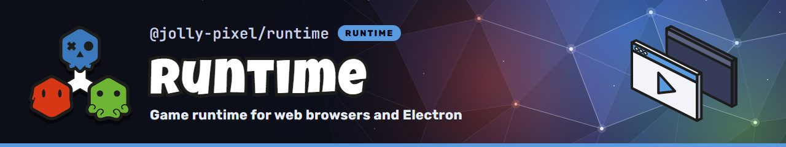

<p align="center">
  
</p>

## 📌 About

The renderer-agnostic runtime shell of JollyPixel. `RuntimeCore` drives a
backend's world on a canvas: game loop, focus and session, loading screen,
HTML overlay and metrics. It imports no renderer and no ECS.

Games use the three.js `Runtime` of `@jolly-pixel/backend.three`, built on
`RuntimeCore`. Use this package directly to write another backend.

## 💡 Features

- Scheduled game loop with rendering on demand and suspension while hidden
- Loading screen with startup assets and the initial scene
- Themeable performance statistics, with a metric registry any subsystem contributes to
- GPU and FPS detection with [detect-gpu](https://github.com/pmndrs/detect-gpu)
- HTML overlay anchored to the canvas

## 💃 Getting Started

This package is available in the Node Package Repository and can be easily installed with [npm][npm] or [yarn][yarn].

```bash
$ npm i @jolly-pixel/runtime
# or
$ yarn add @jolly-pixel/runtime
```

## 👀 Usage example

A backend implements `RuntimeBackend`: its world, a frame source, its metrics,
and how it loads a scene.

```ts
import { RuntimeCore } from "@jolly-pixel/runtime";

const runtime = new RuntimeCore(canvas, backend, {
  renderOnDemand: true
});

await runtime.load({
  scene: level
});
```

## 📚 API

- [`RuntimeCore`](./docs/api/RuntimeCore.md): options, loading, rendering on
  demand, and the `RuntimeBackend` and `RuntimeWorld` contracts.
- [`RuntimeMetrics`](./docs/api/RuntimeMetrics.md): metrics and the readout
  panel.
- [`OverlayLayer`](./docs/api/OverlayLayer.md): HTML mounted over the canvas.

## 📃 License

MIT

<!-- Reference-style links for DRYness -->

[npm]: https://docs.npmjs.com/getting-started/what-is-npm
[yarn]: https://yarnpkg.com
