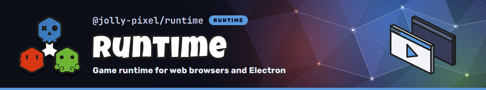

<p align="center">
  
</p>

## 💡 Features

- Web runtime with [Vite][vite]
- Desktop runtime with [Electron.js][electron]
- Themeable performance statistics, with a metric registry any subsystem contributes to
- GPU and FPS detection with [detect-gpu](https://github.com/pmndrs/detect-gpu)
- Catalog-backed asset loading with operation-scoped progress

## 💃 Getting Started

This package is available in the Node Package Repository and can be easily installed with [npm][npm] or [yarn][yarn].

```bash
$ npm i @jolly-pixel/runtime
# or
$ yarn add @jolly-pixel/runtime
```

## 👀 Usage example

The runtime needs a `<canvas>` element to render into.

Start by creating an **HTML** file with a canvas and an ECMAScript `module` script entry point:

```html
<!DOCTYPE html>
<html lang="en">

<head>
  <meta charset="UTF-8">
  <meta name="viewport" content="width=device-width, initial-scale=1.0">
  <title>Game</title>
  <link rel="stylesheet" href="./main.css">
  <link rel="icon" type="image/x-icon" href="/favicon.ico" />
</head>

<canvas tabindex="-1"></canvas>

<script type="module" src="./src/main.ts"></script>

</html>
```

> [!TIP]
> The `tabindex="-1"` attribute on the canvas allows it to receive keyboard focus, which is required for capturing input events.

Then in your main script, create and load a `Runtime`:

- Detect GPU capabilities
- Load startup assets and the initial scene
- Start the world and game loop

```ts
import { Runtime } from "@jolly-pixel/runtime";

const runtime = await Runtime.create("canvas", {
  includePerformanceStats: true,
  focusCanvas: true,
  assets: {
    catalog: new URL("assets.json", document.baseURI)
  }
});

runtime.load({
  scene: new GameScene()
}).catch(console.error);
```

Vite serves `public/assets.json` during development and copies it to the build
output. `Runtime.create()` fetches and parses the catalog before it constructs
the world. Resolving it from `document.baseURI` works on both platforms below.

## 🖥️ Platforms

The web and desktop builds share the same HTML file and application code. Only
the build setup differs.

- [Web](./docs/guides/platforms/web.md): serve and build the application with
  Vite.
- [Desktop](./docs/guides/platforms/desktop.md): a relative Vite base and an
  Electron main process that loads `dist/index.html`.

## 📖 Guides

- [Scenes and assets](./docs/guides/scenes-and-assets.md): the catalog, the
  initial scene, scene changes, and explicit load batches.
- [Loading screen](./docs/guides/loading-screen.md): container, minimum delay,
  theming, or starting without a screen.
- [Custom asset loaders](./docs/guides/custom-asset-loaders.md): register a
  loader for a project-specific asset kind.
- [Frame scheduling and performance](./docs/guides/frame-scheduling-and-performance.md):
  loop and device settings, performance statistics, metrics, and renderer
  counters.

## 📚 API

- [`Runtime`](./docs/api/Runtime.md): construction, loading, services, and
  lifecycle.
- [`RuntimeMetrics`](./docs/api/RuntimeMetrics.md): metrics, renderer
  counters, and the readout panel.
- [`OverlayLayer`](./docs/api/OverlayLayer.md): HTML mounted over the canvas.
- [Runtime asset options](./docs/api/runtime-assets.md): catalogs and platform
  loaders.
- [`SceneManager`](../engine/docs/systems/scene-manager.md): scene-load state,
  progress, and activation gates.

## 📃 License

MIT

<!-- Reference-style links for DRYness -->

[vite]: https://vite.dev/
[electron]: https://www.electronjs.org/
[npm]: https://docs.npmjs.com/getting-started/what-is-npm
[yarn]: https://yarnpkg.com
