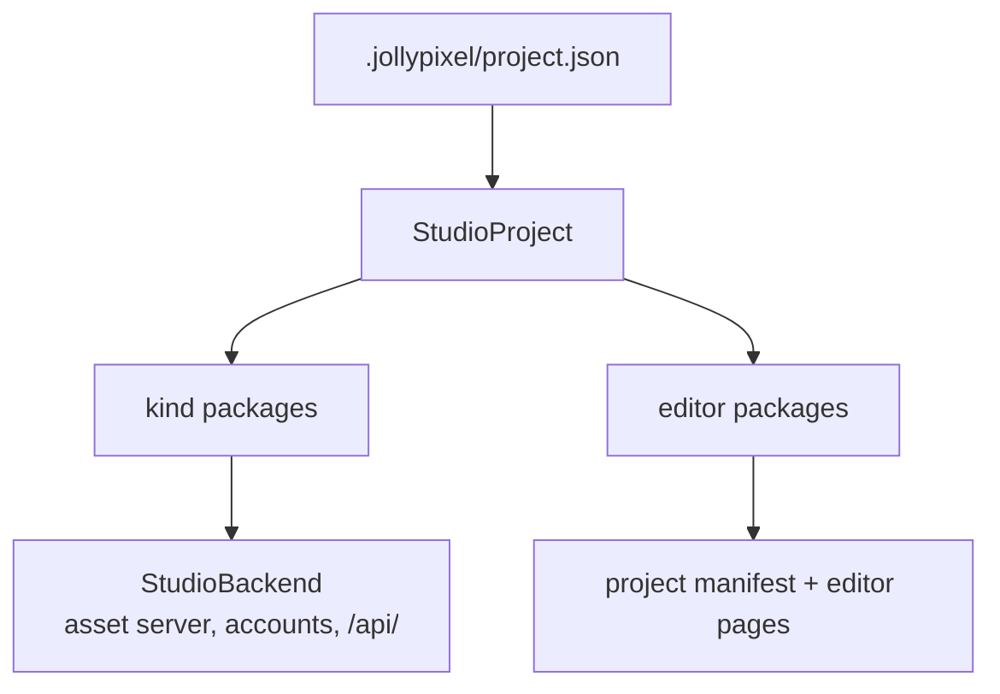
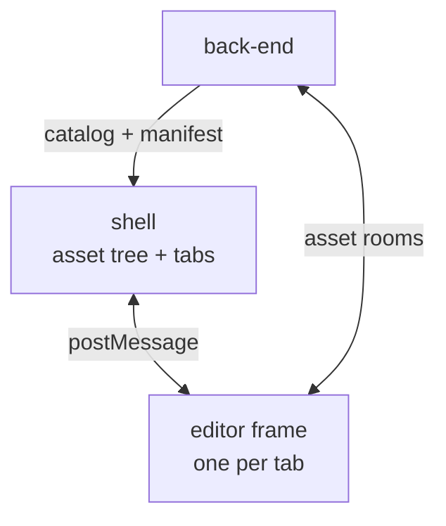
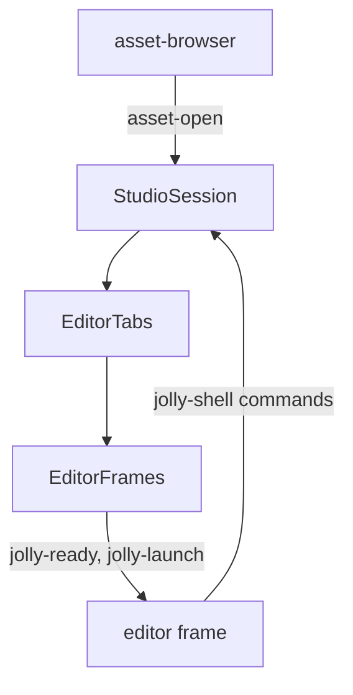
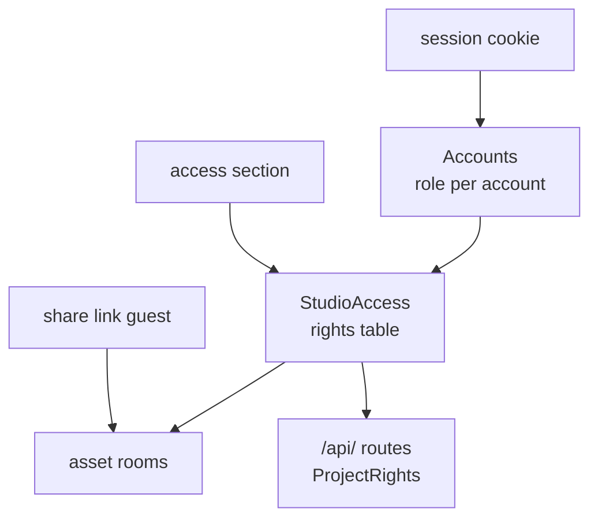
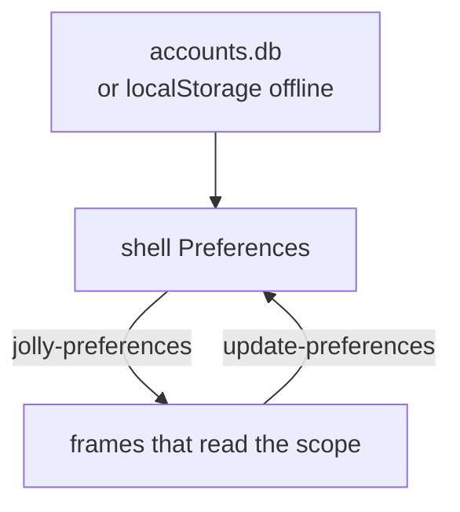
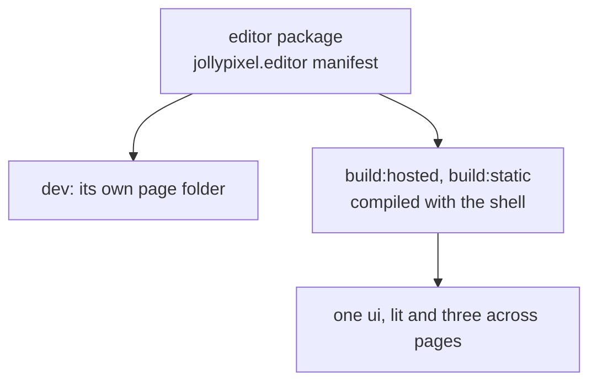

# Architecture

`@jolly-pixel/studio` opens one project: one asset back-end, one asset tree,
one editor page per tab. Terms are defined in the [glossary](./GLOSSARY.md),
decisions in the [ADRs](./docs/adr/README.md).

## One project, one back-end

- The project file lists the editors and kinds. Only the server writes it.
- `vite/backend` mounts the back-end in dev, `StudioServer` when hosted. The static build has none and starts offline.
- Code: `server/`, `vite/`.

## Data in the shell, code in the frames

- The shell never loads kind handler or editor code, and shares no objects with the frames.
- `shared/` holds what the browser and the server both need. `server/` never imports `src/`.
- Code: `src/shell/`, `shared/`.

## Opening an asset

- The iframe is created on first focus, then only hidden: moving it would reload it.
- The launch carries ports for the shell catalog and the frame's console.
- Code: `src/tabs/`, `src/shell/`.

## Who may do what

- Assets reach the browser through the rooms only. Vite never serves the asset files.
- Offline there are no accounts, and every project right is false.
- Code: `server/accounts.ts`, `server/project/`, `server/shares/`, `src/accounts/`. See [accounts](./docs/accounts.md).

## Preferences follow the account

- The scopes come from the shell, the host and each editor package. The server drops unknown scopes and fields.
- Code: `shared/PreferenceScopes.ts`, `server/preferences/`, `src/preferences/`.

## Editor pages

- In dev, a rebuilt page folder reloads that editor's tabs.
- `test/vite/studio.bundle.spec.ts` guards the shared chunks.
- Code: `server/editors/`, `vite/editorPages.ts`. See [hosting](./docs/hosting.md).
