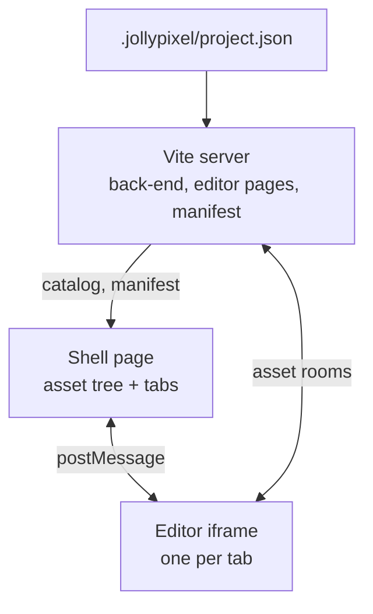
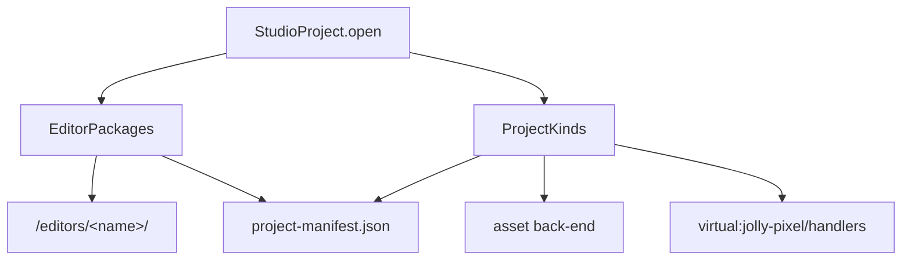
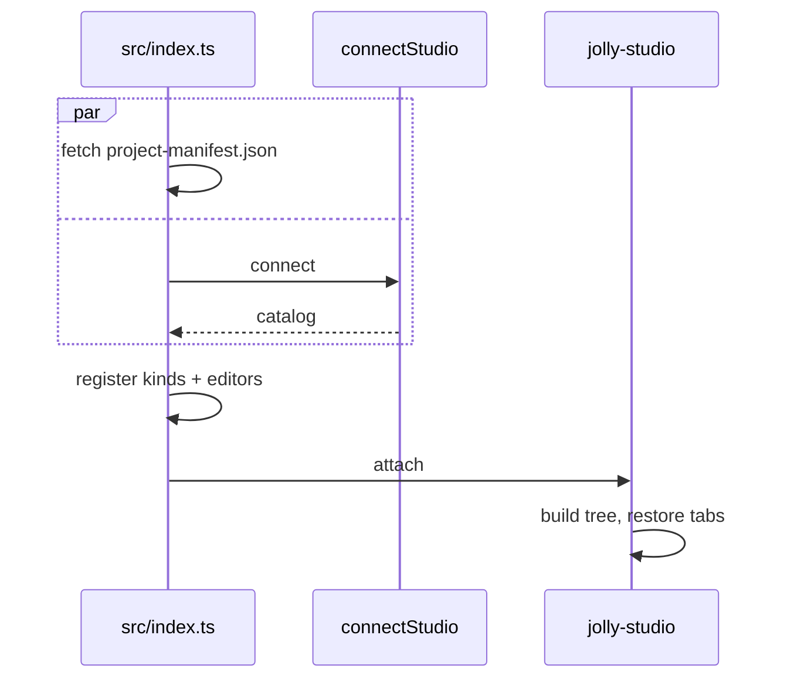
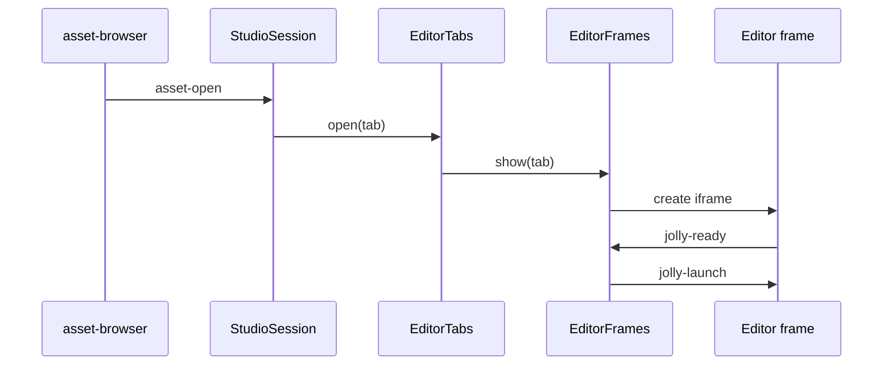
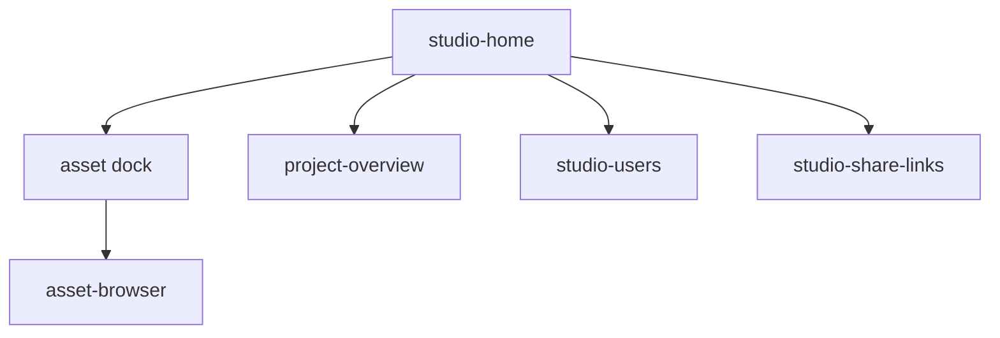
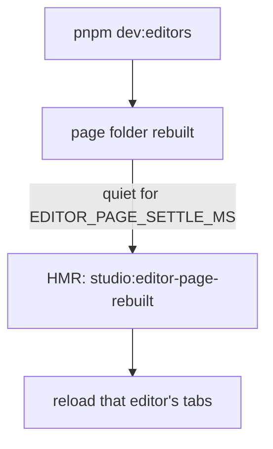

# Architecture

`@jolly-pixel/studio` opens one project: one asset back-end, one asset tree,
one editor page per tab.

See also: [ADRs](./docs/adr/README.md) · [roadmap](./ROADMAP.md) ·
[glossary](./GLOSSARY.md)

## Big picture

- The shell holds **data only**: kind descriptors, editor names, catalog records.
- Kind code runs in the back-end, editor code runs in the frames.
- Shell and frames share one origin but never share objects.

## Server

- `StudioProject.open` writes a default project file when none exists
  ([ADR-0016](./docs/adr/0016-the-project-file-lists-editors-and-kinds.md)).
- Packages resolve through `PackageResolver`: project `node_modules`, then the
  studio's. `./` or `../` means a project folder.
- An editor from `node_modules` is prebuilt and never watched
  ([ADR-0017](./docs/adr/0017-project-packages-are-trusted-code.md)).
- Editing the project file restarts the dev server.
- `server/` knows nothing of Vite; `vite/` only adapts it.
- `StudioBackend` opens the online back-end: the accounts, the asset
  workspace and its catalog view, `StudioApi` and `SharePage`. `vite/backend`
  mounts its middleware and attaches its WebSocket to the dev server. It
  closes its WebSocket transports, the API, the workspace, then the accounts.
- `StudioServer` is the hosted entry, started by `server/start.ts`. One
  `node:http` server chains the back-end, `ManifestRoute` and the built shell,
  which holds every editor page under `editors/<name>/`. It refuses to start
  when a project editor has no page there. `serveBuild` serves the shell and
  its pages, with hashed assets cached as immutable.
- `StudioAccess` reads the `access` section into a rights table with a
  built-in `admin` and the `AccountRoles`. `server/accounts` opens the
  project's `Accounts` on `.jollypixel/accounts.db`: the network server
  authenticates with it and registers its `accounts` room.
- `server/api/StudioApi` is a Fastify app that owns every `/api/` path;
  `StudioBackend` hands those requests to it. Each API surface is a Fastify
  plugin holding only its route table, such as `accountsRoutes`. A controller
  class such as `AccountsController` owns the handlers and maps domain errors
  to statuses.
- The session cookie is named after the project root: cookies ignore ports.
- `StudioProject.privateFiles` lists the globs Vite must not serve: every
  `.jollypixel/` folder and the project's asset files. Assets reach the
  browser through the rooms only, which apply the rights table: the asset
  workspace runs with `http: false`.
- Share links: `StudioShares` checks `studio.$share`, creates links for
  `/api/shares/` and walks the closure for the network server's `admits`. `SharePage` answers
  `/view/<token>` with the editor page plus a `<base>` and the launch.
  Guests read the `asset-catalog-view` room, registered once the workspace
  is ready.
- Project export: `ProjectArchive` checks `studio.$export` and answers
  `GET /api/project/archive` with every asset in one asset archive, named
  after the project root. It goes over HTTP, so the catalog content limit
  does not apply. `GET /api/project/` answers `canExport` for the caller.

| Mode | Project file | Back-end | Editor pages |
|---|---|---|---|
| `dev` | on disk | project root | each page folder |
| `e2e` | in memory | in memory, fixed port, accounts in memory, new accounts are `member` | same |
| `static` | in memory | none, no accounts, shell starts offline | `dist/editors/`, offline-only |

Online and offline back-ends get the same handlers (plus `texture`) and the
same seed (`src/seed.ts`).

## Boot

- The manifest loads while the sign-in dialog is open. A valid session cookie
  skips the dialog (`me`).
- `StudioSignedIn` holds the signed-in account and what derives from it: the
  peer identity, the shell's client, the roster, the share links and the
  session renewal. A new avatar changes the identity the next launch carries.
- Editor frames connect with the same cookie; `jolly-launch` carries the
  identity only.
- A refused socket (`unauthorized`), the shell's or a frame's, goes through
  `SessionRenewal`: `me` or the dialog, then every client reconnects. Another
  account reloads
  ([ADR-0022](./docs/adr/0022-a-refused-session-renews-in-place.md)).
- Catalog unreachable: Retry, or go offline.
- Offline adds `{ offline, workspace: "studio" }` to every editor URL, so the
  frames join the same browser workspace.

## Opening an asset

- Kind without an editor: nothing opens, the row shows `no editor`.
- Already open: the tab gets focus.
- Tab cap reached: confirm closing the least recently used tab.
- The iframe is created on first focus. Hidden tabs keep theirs
  (`display: none`). Closing a tab removes it.
- `EditorTabs` and `EditorFrames` are plain controllers, not Lit templates:
  moving an iframe reloads it.

## Frame messages

| Message | Direction | Carries |
|---|---|---|
| `jolly-ready` | frame → shell | nothing |
| `jolly-launch` | shell → frame | target asset, theme, density, the shell's peer identity, a port to the shell catalog and a port for the frame's console |
| `jolly-catalog-open` | frame → shell, on the launch port | a port for one catalog |
| `jolly-shell` | frame → shell | `open-asset`, `toggle-console`, `session-refused`, `unsaved` or `editor-state` |
| `jolly-appearance` | shell → frame | new theme or density |
| `jolly-session-renewed` | shell → frame | nothing; refused clients reconnect |

- `EditorFrames` ignores messages from any other window.
- Frames open their catalog on the launch port, served by the shell's
  `CatalogShare` ([ADR-0018](./docs/adr/0018-frames-read-the-catalog-through-the-shell.md)).
- `StudioSession` handles every `jolly-shell` command and never answers one.
  `jolly-session-renewed` goes to every frame, not only those that posted
  `session-refused`.
- Online, every frame joins as the shell's peer (`username`, `peerId`), so one
  user has one presence color across tabs. Offline frames stay guests.
- A frame posts `unsaved` when its documents gain or lose changes the server
  has not acknowledged. The shell marks its tab and cancels `beforeunload`
  while any tab is marked; closing a marked tab does not ask.
- A tab spins from the moment its frame is created until the frame posts
  `editor-state` `ready`, spins again while it posts `switching`, and shows a
  warning on `failed`. A tab opened in the background stays still until its
  frame loads.
- One console for the whole studio: Ctrl+K in a frame posts `toggle-console`
  ([ADR-0015](./docs/adr/0015-the-studio-console-takes-precedence.md)).
- The frame serves its console namespaces on the console port, and
  `FrameConsoles` shows those of the active tab in the studio console
  ([ADR-0019](./docs/adr/0019-the-active-editor-namespaces-join-the-studio-console.md)).

## Saved state

| Key | Storage | Holds |
|---|---|---|
| `studio:tabs` | `localStorage` | open tab ids in order, active id |
| `studio:home-layout` | `localStorage` | asset dock size |
| `studio:asset-kind` | `localStorage` | kind filter |
| `studio:asset-expanded` | `localStorage` | expanded folder node ids |
| `jolly_session_<hash>` | HttpOnly cookie | session token, unreadable from scripts |

`StudioPreferences` reads and writes the `studio:` keys through one
`StorageAdapter`, and parses each one once; an unreadable value reads as
empty. Restoring tabs skips missing assets and kinds without an editor, stops
at the cap, and loads only the active frame.

## Home

- Home is a fixed tab. Opening an editor hides it, so the tree keeps its state
  ([ADR-0014](./docs/adr/0014-the-asset-browser-lives-on-home.md)).
- Settings is a shell page like Home, but closable: no frame, outside the cap
  and the saved tabs.
- The Home tools, online only: Settings opens the Settings tab, Search the
  console, Export downloads the project archive. Export stays disabled when
  the role has no write on `studio.$export`.
- `project-overview` counts assets per kind (`AssetTally`) and lists open
  editors.
- `studio-users`, in the right dock when online, draws the `accounts` room
  roster through `UsersTreeModel`; admins get a role menu.
- `studio-share-links`, under it, lists the links the account may manage
  (its own, every one for admins), newest first, with asset, creator, dates,
  Copy link and Revoke. The Share dialog shows the same `share-link-list` for
  one asset. Both read one `StudioShareLinks`, so a link created or revoked
  in this shell shows in both; Refresh picks up other accounts' changes.

## Asset browser

| Action | Trigger | Rule |
|---|---|---|
| Open | double-click, Enter | |
| Rename | F2 | keeps the extension, no `/` (moving is a drag) |
| Delete | Delete | dialog lists the assets that still reference it |
| New asset | toolbar, menu | back-end writes the default content, then rename starts |
| New folder | toolbar, menu | created in the project, then rename starts |
| Export | toolbar, menu | `<stem>.zip` with dependencies, not on folders |
| Share | toolbar, menu | online only; lists, creates and revokes view-only links |
| Add files | drop files from the OS | into the folder under the cursor, or the root |

- Context menu: right-click, Shift+F10 or the menu key.
- Dropped files (`AssetDrop`), 10 MB each at most, the WebSocket limit:
  - `.zip`: imported as an asset archive at its own paths, asking first when
    some of its assets exist. A `.zip` the catalog refuses to plan is added
    as a file; any other failure is reported.
  - A format a kind converts from (`convertsFrom` in the manifest): one
    question per format, convert or keep. Converting creates
    `<stem><kind extension>` and the back-end handler converts the bytes.
  - Anything else: added under its own name; the back-end picks the kind by
    extension, `binary` otherwise.
- Folders start collapsed; the expanded ones are kept in `localStorage`
  (`studio:asset-expanded`), like the kind filter.
- The tree is `virtual` and scrolls inside the pane, under the toolbar.
- `AssetTreeView` holds the tree state without the DOM: expanded folders,
  selection, kind filter, a renamed row's new name until the catalog confirms
  it, and the asset or folder just created, whose rename starts once the tree
  shows it. `<asset-browser>` renders it and owns the menus and dialogs.
- `AssetSelection` decides which actions apply, and re-checks before running.
- Errors go to the `jolly-log`.

## Catalog changes

- Asset deleted: its tab closes.
- Asset renamed: its tab label and tooltip update.
- The tree rebuilds but keeps expanded folders, selection and filter. It
  rebuilds only when an asset's kind, path or dependencies change, or a folder
  comes or goes (`CatalogLayout`): saving content changes only the revision.
- Folders live in the asset source: renaming one sends one command per asset
  inside, plus one per companion, then one `catalog:move-folder` that carries
  its empty folders over and deletes the old one.

## Editor pages

| Editor | Package | Page folder | Kinds |
|---|---|---|---|
| `voxel-map` | `@jolly-pixel/editor.voxel-map` | `dist/` | `voxelmap` |
| `voxel-model` | `@jolly-pixel/editor.voxel-model` | `dist/` | `voxelmodel` |
| `pixel-art` | `@jolly-pixel/editor.pixel-art` | `dist-page/` | `pixelart` |

- In dev, each page folder bundles its own `editor.host` and
  `@jolly-pixel/ui`: change either, rebuild the page.
- Reload hits the active tab now, the others on next focus.
- `build:hosted` and `build:static` compile every page whose manifest names a
  `page` in the shell's Vite build, so ui, lit and three get one URL across
  pages. `vite/editorPages` adds each page as a virtual
  `editors/<name>/index.html` input. The page's URLs must be relative: a
  root-absolute one fails the build.
- That build turns off rolldown's `mergeCommonChunks`: left on, it moves
  shared modules into one page's entry chunk and the shell preloads the
  voxel-map entry. `test/vite/studio.bundle.spec.ts` guards it.
- Both builds then fill `editors/<name>/` with the `public/` folder of each
  compiled page and the `dist` of every other editor.
- `pixel-art` builds its page with `build:page`, which the studio `build`
  runs.

## Layout

| Path | Role |
|---|---|
| `server/StudioBackend.ts` | the online back-end, opened and closed as one |
| `server/StudioServer.ts`, `server/start.ts` | hosted entry and its environment |
| `server/project/` | project file, `access` section, private files |
| `server/editors/` | editor packages and pages, manifest route, dist watcher |
| `server/accounts.ts` | project accounts |
| `server/shares/` | share rules, guest admission, `/view/` page |
| `vite.config.ts`, `vite/` | Vite plugins |
| `src/index.ts` | boot |
| `src/connection.ts`, `src/offlineConnection.ts` | online catalog, offline fallback |
| `src/seed.ts` | seed for both back-ends |
| `src/catalog/` | pure tree logic (`AssetTreeModel`, `AssetPath`, …) |
| `src/accounts/` | `StudioSignedIn`, `SessionRenewal`, `UsersTreeModel`, `/users` console |
| `src/api/` | `ApiEndpoint`: fetch and failure shape shared by the HTTP clients |
| `src/shares/` | share routes, lifetimes, `ShareLinksClient`, `StudioShareLinks` |
| `src/project/` | project routes, `ProjectArchiveClient`, `AttachmentDisposition` |
| `src/files/` | `DroppedFile`, `FileDownload` |
| `src/editors/` | `EditorRegistry`, `ProjectManifest` |
| `src/preferences/` | `StudioPreferences` |
| `src/tabs/` | `EditorTabs`, `EditorFrames`, `SavedTabs` |
| `src/shell/` | `<jolly-studio>`, `StudioSession`, Home, asset browser (`AssetTreeView`), sign-in dialog, Users pane |
