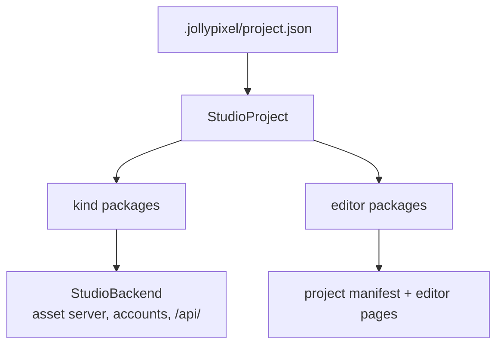
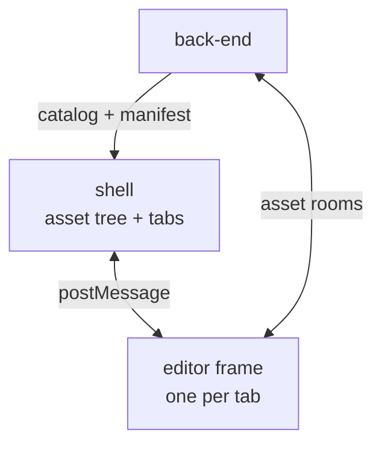
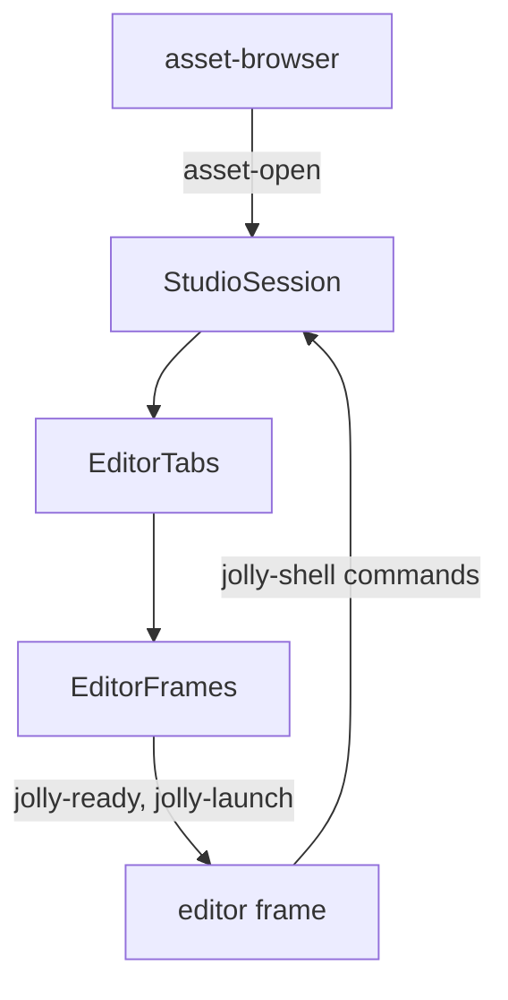
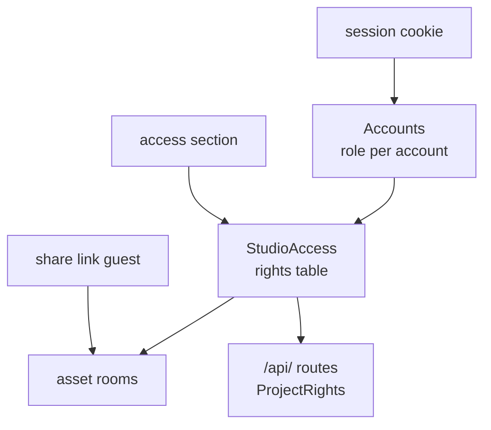
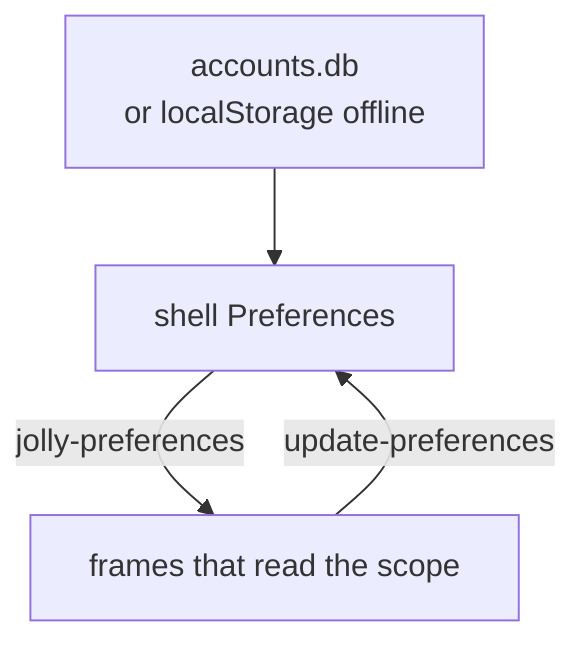
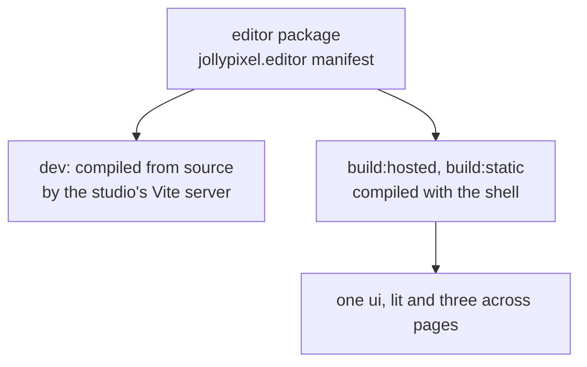

# Architecture

`@jolly-pixel/studio` opens one project: one asset back-end, one asset tree,
one editor page per tab. Terms are defined in the [glossary](./GLOSSARY.md),
decisions in the [ADRs](./docs/adr/README.md).

## One project, one back-end

- The project file lists the editors and kinds. Only the server writes it.
- `vite/backend` mounts the back-end in dev, `StudioServer` when hosted. The static build has none and starts offline.
- The back-end lives in `@jolly-pixel/server`. The studio passes it the shell, the project template, the seed and the package folders from `node/studioFiles.ts`.
- Code: `node/`, `vite/`.

## Data in the shell, code in the frames

- The shell never loads kind handler or editor code, and shares no objects with the frames.
- `@jolly-pixel/server` exports the API contract from its root. `shared/` holds the seed, the shell's preference scopes and the editor page rebuild event: the only studio code that runs in both the browser and Node.js. `node/` and `vite/` never import `src/`.
- Code: `src/shell/`, `shared/`.

## Opening an asset

- The iframe is created on first focus, then only hidden: moving it would reload it.
- The launch carries ports for the shell catalog and the frame's console.
- Code: `src/tabs/`, `src/shell/`.

## Who may do what

- Assets reach the browser through the rooms only. Vite never serves the asset files.
- Offline there are no accounts, and every project right is false.
- Code: `src/accounts/`, and `@jolly-pixel/server` for the server side. See [accounts](./docs/accounts.md).

## Preferences follow the account

- The scopes come from the shell, the host and each editor package. The server drops unknown scopes and fields.
- Code: `src/preferences/`, and `@jolly-pixel/server` for the scopes and their storage.

## Editor pages

- Both paths resolve the scene's `virtual:jolly-pixel/contributions/scene` against the studio's project.
- A page without source HTML is served from its built folder; in dev, a rebuild of that folder reloads the editor's tabs.
- The preview frame page, `preview/index.html` (`src/preview/`), is built with the shell and reads the same scene contributions to render 3D asset previews.
- `test/vite/studio.bundle.spec.ts` guards the shared chunks.
- Code: `vite/editorPages.ts`, and `@jolly-pixel/server` for the editor packages. See [hosting](./docs/hosting.md).
