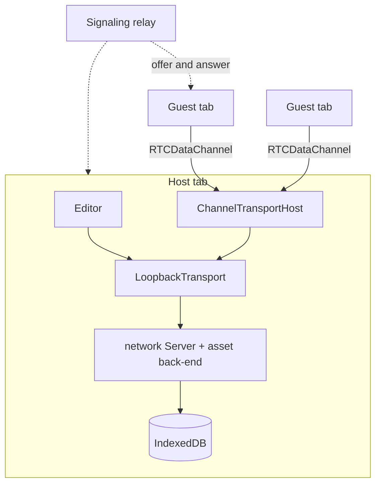

# Browser-hosted sessions

Plan for running an editor session from a browser tab, written on 2026-10-13
from the code at `27d7ace2`. The hosted studio server is built; see
[docs/hosting.md](./docs/hosting.md).

The host opens an editor the way it opens one offline: its tab runs
`OfflineWorkspace` over IndexedDB. Guests open an invite link to the static
build and connect to the host over a WebRTC data channel. No server stores or
sees the project.

The shared-tab workspace (`editors/host/src/workspace/shared-tab/`) already
does this inside one browser profile. `OwnerWorkspace` serves a
`ChannelTransportHost` over a BroadcastChannel and `RemoteWorkspace` connects
with `ChannelTransport`. A `ChannelPort` only needs `postMessage`, a `message`
listener and an optional `close`, so an `RTCDataChannel` can carry the same
protocol.

Guests connect to the host and to nobody else. `CommandSync` and the asset
rooms rely on one server to order commands, echo them and send correcting
snapshots. With the host tab as that server, every guarantee holds. A mesh
between guests would break them.

## Work

- **Data-channel port.** A `ChannelPort` over an ordered, reliable
  `RTCDataChannel` in `@jolly-pixel/network`. Browsers cap the size of one
  data-channel message and a pixel-art snapshot can weigh several megabytes,
  so the port splits messages. It also waits on `bufferedAmount` before
  sending more. A fake channel in `node:test` covers both.
- **Peer workspaces.** A `workspace/peer/` folder in the host, next to
  `shared-tab/`. The host side wraps `OfflineWorkspace` like `OwnerWorkspace`
  does and opens one relay per guest. The guest side follows
  `RemoteWorkspace`: launch from the host's catalog, `ConnectionHandoff`, a
  "host left" screen. `bootStandalone` reads an invite parameter.
- **Signaling.** Peers exchange an offer, an answer and ICE candidates once.
  Either a relay room on a network `Server`, in the hosted studio process or
  a small worker, forwards them between two client ids, or Trystero does it
  over public Nostr or MQTT relays. Trystero needs no infrastructure but adds
  a dependency.
- **Admission and roles.** Each bridged socket authenticates through
  `LoopbackSocket` with `url: "loopback:"` and empty headers, so every guest
  gets the default role. Edit and view links need the channel `connect`
  message to carry a credential that the host's `AuthenticationProvider`
  checks: a random invite token in the URL fragment, which never reaches a
  server. `PasswordAuthentication` cannot run in a browser because it uses
  scrypt. The host also needs a list to approve and remove guests.
- **NAT traversal.** STUN is enough on most home networks. Symmetric NATs and
  company firewalls need TURN, either Cloudflare's (1,000 GB a month shared
  with its SFU, then $0.05 per GB, checked on 2026-10-13) or a self-hosted
  coturn. Without TURN some guests cannot join, and the UI has to say so.
- **Host lifecycle.** Closing the host tab ends the session, as it does today
  when a shared-tab owner leaves. Check how Chrome throttles timers in hidden
  tabs against the `SnapshotScheduler` delays. Moving the host role to a guest
  stays out of the first version.

## Order

1. Spike on voxel-map with the port, the peer workspaces and signaling through
   the hosted server. It is done when two browsers on different machines edit
   one map and a pixel-art snapshot over 1 MB crosses the channel.
2. Admission and roles, TURN, the "host left" screen and the throttling check.
   Then voxel-model and the studio.

## Open questions

- Signaling through a relay room on the hosted server, which someone then has
  to run, or through Trystero?
- Pay for TURN, or accept that some company networks cannot join?
- Should guests keep a copy of the project when the host leaves? Archives can
  do it, but it changes who owns the project.
