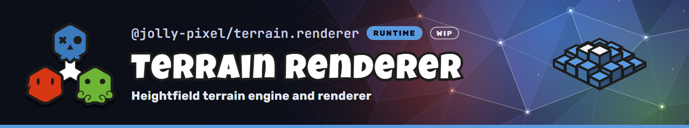

  

## 💃 Getting Started

This workspace-private package holds the headless terrain data (chunk
coordinates, chunks of 64×64 owned samples written by 16×16 tile, and the
`Terrain` with world-space sampling), the surface queries that match
what is drawn (`surfaceHeight` and `raycastTerrain`), and the CDLOD view that
draws it: quadtree selection,
node meshes, height texture arrays and the TSL material. The
`@jolly-pixel/terrain.renderer/engine` entry adds the `TerrainRenderer`
component. See the terrain editor [design][design] and [roadmap][roadmap].

A `SampleBlock` is a short-lived snapshot of one chunk's area: the chunk's own
samples, or samples borrowed from its eight neighbours when the chunk is
missing. A missing sample within two samples of the chunk's edge steps one
sample at a time, always in the same direction for its position, until it
lands on an existing chunk: the bottom rows step down, the right columns
right, the top rows up and the left columns left. The bottom-left corner
steps with the bottom rows, the bottom-right with the right columns, the
top-right with the top rows and the top-left with the left columns, so the
steps circle the four chunks that meet at a corner.
Other missing samples copy the outer sample of the nearest neighbour, with
equal-distance ties going to the left, below, then diagonal neighbour.

The shader reads these samples from each chunk's height apron, which is as
wide as that border, so its own neighbour order does not change what is
drawn. A chunk added next to the terrain is seeded from its sample block, so
it keeps the heights shown before the add. Because the steps do not depend on
which chunks exist, a sample that now stops on the added chunk reads the value
it stepped to before, and no other chunk's apron changes.

## License

MIT

<!-- Reference-style links for DRYness -->

[design]: ../editors/terrain/docs/design.md
[roadmap]: ../editors/terrain/ROADMAP.md
