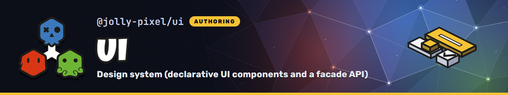

<p align="center">
  
</p>

## 💡 About

Lit components for building editor interfaces: fields, panels, docks, dialogs, trees and more.
The JollyPixel editors are built with it, with light and dark themes and live collaboration
included.

## 💃 Getting Started

This package is available in the Node Package Repository and can be easily installed with [npm][npm] or [yarn][yarn].

```bash
$ npm i @jolly-pixel/ui
# or
$ yarn add @jolly-pixel/ui
```

> [!IMPORTANT]
> `lit` is a peer dependency. Use one compatible copy in the application.

## 📖 Guides

Start with [Getting started](./docs/guides/getting-started.md), then pick the task at hand.

Fields:

- [Building an inspector](./docs/guides/building-an-inspector.md): fields bound to a model with
  `FieldBinding`, multi-selections and row layout.
- [Preview and commit](./docs/guides/preview-and-commit.md): live preview on `jolly-input`, one
  undo step and one network command on `jolly-change`.
- [Keeping an element in sync](./docs/guides/syncing-with-a-model.md): render again when the model
  changes elsewhere.

Panels and shell:

- [Hierarchy panels](./docs/guides/hierarchy-panels.md): a `jolly-tree` with renaming, drag and
  drop and a row menu.
- [Dialogs](./docs/guides/dialogs.md): one-question helpers, dialog elements and inline
  confirmation.
- [Editor layout](./docs/guides/editor-layout.md): docks, tab groups and reacting to where panes
  are.
- [Toolbars and menus](./docs/guides/toolbars-and-menus.md): tool buttons, menus opened from a
  button, and keyboard ownership.
- [Persisting settings](./docs/guides/persisting-settings.md): storage keys and the
  `StorageAdapter` port.
- [Theming and density](./docs/guides/theming-and-density.md): scopes, user preferences, token
  overrides and canvases.

Collaboration and debugging:

- [Collaboration](./docs/guides/collaboration.md): roster, per-row peer marks and field locks.
- [Debug panels](./docs/guides/debug-panels.md): the facade over a plain object, and a stats
  overlay.

## 📚 API

Importing `@jolly-pixel/ui` registers every element. The network adapters live in
`@jolly-pixel/ui/network`.

Each element page lists its properties, events and slots. A property marked `property only` has no
HTML attribute.

### Components

Each entry gives the HTML tag, then the class name.

#### Controls

Field controls share the [field API](./docs/api/field/shared-field-api.md).
[Building an inspector](./docs/guides/building-an-inspector.md) maps values to controls.

- [`jolly-button`](./docs/api/controls/button.md) (`Button`)
- [`jolly-button-group`](./docs/api/controls/button-group.md) (`ButtonGroup`)
- [`jolly-checkbox`](./docs/api/controls/checkbox.md) (`Checkbox`)
- [`jolly-color`](./docs/api/controls/color.md) (`Color`)
- [`jolly-color-picker`](./docs/api/controls/color-picker.md) (`ColorPicker`)
- [`jolly-control`](./docs/api/controls/control.md) (`Control`)
- [`jolly-controls`](./docs/api/controls/controls.md) (`Controls`)
- [`jolly-flags`](./docs/api/controls/flags.md) (`Flags`)
- [`jolly-layer-grid`](./docs/api/controls/layer-grid.md) (`LayerGrid`)
- [`jolly-number`](./docs/api/controls/number.md) (`NumberField`)
- [`jolly-property-row`](./docs/api/controls/property-row.md) (`PropertyRow`)
- [`jolly-range`](./docs/api/controls/range.md) (`Range`)
- [`jolly-search`](./docs/api/controls/search.md) (`Search`)
- [`jolly-select`](./docs/api/controls/select.md) (`Select`)
- [`jolly-separator`](./docs/api/controls/separator.md) (`Separator`)
- [`jolly-slider`](./docs/api/controls/slider.md) (`Slider`)
- [`jolly-spin-slider`](./docs/api/controls/spin-slider.md) (`SpinSlider`)
- [`jolly-text`](./docs/api/controls/text.md) (`Text`)
- [`jolly-toggle`](./docs/api/controls/toggle.md) (`Toggle`)
- [`jolly-tool-button`](./docs/api/controls/tool-button.md) (`ToolButton`)

#### Math fields

The vector, quaternion and transform fields take structural values and do not depend on Three.js.

- [`jolly-point2d`](./docs/api/math/point2d.md) (`Point2d`)
- [`jolly-quaternion`](./docs/api/math/quaternion.md) (`Quaternion`)
- [`jolly-transform`](./docs/api/math/transform.md) (`Transform`)
- [`jolly-vector2`](./docs/api/math/vector2.md) (`Vector2`)
- [`jolly-vector3`](./docs/api/math/vector3.md) (`Vector3`)
- [`jolly-vector4`](./docs/api/math/vector4.md) (`Vector4`)
- [Axis fields](./docs/api/math/axis-fields.md): rules shared by every axis, and axis markers.
- [Math value types](./docs/api/math/types.md): `Vec3Like`, `QuatLike`, `TransformLike` and the
  value helpers.

#### Containers

[Editor layout](./docs/guides/editor-layout.md) and [Dialogs](./docs/guides/dialogs.md) cover how
they fit together.

- [`jolly-context-menu`](./docs/api/containers/context-menu.md) (`ContextMenu`)
- [`jolly-dialog`](./docs/api/containers/dialog.md) (`Dialog`)
- [`jolly-dock`](./docs/api/containers/dock.md) (`Dock`)
- [`jolly-dock-layout`](./docs/api/containers/dock-layout.md) (`DockLayout`)
- [`jolly-floating`](./docs/api/containers/floating.md) (`Floating`)
- [`jolly-folder`](./docs/api/containers/folder.md) (`Folder`)
- [`jolly-pane`](./docs/api/containers/pane.md) (`PaneElement`)
- [`jolly-pane-group`](./docs/api/containers/pane-group.md) (`PaneGroup`)
- [`jolly-rail`](./docs/api/containers/rail.md) (`Rail`)
- [`jolly-tab`](./docs/api/containers/tab.md) (`Tab`)
- [`jolly-tabs`](./docs/api/containers/tabs.md) (`Tabs`)
- [`jolly-toolbar`](./docs/api/containers/toolbar.md) (`Toolbar`)
- [Layout data and functions](./docs/api/containers/layout.md): the snapshot a `jolly-dock-layout`
  persists.
- [Dialog helpers](./docs/api/containers/dialog-helpers.md): promise-based dialogs created under
  `document.body`.

The root entry point also exports `DockAlign`, `DockSide`, `DockSlot`, `RailOrientation`,
`TabsOrientation` and `ToolbarOrientation`.

#### Data

- [`jolly-tree`](./docs/api/data/tree.md) (`Tree`)
- [Tree data and functions](./docs/api/data/tree-utilities.md): pure helpers over `TreeNode`
  arrays.

#### Feedback

Also exported from `@jolly-pixel/ui/feedback`.

- [`jolly-loading`](./docs/api/feedback/loading.md) (`Loading`)
- [`jolly-log`](./docs/api/feedback/log.md) (`LogElement`), with its `LogQueue`
- [`jolly-progress`](./docs/api/feedback/progress.md) (`Progress`)
- [`jolly-spinner`](./docs/api/feedback/spinner.md) (`Spinner`)

#### Icons

Also exported from `@jolly-pixel/ui/icon`. Importing either entry point registers the built-in
glyphs.

```ts
import {
  Icon,
  getIcon,
  hasIcon,
  registerIcon
} from "@jolly-pixel/ui/icon";
```

- [`jolly-icon`](./docs/api/icon/icon.md) (`Icon`)
- [Icon registry](./docs/api/icon/registry.md): registers application glyphs and exposes them to
  Lit templates. `BuiltinIconName`, `IconName` and `IconGlyph` describe the accepted names and
  glyphs.

#### Monitors

- [`jolly-graph`](./docs/api/monitors/graph.md) (`GraphElement`)
- [`jolly-monitor`](./docs/api/monitors/monitor.md) (`MonitorElement`)
- [Formatting functions](./docs/api/monitors/format.md)

#### Stats

- [`jolly-stats`](./docs/api/stats/stats.md) (`StatsElement`): renders one
  [recorder](#stats-recording) metric and its history.

#### Peer presence

- [`jolly-presence`](./docs/api/peer/presence.md) (`PresenceElement`)
- [`jolly-presence-stack`](./docs/api/peer/presence-stack.md) (`PresenceStack`)
- [`jolly-avatar`](./docs/api/peer/avatar.md) (`Avatar`)
- [Field collaboration state](./docs/api/field/shared-field-api.md#collaboration)

#### Theme

[Theming and density](./docs/guides/theming-and-density.md) covers scope setup.

- [`jolly-density-control`](./docs/api/theme/density-control.md) (`DensityControl`)
- [`jolly-scope`](./docs/api/theme/scope-host.md) (`ScopeHost`)
- [`jolly-theme-control`](./docs/api/theme/theme-control.md) (`ThemeControl`)
- [`jolly-theme-preferences`](./docs/api/theme/theme-preferences.md) (`ThemePreferences`)
- [Theme exports and tokens](./docs/api/theme/tokens.md): `themeStyles`, the theme types and the
  token readers.

### Facade

The facade builds the components from JavaScript and binds them to object properties.
[Debug panels](./docs/guides/debug-panels.md) walks through a panel.

```ts
import {
  DockFacade,
  Pane
} from "@jolly-pixel/ui";
```

- [`Pane`](./docs/api/facade/pane.md): the entry point, and `FacadeHost` for an existing element.
- [`DockFacade`](./docs/api/facade/dock.md): wraps an authored `jolly-dock`.
- [Builders](./docs/api/facade/builders.md): the surface every builder and container shares, and
  the exported types.
- [Folders](./docs/api/facade/folder.md): group builders.
- [Bindings](./docs/api/facade/binding.md): edit object properties.
- [Monitors](./docs/api/facade/monitor.md): display object properties.
- [Buttons and separators](./docs/api/facade/actions.md)
- [Notes, elements and theme preferences](./docs/api/facade/content.md)
- [Presence](./docs/api/facade/presence.md): peer snapshots.

### Headless APIs

Classes, ports and functions that register no element.

#### Storage

- [`StorageAdapter`](./docs/api/storage.md): the port stateful components persist through, with
  `LocalStorageAdapter` and `MemoryStorageAdapter`.

#### Interaction

- [`PopoverController`](./docs/api/interaction/popover-controller.md): positions a native popover
  against an anchor.
- [Overflow titles](./docs/api/interaction/overflow-titles.md): full text as a tooltip on cut-off
  labels.
- [Input layers](./docs/api/interaction/input-layers.md): `inputLayers`, the keyboard events that
  belong to the UI.
- [Drag sessions](./docs/api/interaction/drag-sessions.md): `startPointerDragSession`.

#### Stats recording

Recording is separate from rendering, and `@jolly-pixel/ui/stats` loads no element:

```ts
import {
  StatsRecorder,
  resolveMetricFormat,
  resolveMetricRange,
  type MetricDefinition,
  type MetricSource
} from "@jolly-pixel/ui/stats";
```

- [`StatsRecorder`](./docs/api/stats/stats-recorder.md): a DOM-free frame and metric recorder.
- [Metric definitions](./docs/api/stats/metric-definition.md): aggregation, formatting and graph
  bounds. `MetricSource` lets another package describe metrics without depending on this one.

#### Color picker preferences

`@jolly-pixel/ui/color-picker` loads no element either. It exports the preference types, the
values with their labels, and the defaults, so a settings page can edit the picker preferences from
code that runs without a DOM:

```ts
import {
  COLOR_PICKER_DEFAULTS,
  COLOR_PICKER_OPTIONS,
  type ColorPickerPreferences
} from "@jolly-pixel/ui/color-picker";
```

- [Options and defaults](./docs/api/controls/color-picker.md#options-and-defaults)

#### Presence

- [Presence and locking](./docs/api/peer/presence-source.md): the `PresenceSource` port, and its
  `RoomPresenceSource` network adapter.
- [Peer identity](./docs/api/peer/identity.md): `promptPeerIdentity`, `peerIdentity` and the
  profile helpers.
- [Room roster and peer marks](./docs/api/peer/roster.md): the `PeerRoster`, `PeerMarkTracker` and
  `peerBadges` network adapters.

#### Lit helpers

- [`FieldBinding`](./docs/api/field/field-binding.md): binds a field in a Lit template to one
  value.
- [`SubscriptionController`](./docs/api/subscription-controller.md): keeps a host subscribed to one
  source while connected.
- [`LazyTemplate`](./docs/api/lazy-template.md): renders part of a template once the module that
  defines its elements is loaded.

#### Utilities

- [Colour](./docs/api/color.md): `parseColor` and `formatHex`.
- [Search queries](./docs/api/search.md): `SearchQuery` and the `Searchable` hook.
- [Geometry](./docs/api/geometry.md): `Rect` and anchored placement.
- [DOM](./docs/api/dom.md): DOM guards and field event helpers.

## 🖼️ Examples Gallery

Every component has a gallery entry, which is also its end to end fixture.

```bash
pnpm run dev
```

Open one example with `/?example=controls/number`, and add `&chrome=off` to hide the shell.

To add an example, put its module in `examples/scripts/examples/<group>/` and register it in that
folder's `index.ts`. Declare variants as `options` on the same page; the shell keeps them in the URL.

## Contributors Guide

Read the [contributing guide][contributing], and add tests with every feature or bug fix.

```bash
pnpm run test      # unit (node:test) and type tests
pnpm run test:e2e  # Playwright against the gallery
pnpm run lint
```

End to end specs in `test/e2e/` sit with the component they cover. Cross-component workflows go in
`scenarios/`, shared helpers in `support/`.

> [!IMPORTANT]
> `node --test` cannot import decorated components, so keep unit-test assertions in plain modules.

## License

MIT

This package embeds Roboto Mono (weight 400, latin subset), licensed under the
[Apache License 2.0][roboto-mono]. See [NOTICE](./NOTICE) for the full attribution.

<!-- Reference-style links for DRYness -->

[npm]: https://docs.npmjs.com/getting-started/what-is-npm
[yarn]: https://yarnpkg.com
[contributing]: ../../CONTRIBUTING.md
[roboto-mono]: https://github.com/googlefonts/robotomono
