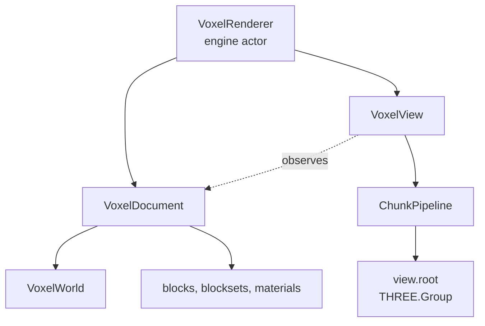
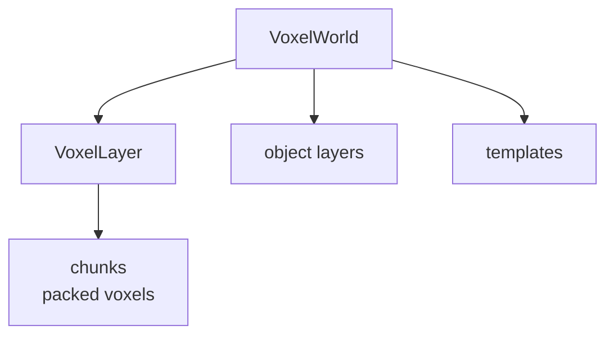
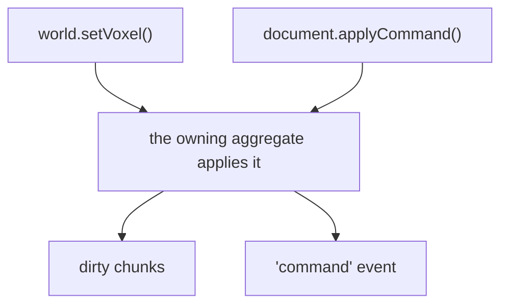
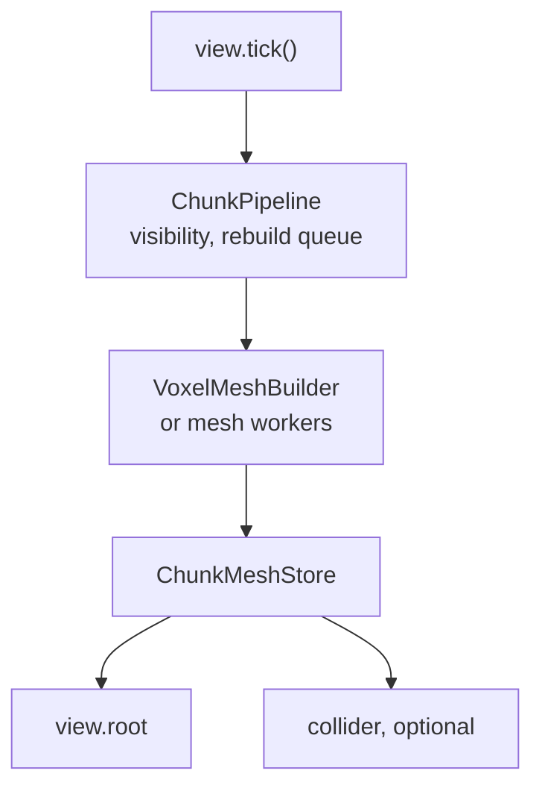
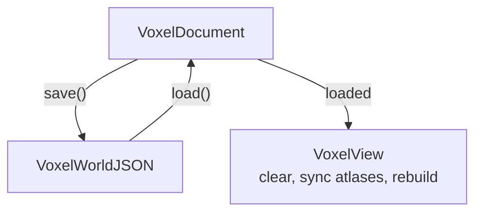

# Voxel renderer architecture

Two layers. The document never imports the view; a lint rule enforces it.

- `src/document`: `VoxelDocument`, the headless state and its commands.
- `src/view`: `VoxelView`, the Three.js meshes that draw a document.
- `src/plugins`: the `engine` actor component and the `rapier` collider.

## Map

Without the engine, add `view.root` to a scene and call `init()`, `tick()` and
`dispose()` yourself.

## World

- A voxel is a block ID plus a transform.
- A merged cell holds two shapes, such as a bottom and a top slab.

Code: `src/document/world`.

## Edits

- `VoxelWorld`, `BlockRegistry`, `MaterialGroupList` and `BlocksetList` each apply their own commands.
- The event carries the origin: `"local"` for an edit, the caller's for `applyCommand()`.

Code: `src/document/commands`.

## Dirty chunk to mesh

- An edit dirties its chunk and the neighbours whose faces it can expose or cover.
- Rebuilds run within a budget per tick; `flush()` drains the queue at once.

Code: `src/view/chunks`, `src/view/meshing`, `src/view/workers`.

## Save and load

- Each layer is saved as a palette plus run-length encoded chunks.

Code: `src/document/serialization`.

Details: [`VoxelDocument`](./docs/api/core/VoxelDocument.md),
[`VoxelView`](./docs/api/core/VoxelView.md),
[`VoxelRenderer`](./docs/api/engine/VoxelRenderer.md),
[serialization](./docs/api/serialization/serialization.md),
[physics integration](./docs/guides/adding-physics.md).
