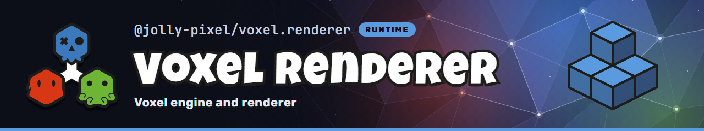
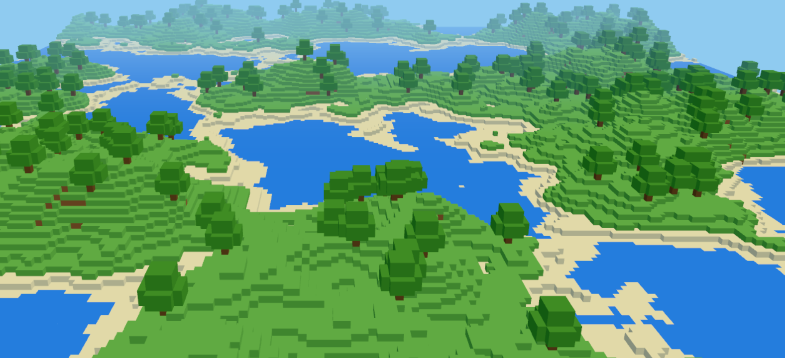

<p align="center">
  
</p>

<p align="center">
  
</p>

## 💃 Getting Started

This package is available in the Node Package Repository and can be easily installed with [npm][npm] or [yarn][yarn].

```bash
$ npm install @jolly-pixel/voxel.renderer
# or
$ yarn add @jolly-pixel/voxel.renderer
```

## 👀 Usage example

Load atlas textures before creating the view:

```ts
import {
  Face,
  VoxelDocument,
  VoxelView,
  loadBlocksets,
  type BlockDefinition
} from "@jolly-pixel/voxel.renderer";

const blocksets = await loadBlocksets([
  {
    id: "default",
    src: "blockset/UV_cube.png",
    tileSize: 32
  }
]);

const blocks: BlockDefinition[] = [
  {
    id: 1,
    name: "Dirt",
    shapeId: "cube",
    collidable: true,
    defaultTexture: {
      blocksetId: "default",
      col: 2,
      row: 0
    },
    faceTextures: {
      [Face.PosY]: {
        blocksetId: "default",
        col: 0,
        row: 2
      }
    }
  }
];

const document = new VoxelDocument({
  layers: ["Ground"],
  blocks
});
const view = new VoxelView(document, {
  blocksets
});

scene.add(view.root);
view.init();
```

Place voxels through the document; the view picks the edits up:

```ts
for (let x = 0; x < 8; x++) {
  for (let z = 0; z < 8; z++) {
    document.world.setVoxel("Ground", {
      position: {
        x,
        y: 0,
        z
      },
      blockId: 1
    });
  }
}
```

Call `view.tick(deltaTime)` from the application's frame loop. Remove
`view.root` and call `view.dispose()` during teardown; `view.dispose()` leaves
the document alone, so call `document.dispose()` once nothing else uses it.
ECS applications can wrap these calls in a component local to the application;
the renderer package does not depend on an ECS runtime.

## 📖 Guides

[GLOSSARY.md](GLOSSARY.md) defines the vocabulary used for worlds, blocks, layers, and meshing.

- [Saving and loading worlds](docs/guides/saving-and-loading-worlds.md)
- [Creating custom shapes](docs/guides/creating-custom-shapes.md)
- [Adding physics](docs/guides/adding-physics.md)

## 📚 API

### Core

- [`VoxelDocument`](docs/api/core/VoxelDocument.md): voxel data, headless
- [`VoxelView`](docs/api/core/VoxelView.md): the meshes drawn from a document
- [`VoxelInspector`](docs/api/core/VoxelInspector.md): mesh and block statistics
- [Commands](docs/api/core/commands.md)
- [`VoxelTransparencyPassNode`](docs/api/core/VoxelTransparencyPassNode.md):
  transparent scene compositing, setup, and limitations

### World

- [`VoxelWorld`](docs/api/world/VoxelWorld.md)
- [`VoxelLayer`](docs/api/world/VoxelLayer.md)
- [`VoxelTemplates`](docs/api/world/VoxelTemplates.md)
- [`VoxelChunk`](docs/api/world/VoxelChunk.md): chunks and packed voxels
- [`VoxelTransform`](docs/api/world/VoxelTransform.md)
- [`ViewDistance`](docs/api/world/ViewDistance.md)

### Blocks

- [`BlockDefinition`](docs/api/blocks/BlockDefinition.md)
- [`BlockRegistry`](docs/api/blocks/BlockRegistry.md)
- [`BlockShape`](docs/api/blocks/BlockShape.md): built-in shapes
- [`BlockSurface`](docs/api/blocks/BlockSurface.md)
- [`BlockTextures`](docs/api/blocks/BlockTextures.md): texture slots
- [`BlockPieces`](docs/api/blocks/BlockPieces.md)

### Blocksets and materials

- [Blocksets](docs/api/blocksets/blocksets.md)
- [`BlocksetDocument`](docs/api/blocksets/BlocksetDocument.md)
- [`BlocksetLink`](docs/api/blocksets/BlocksetLink.md)
- [`BlocksetAtlases`](docs/api/blocksets/BlocksetAtlases.md)
- [`BlocksetAtlas`](docs/api/blocksets/BlocksetAtlas.md)
- [`MaterialGroup`](docs/api/materials/MaterialGroup.md)
- [`BlendGroup`](docs/api/materials/BlendGroup.md)

### Collision

- [`VoxelCollider`](docs/api/collision/VoxelCollider.md)
- [`RapierVoxelCollider`](docs/api/collision/RapierVoxelCollider.md)

### Serialization and integration

- [Serialization](docs/api/serialization/serialization.md): the world codec
- [`VoxelRenderer`](docs/api/engine/VoxelRenderer.md): `@jolly-pixel/engine`
  actor component wrapping a `VoxelDocument` and a `VoxelView`
- [`VoxelMapDefinition`](docs/api/engine/VoxelMapDefinition.md): the `VoxelMap`
  scene-file component type

## 🚀 Running the examples

```bash
pnpm --filter @jolly-pixel/voxel.renderer dev
```

Open `http://localhost:5173/` for the landing page, which links every example.

## 🧪 Benchmarks

```bash
pnpm run bench
pnpm run bench:light
pnpm run bench:render
```

[BENCHMARK.md](BENCHMARK.md) covers each suite's options, the `/noise-world/`
browser benchmark, and how to compare runs.

## 🔥 Troubleshooting

If something isn't working as expected, enable verbose logging to get detailed runtime output:

```ts
// Enable debug logs for the entire runtime
const { world } = runtime;
world.logger.setLevel("debug");
world.logger.enableNamespace("*");
```

Pass a custom logger to `VoxelDocument` and `VoxelView` when they are not
hosted by a runtime:

```ts
import { Systems } from "@jolly-pixel/engine";
import {
  VoxelDocument,
  VoxelView
} from "@jolly-pixel/voxel.renderer";

const logger = new Systems.Logger({
  level: "trace",
  namespaces: ["*"]
});

const document = new VoxelDocument({
  logger
});
const view = new VoxelView(document, {
  logger
});
```

## Contributors guide

If you are a developer **looking to contribute** to the project, you must first read the [CONTRIBUTING][contributing] guide.

Once you have finished your development, check that the tests (and linter) are still good by running the following script:

```bash
$ pnpm run test
$ pnpm run lint
```

> [!CAUTION]
> In case you introduce a new feature or fix a bug, make sure to include tests for it as well.

## License

MIT

<!-- Reference-style links for DRYness -->

[npm]: https://docs.npmjs.com/getting-started/what-is-npm
[yarn]: https://yarnpkg.com
[contributing]: ../../CONTRIBUTING.md
